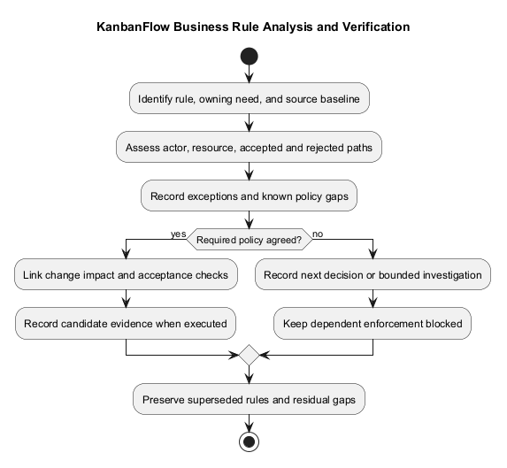
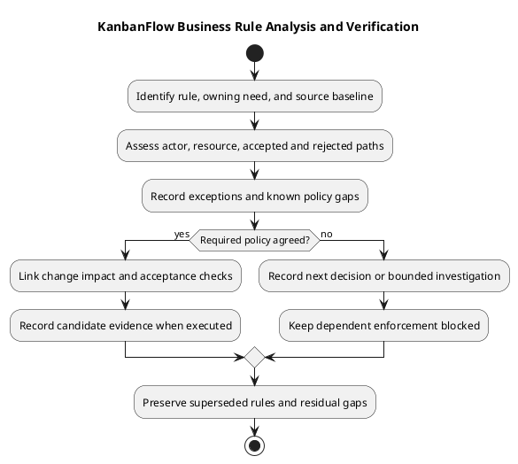

# KanbanFlow Business Rules Catalog

> **Policy amendment (2026-10-10):** Membership mutations are now owner-only; DEC-003/PB-001's bypass is fixed. Earlier open-policy text and diagrams below describe the preceding state. See [QA corrections](../06-testing/qa-corrections-2026-10-10.md) for the selected rule and regression evidence.

This catalog organizes documented domain rules and open policy boundaries. It is not a complete endpoint matrix or proof that every rule has fresh runtime evidence.

| Rule area | Documented boundary | Analysis focus |
| --- | --- | --- |
| Workspace access | Current membership defines the viewing context | Removal, role changes, and direct requests |
| Private boards | Creator/current owner/manager access additionally requires membership | Nested tasks/comments and aggregate exposure |
| Member-role updates | Direct role changes use owner-only policy | Remove/re-add indirect loophole remains unresolved |
| Task movement | Valid ancestry, authorization, ordering, and applicable WIP constraints | Rejection, persistence, and stale state |
| Ordered resources | Allocation/movement/deletion preserve applicable ordered positions | Locking and database contention |
| Comments | Authorship does not override revoked board/workspace access | Combined controller and policy guards |
| Analytics | Accepted affected mutations refresh scoped summaries | Private-data filtering and cache invalidation |

## Rule record

```text
Rule identifier and requirement:
Current implementation/source revision:
Actor and preconditions:
Accepted/rejected behavior:
Policy decision or unresolved question:
Affected records and operations:
Verification evidence or pending:
```

Use actual source and [roles requirements](../02-requirements/roles-and-use-cases.md) before expanding permission claims. Rules for restore/force-delete in a policy do not prove a corresponding user-facing endpoint exists.

## Rule catalog and sources

BR references are local documentation identifiers, not issue numbers or completed verification. Source inspection supports the descriptions below; runtime acceptance still needs candidate evidence. Read policies with controller/request guards rather than treating any single method as the entire endpoint rule.

| ID | Rule | Source/context | Relevant edge case |
| --- | --- | --- | --- |
| BR-01 | Workspace viewing checks current membership | [WorkspacePolicy](../../../backend/app/Policies/WorkspacePolicy.php) | Removed membership and direct resource requests |
| BR-02 | Workspace update/delete policy checks ownership | WorkspacePolicy | Ownership differs from merely having a manager role |
| BR-03 | Member management policy allows owner/current manager; direct role changes are owner-only | WorkspacePolicy and [member controller](../../../backend/app/Http/Controllers/Api/WorkspaceMemberController.php) | Remove/re-add loophole remains open |
| BR-04 | Project viewing checks membership; update/delete policy allows owner/manager | [ProjectPolicy](../../../backend/app/Policies/ProjectPolicy.php) | Cross-workspace ancestry and surrounding guards |
| BR-05 | Board access uses current membership and visibility; private access adds creator/owner/manager conditions | [Board model](../../../backend/app/Models/Board.php) and [BoardPolicy](../../../backend/app/Policies/BoardPolicy.php) | Former creator membership revoked; ordinary private-board access rejected |
| BR-06 | Board update/delete policy first requires visibility, then owner/manager authorization | BoardPolicy | A role does not override missing view access |
| BR-07 | Nested task operations validate resource context and applicable board authorization | [TaskController](../../../backend/app/Http/Controllers/Api/TaskController.php) | Mismatched ancestry and stale resource state |
| BR-08 | WIP enforcement concerns active tasks where `completed_at` is null | TaskController acceptance helper | Null limit disables this helper's limit check; completed task bypasses its active-task acceptance check |
| BR-09 | Ordered task allocation/movement uses relevant parent/task locks and rechecks state | TaskController | Stale movement/update/delete and competing requests |
| BR-10 | Ordered columns and deletion normalization need scoped integrity | [ColumnController](../../../backend/app/Http/Controllers/Api/ColumnController.php) | Interior deletion and concurrent allocation |
| BR-11 | Comment actions require combined ancestry, board access, and action rules | [CommentController](../../../backend/app/Http/Controllers/Api/TaskCommentController.php) and [comment policy](../../../backend/app/Policies/TaskCommentPolicy.php) | Authorship does not bypass revoked endpoint access |
| BR-12 | Analytics must respect permitted resources; affected project mutations refresh cached summaries | [AnalyticsController](../../../backend/app/Http/Controllers/Api/WorkspaceAnalyticsController.php) and documented frontend behavior | Restricted data and stale visible totals |

Policy restore/force-delete methods do not establish available routes or UI actions. Do not infer a complete permission matrix, numerical field limits, or deletion cascades from this summary.

## WIP and ordering interpretation

The inspected task acceptance helper counts active tasks using null `completed_at`, returns without a WIP check when the limit is null, and returns for a completed task. A change must assess each calling path, including creation, movement, and completion changes; the helper alone does not describe every route's behavior.

Specify the accepted destination, position, relevant capacity state, and persisted result. Check rejected movement and visible rollback separately from reload persistence. A correctly restored card does not by itself prove correct stored ordering.

Locking source indicates intended serialization boundaries, not proof of all database interleavings. SQLite regressions do not establish MySQL contention behavior. Use relevant isolated checks and record the tested revision and limitations.

## Distinguish rule status from evidence

| Record type | Meaning |
| --- | --- |
| Current source rule | Inspected implementation at its stated scope |
| Intended policy | Agreed rule with an owning decision reference |
| Proposed change | Candidate rule requiring agreement/refinement |
| Known defect | Current behavior conflicts with an intended boundary |
| Verification result | Actual check at an identified candidate/environment |

DEC-003/PB-001 remains an unresolved policy/enforcement dependency for indirect membership role changes. Owner-only direct updates do not close removal/re-addition paths. Owners should manage membership until that issue is resolved.

## Detailed rule and exception record

```text
BR reference and owning requirement:
Inspected source revision and references:
Rule status and actual decision reference:
Actor, membership, visibility, and resource ancestry:
Trigger and accepted persisted outcome:
Rejected conditions and recovery:
Exceptions and their source/rationale:
Dependencies and known defects:
Acceptance criteria and verification approach:
Actual result/evidence or pending:
Next action and agreed owner, or unassigned:
```

Record exceptions explicitly rather than treating them as universal permissions. Unknown rule details remain questions. Local identifiers do not imply a scheduled implementation item or performed check.

## Rule-to-check matrix

| Rule/criterion | Scenario | Expected result | Candidate/environment | Evidence state and gap |
| --- | --- | --- | --- | --- |
| Actual BR/criterion | Specific actor/input/resource condition | Observable accepted/rejected result | Exact revision or pending | Pass / Fail / Blocked / Not run / justified Not applicable |

Use the [verification template](../../Releases/verification-template.md) and [quality plan](../../Project-Management/quality-and-risk-plan.md). Include direct requests, nested/aggregate data exposure, removal, stale state, and contention where relevant. Historical tests do not verify a new candidate.

## Change impact and handoff

When changing a rule, assess affected actors, UI affordances, server guards, data integrity, failure feedback, and compatibility. Link the actual policy decision and acceptance criteria before dependent implementation. A bounded investigation can clarify options without choosing policy silently.

Keep [domain model](domain-model.md), [data flow](data-flow-diagram.md), and [lifecycle analysis](data-classification-and-lifecycle.md) consistent with their owning sources. Use [traceability](../../Project-Management/traceability.md) to connect needs, decisions, implementation, and checks.

## Maintenance checklist

- Rules identify source or actual policy rather than inferred actor responsibilities.
- Accepted, rejected, and exception paths are explicit.
- Known loopholes and unresolved decisions remain visible.
- Source descriptions and runtime evidence are distinguished.
- Changes preserve decision context and superseded references.
- Required gaps prevent false completion claims.

Record material changes and their impact; repair source links when files move. Keep secrets and unnecessary personal data out of examples. Rule agreement, implementation completion, release publication, and deployment remain separate events.

## Review

Record proposed changes separately from current rules. Keep DEC-003/PB-001 visible for membership enforcement. Link criteria to [acceptance guidance](../02-requirements/validation-and-acceptance-criteria.md), and preserve superseded rules with decision context.

## Related guidance

See the [analysis index](README.md), [requirements](../02-requirements/README.md), [design](../04-design/README.md), and [diagram guide](../../diagram-guide.md). Keep proposed behavior, inspected source, and actual check results distinct.

## PlantUML diagram



[PlantUML source](diagrams/business-rules-catalog.puml)


