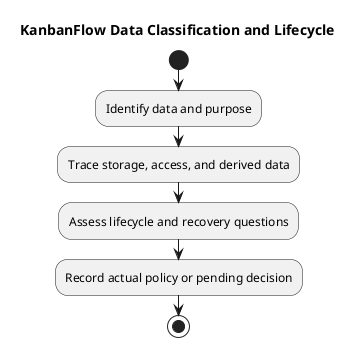

# KanbanFlow Data Classification and Lifecycle

Classify data by access and purpose before changing collection, exposure, or lifecycle behavior. This is an analysis framework, not an agreed legal retention schedule or proof of implemented deletion/export controls.

| Data category | Access/context | Lifecycle questions |
| --- | --- | --- |
| Accounts and sessions | Authentication context | Session expiry/revocation and account-related dependencies |
| Membership and roles | Workspace access control | Removal, re-addition, role changes, and revoked access |
| Projects/boards/columns/tasks | Workspace ancestry and board visibility | Creation, accepted updates, deletion effects, and ordering |
| Comments/activity | Permitted task context | Authorship, removal access, history and deletion implications |
| Notifications/analytics | Recipient or scoped summaries | Exposure, state updates, and derived-data refresh |
| Theme preference | Browser-local storage | Browser persistence and tab synchronization, separate from shared data |
| Logs/backups/evidence | Operational or verification context | Sensitive content, access, restore compatibility, and actual policy |

## Lifecycle record

```text
Data and purpose:
Source/storage and access boundary:
Creation and update paths:
Derived data and exposure paths:
Removal/deletion effects verified in source:
Retention/export/backup policy or pending question:
Migration and restore implications:
Evidence and unresolved dependencies:
```

Do not infer cascading deletion or retention behavior without inspecting migrations/models/controllers. Source rollback does not restore data. Follow [upgrade guidance](../../Releases/upgrade-and-rollback.md) for recovery preparation.

## Privacy and review

Minimize sensitive content in examples and evidence. Exclude credentials and unnecessary personal data. New retention, export, or deletion requirements need actual decisions and evidence; no compliance guarantee is established here. See [security/privacy requirements](../02-requirements/security-and-privacy-requirements.md).

## Related guidance

See the [analysis index](README.md), [requirements](../02-requirements/README.md), [design](../04-design/README.md), and [diagram guide](../../diagram-guide.md). Keep proposed behavior, inspected source, and actual check results distinct.

## PlantUML diagram


[PlantUML source](diagrams/data-classification-and-lifecycle.puml)


