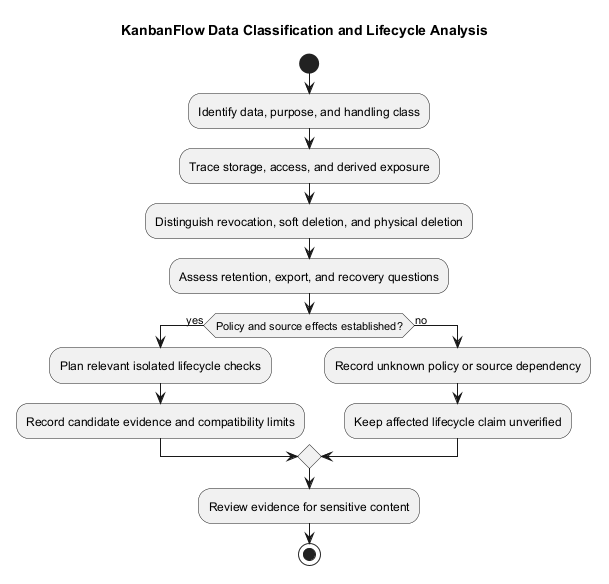
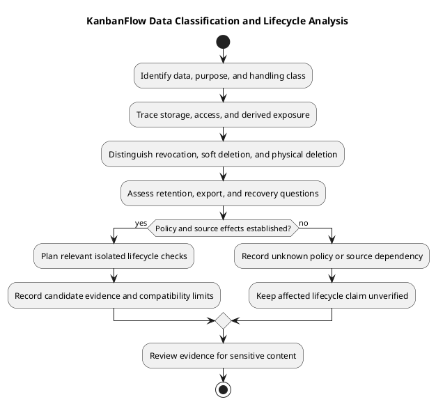

# KanbanFlow Data Classification and Lifecycle

Classify data by access and purpose before changing collection, exposure, or lifecycle behavior. This is an analysis framework, not an agreed legal retention schedule or proof of implemented deletion/export controls.

| Data category | Access/context | Lifecycle questions |
| --- | --- | --- |
| Accounts and sessions | Authentication context | Session expiry/revocation and account-related dependencies |
| Membership and roles | Workspace access control | Removal, re-addition, role changes, and revoked access |
| Projects/boards/columns/tasks | Workspace ancestry and board visibility | Creation, accepted updates, deletion effects, and ordering |
| Comments/activity | Permitted task context | Authorship, removal access, history and deletion implications |
| Notifications/analytics | Recipient or scoped summaries | Exposure, state updates, and derived-data refresh |
| Theme preference | Browser-local storage | Browser persistence and tab synchronization, separate from shared data |
| Logs/backups/evidence | Operational or verification context | Sensitive content, access, restore compatibility, and actual policy |

## Lifecycle record

```text
Data and purpose:
Source/storage and access boundary:
Creation and update paths:
Derived data and exposure paths:
Removal/deletion effects verified in source:
Retention/export/backup policy or pending question:
Migration and restore implications:
Evidence and unresolved dependencies:
```

Do not infer cascading deletion or retention behavior without inspecting migrations/models/controllers. Source rollback does not restore data. Follow [upgrade guidance](../../Releases/upgrade-and-rollback.md) for recovery preparation.

## Working classification

These classifications describe handling needs for analysis; they are not a formally approved organizational classification policy or legal determination.

| Class | Examples | Handling boundary |
| --- | --- | --- |
| Access/security sensitive | Session material, credentials, authorization configuration | Exclude secret values from documentation and evidence; assess actual runtime protections |
| Account-related | Account identifiers and membership/role records | Use only necessary details and permitted access |
| Scoped collaboration | Projects, private/workspace boards, tasks, comments, and activity | Current membership, visibility, ancestry, and action rules |
| Derived scoped data | Analytics and notifications | Preserve source/recipient access boundaries and refresh implications |
| Local preference | Theme setting in browser storage | Separate from shared application records and account-wide state |
| Operational evidence | Logs, screenshots, exports, backups, and verification records | Minimize sensitive content and record actual access/lifecycle policy |

Workspace visibility does not mean public internet visibility. Treat exposure paths explicitly, including nested and aggregate responses. A copied screenshot or export can introduce another data exposure path even when the application response was correctly scoped.

## Source-backed deletion distinctions

The inspected [models](../../../backend/app/Models/) use Laravel SoftDeletes for Workspace, Project, Board, Column, Task, and TaskComment. The [migrations](../../../backend/database/migrations/) also declare physical foreign-key delete behavior.

| Source pattern | Meaning | Analysis limit |
| --- | --- | --- |
| SoftDeletes on listed models | Logical deletion uses the model's deleted marker under normal soft-delete behavior | Does not establish automatic erasure, retention duration, or public restore endpoints |
| Hierarchy/pivot cascade declarations | Physical referenced-row deletion can trigger database cascading where declared | Soft deletion does not itself trigger a physical foreign-key cascade |
| Task `assigned_to` null-on-delete | Physical deletion of the referenced user can clear the assignment under the declared constraint | Do not infer the same result from workspace membership removal |
| Activity `user_id` null-on-delete | Physical deletion of the referenced user can clear that reference | Does not define activity retention or anonymization policy |

Inspect calling controllers, model hooks, actual schema, and relevant queries before specifying complete deletion behavior. A policy method for restore/force-delete does not prove an exposed endpoint or a tested recovery workflow. No deletion or restore operation was performed for this documentation update.

## Lifecycle stages

| Stage | Questions to record |
| --- | --- |
| Creation | What data is necessary, who can create it, and what context links it? |
| Use/read | Which actors and direct/nested/aggregate paths expose it? |
| Update | Which validation, access, ordering, or stale-state checks apply? |
| Derivation | Which summaries, activity, notifications, or caches reflect it? |
| Revocation | What becomes inaccessible after removal or role change? |
| Logical deletion | Which records/queries become unavailable and what related effects occur? |
| Physical deletion | Which constraints, references, and backups are affected? |
| Recovery | Which actual restore process and compatibility checks are required? |

Data access revocation and data erasure are different outcomes. Removing membership must revoke applicable access, but does not automatically prove deletion of authored content or account data. The membership-policy loophole remains tracked in DEC-003/PB-001.

## Collection, retention, and export decisions

For a new data-handling change, record the purpose, necessary fields, access scope, storage, retention requirement, and actual agreement. Leave unknown retention periods, export capabilities, or deletion guarantees pending.

Do not invent legal bases, consent flows, regulatory compliance, or an implemented retention schedule. Privacy decisions belong in the [decision register](../../Project-Management/decision-register.md), linked to [security/privacy requirements](../02-requirements/security-and-privacy-requirements.md).

## Derived data and caches

Identify which accepted changes affect analytics, notifications, activity, and visible client caches. Review recipient/resource scope as well as invalidation. Cache refresh in a tested journey does not imply universal real-time synchronization or correct handling of every future mutation.

Browser-local theme preference persists separately from shared work records. It does not imply offline task storage or cross-device account synchronization. Keep conceptual [data flow](data-flow-diagram.md) and [domain model](domain-model.md) consistent with actual sources.

## Migration and recovery impact

Assess schema, source/assets, configuration, and existing data compatibility before a change. Record backups and restoration only when actually performed and checked. Source rollback does not recover deleted or changed records, and a declared cascade does not establish tested restore readiness.

Use authorized isolated data for lifecycle/recovery checks. Never use reset commands as an ordinary upgrade step. Follow upgrade guidance for actual operation planning, keeping production authorization and environment evidence separate from this analysis.

## Lifecycle evidence matrix

| Data/operation | Actor and access context | Expected visible/persisted effect | Candidate/environment | Result/evidence | Gap |
| --- | --- | --- | --- | --- | --- |
| Actual record and operation | Specific conditions | Observable lifecycle boundary | Exact revision or pending | Actual check or not run | Explicit limitation |

Use the [verification template](../../Releases/verification-template.md). SQLite tests do not establish MySQL contention behavior; historical results do not verify a new candidate. Assess direct access, aggregate exposure, revocation, deletion effects, and recovery only where relevant to the change.

## Review and change control

- Classification explains purpose and handling without implying a public/private legal policy.
- Access scope and exposure paths are explicit.
- Revocation, logical deletion, physical deletion, and recovery are distinguished.
- Source/model/schema effects are checked rather than inferred.
- Unknown lifecycle policies remain visible with next actions.
- Derived data and compatibility implications are assessed.
- Evidence identifies its candidate, method, and limitations.

Preserve historical decisions and record changed lifecycle requirements with their rationale and actual agreement. Link follow-up to the [product backlog](../../Project-Management/product-backlog.md). Exclude credentials and unnecessary personal data from examples, diagrams, and logs.

## Privacy and review

Minimize sensitive content in examples and evidence. Exclude credentials and unnecessary personal data. New retention, export, or deletion requirements need actual decisions and evidence; no compliance guarantee is established here. See [security/privacy requirements](../02-requirements/security-and-privacy-requirements.md).

## Related guidance

See the [analysis index](README.md), [requirements](../02-requirements/README.md), [design](../04-design/README.md), and [diagram guide](../../diagram-guide.md). Keep proposed behavior, inspected source, and actual check results distinct.

## PlantUML diagram



[PlantUML source](diagrams/data-classification-and-lifecycle.puml)


