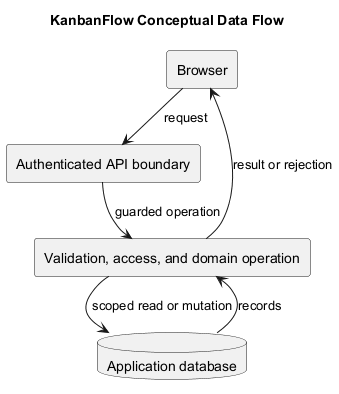
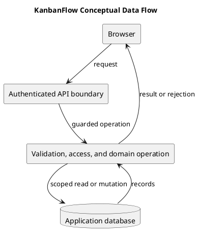

# KanbanFlow Data Flow Diagram

This conceptual diagram shows browser/API/database flow and the authorization boundary. It is not a complete endpoint map or a claim of external integrations or automatic real-time synchronization.

## Flow responsibilities

| Stage | Responsibility | Analysis questions |
| --- | --- | --- |
| Browser frontend | Present state, collect input, request API actions | Loading, errors, stale cache, keyboard behavior |
| Backend request boundary | Authenticate, validate, authorize, and check ancestry | Current membership, visibility, accepted/rejected requests |
| Domain mutation/read | Apply scoped operations and relevant integrity rules | Persistence, locks, WIP, derived data |
| Database | Store shared application records | Transactions, constraints, concurrent operations |
| Response/cache update | Reflect accepted results or recover from rejection | Invalidation, rollback, and reload observations |

## Trace a change

Record actor, request, input, policy/controller checks, database effects, response, and visible state. Identify derived analytics, activity, or notification effects when applicable. Exclude passwords, tokens, and real private records from diagrams.

Browser-local theme preference is separate from backend shared data. Database notifications do not promise email/SMS delivery. A conceptual arrow does not prove an operation succeeds or that every response is authorized.

## Evidence

Inspect actual frontend calls, routes, controllers, policies, and storage paths. Use [acceptance guidance](../02-requirements/validation-and-acceptance-criteria.md) to check affected success and failure flows at a recorded candidate.

## Related guidance

See the [analysis index](README.md), [requirements](../02-requirements/README.md), [design](../04-design/README.md), and [diagram guide](../../diagram-guide.md). Keep proposed behavior, inspected source, and actual check results distinct.

## PlantUML diagram

[PlantUML source](diagrams/data-flow-diagram.puml)

