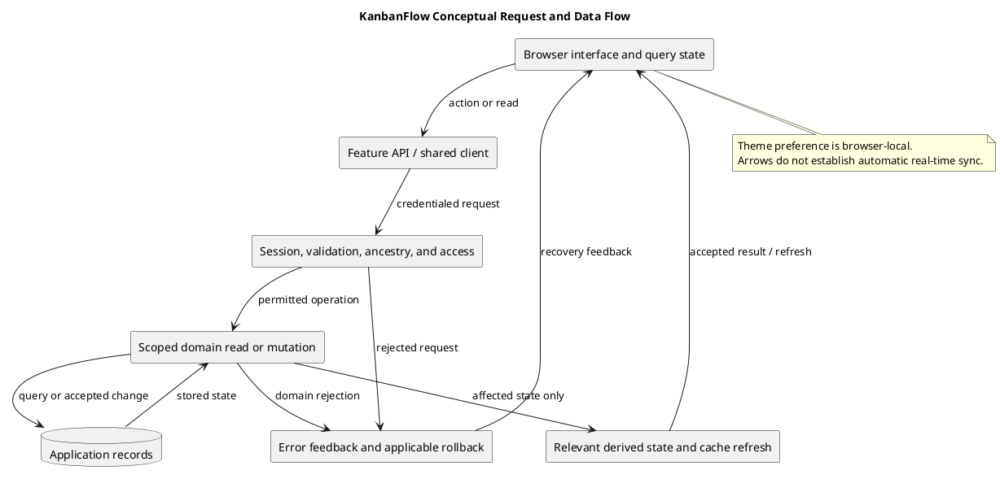

# KanbanFlow Data Flow Diagram

This conceptual diagram shows browser/API/database flow and the authorization boundary. It is not a complete endpoint map or a claim of external integrations or automatic real-time synchronization.

## Flow responsibilities

| Stage | Responsibility | Analysis questions |
| --- | --- | --- |
| Browser frontend | Present state, collect input, request API actions | Loading, errors, stale cache, keyboard behavior |
| Backend request boundary | Authenticate, validate, authorize, and check ancestry | Current membership, visibility, accepted/rejected requests |
| Domain mutation/read | Apply scoped operations and relevant integrity rules | Persistence, locks, WIP, derived data |
| Database | Store shared application records | Transactions, constraints, concurrent operations |
| Response/cache update | Reflect accepted results or recover from rejection | Invalidation, rollback, and reload observations |

## Trace a change

Record actor, request, input, policy/controller checks, database effects, response, and visible state. Identify derived analytics, activity, or notification effects when applicable. Exclude passwords, tokens, and real private records from diagrams.

Browser-local theme preference is separate from backend shared data. Database notifications do not promise email/SMS delivery. A conceptual arrow does not prove an operation succeeds or that every response is authorized.

## Source references and diagram scope

| Source | Investigation focus |
| --- | --- |
| [Shared request client](../../../frontend/src/api/client.ts) | API base URL, JSON headers, credentials, and XSRF settings |
| [Authentication API](../../../frontend/src/features/auth/api.ts) | CSRF initialization, session requests, and current-user lookup |
| [Task API](../../../frontend/src/features/tasks/api.ts) | Task requests and payloads |
| [API routes](../../../backend/routes/api.php) and [web routes](../../../backend/routes/web.php) | Actual endpoint and middleware context |
| [Controllers](../../../backend/app/Http/Controllers/Api/) and [policies](../../../backend/app/Policies/) | Validation, ancestry, access, operations, and responses |
| [Models](../../../backend/app/Models/) and [migrations](../../../backend/database/migrations/) | Query scope, relationships, and storage constraints |

This conceptual diagram is not an exhaustive DFD, network topology, or sequence for every endpoint. Individual check order differs by route. Source inspection is separate from performed runtime verification.

## Session establishment

The inspected frontend obtains `/sanctum/csrf-cookie` before registration, login, and logout. Its shared client uses credentials and XSRF settings with `VITE_API_URL` as the base URL. Current-user lookup uses `/api/user`.

Actual hosts, stateful origins, cookies, and session configuration determine authenticated behavior. Reaching both services alone does not establish a valid session. Use the [setup guide](../../../README.md) for configuration instructions without copying secrets into records.

## Read and accepted-mutation paths

1. The interface requests the resource through its feature API/shared client.
2. The backend applies relevant session, validation, ancestry, and access checks.
3. Scoped reads or accepted mutations operate on application records.
4. Responses update visible state and relevant caches or derived information.
5. Reload observations establish the persisted result where required.

Inspect direct, nested, list, and aggregate reads separately when private data matters. Hidden controls cannot replace backend authorization. For mutations, identify actual locks/transactions, affected records, and response behavior instead of assuming every mutation produces activity or notifications.

For task movement, compare both visible lists with server state and reload persistence. For project changes, assess affected analytics refresh. Derived side effects must be traced at their owning implementation.

## Rejection and recovery

| Condition | Trace/check |
| --- | --- |
| Invalid input | Actual validation and useful field/error feedback |
| Expired session | Protected rejection and actual recovery path |
| Revoked/private access | Current rules and restricted data exclusion |
| WIP/stale conflict | Rejection, applicable rollback, and persisted state |
| Connection failure | Feedback without false success; establish actual server outcome |

A connection failure does not necessarily prove the server made no change. Inspect persisted state and request semantics before assuming retry safety. No automatic idempotent retry or universal conflict merging is established here.

## Stores and derived state

| State/store | Boundary |
| --- | --- |
| Application database | Shared records and actual query/schema constraints |
| Browser session/CSRF context | Configuration and authentication; not authoritative role claims |
| Frontend query/cache state | Client representation, invalidation, and optimistic recovery |
| Browser theme preference | Local appearance setting separate from shared tasks |
| Activity/notifications/analytics | Actual derived records or summaries with scoped access |

These descriptions do not establish every session driver, cache implementation, or retention policy. No offline task persistence, automatic push synchronization, or email/SMS flow is promised.

## Flow analysis record

```text
Requirement/journey and baseline:
Actor, session, membership, and resource context:
Request and payload:
Route/controller/policy checks:
Query or mutation and storage effects:
Derived data/cache effects:
Response and visible state:
Rejection/recovery alternatives:
Observed persistence and evidence:
Remaining uncertainty and next action:
```

Use the [verification template](../../Releases/verification-template.md) for candidate results. Build success does not establish usability; SQLite tests do not establish MySQL contention behavior. Historical observations are not fresh candidate evidence.

## Review and maintenance

- Requests link to actual feature APIs and route/controller boundaries.
- Session configuration and authorization are distinguished.
- Nested and aggregate exposure is assessed when relevant.
- Accepted effects and derived/cache state are traced explicitly.
- Rejection, uncertain connection outcomes, and reload persistence are considered.
- Conceptual arrows do not imply unimplemented integrations or verified guarantees.

See [domain model](domain-model.md), [data lifecycle](data-classification-and-lifecycle.md), and [threat analysis](security-threat-model-and-risk-analysis.md). Preserve changed assumptions and decisions. Exclude credentials and unnecessary personal data. Publication does not establish deployed runtime behavior.

## Evidence

Inspect actual frontend calls, routes, controllers, policies, and storage paths. Use [acceptance guidance](../02-requirements/validation-and-acceptance-criteria.md) to check affected success and failure flows at a recorded candidate.

## Related guidance

See the [analysis index](README.md), [requirements](../02-requirements/README.md), [design](../04-design/README.md), and [diagram guide](../../diagram-guide.md). Keep proposed behavior, inspected source, and actual check results distinct.

## PlantUML diagram


[PlantUML source](diagrams/data-flow-diagram.puml)


