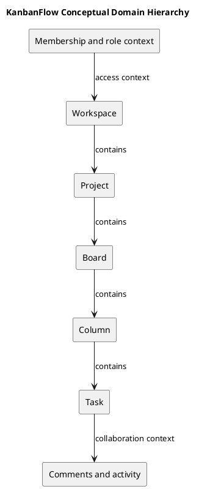

# KanbanFlow Domain Model

This conceptual model explains the workspace/project/board/column/task hierarchy and supporting collaboration data. It is not a complete physical database schema. Check actual migrations, model relations, keys, and deletion behavior before a data-model change.

| Concept | Domain responsibility | Boundary |
| --- | --- | --- |
| User | Account participating in workspaces | Session identity is separate from resource permission |
| Workspace membership | Relate a user to workspace access/role | Current role and unresolved membership policy matter |
| Workspace | Organize projects and membership | Ownership and membership must not be conflated |
| Project | Group boards within a workspace | Nested ancestry |
| Board | Define visible workflow context | Workspace/private visibility |
| Column | Ordered workflow stage and applicable WIP limit | Position and capacity integrity |
| Task | Work details, assignment, completion, movement | Current column, authorization, and persistence |
| Comment/activity | Collaboration context for tasks | Permitted access and authorship boundaries |

## Model-change record

```text
Affected concepts and requirement:
Actual model/migration references:
Relationship/key changes:
Permission and visibility effects:
Deletion and derived-data implications:
Compatibility/migration plan:
Verification and remaining questions:
```

The diagram shows conceptual containment without asserting exact cardinalities, cascade rules, or every assignment/notification relation. Add schema detail only when sourced. Link [data lifecycle](data-classification-and-lifecycle.md) and [business rules](business-rules-catalog.md).

## Review

Assess data integrity, ancestry checks, concurrency, and backward compatibility. Keep unknown effects explicit. Analysis does not establish migration execution or restore readiness.

## Related guidance

See the [analysis index](README.md), [requirements](../02-requirements/README.md), [design](../04-design/README.md), and [diagram guide](../../diagram-guide.md). Keep proposed behavior, inspected source, and actual check results distinct.

## PlantUML diagram


[PlantUML source](diagrams/domain-model.puml)


