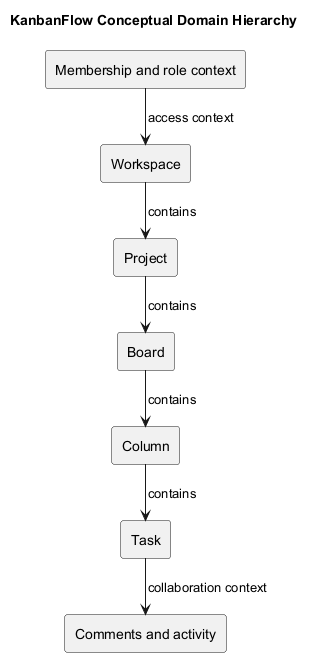
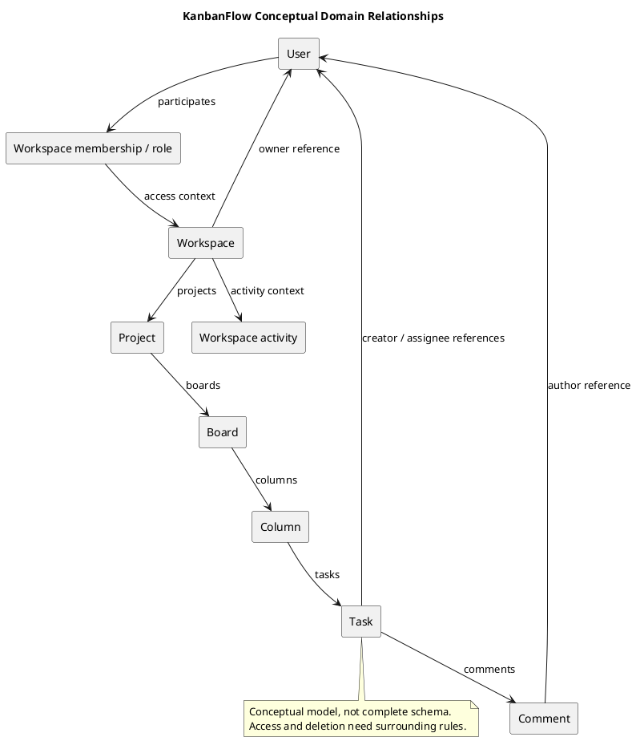

# KanbanFlow Domain Model

> **Policy amendment (2026-10-10):** Membership mutations are now owner-only; DEC-003/PB-001's bypass is fixed. Current guidance below reflects this rule; historical records retain their original scope. See [QA corrections](../06-testing/qa-corrections-2026-10-10.md) for the selected rule and regression evidence.

This conceptual model explains the workspace/project/board/column/task hierarchy and supporting collaboration data. It is not a complete physical database schema. Check actual migrations, model relations, keys, and deletion behavior before a data-model change.

| Concept | Domain responsibility | Boundary |
| --- | --- | --- |
| User | Account participating in workspaces | Session identity is separate from resource permission |
| Workspace membership | Relate a user to workspace access/role | Current role and owner-only membership mutation policy matter |
| Workspace | Organize projects and membership | Ownership and membership must not be conflated |
| Project | Group boards within a workspace | Nested ancestry |
| Board | Define visible workflow context | Workspace/private visibility |
| Column | Ordered workflow stage and applicable WIP limit | Position and capacity integrity |
| Task | Work details, assignment, completion, movement | Current column, authorization, and persistence |
| Comment/activity | Collaboration context for tasks | Permitted access and authorship boundaries |

## Model-change record

```text
Affected concepts and requirement:
Actual model/migration references:
Relationship/key changes:
Permission and visibility effects:
Deletion and derived-data implications:
Compatibility/migration plan:
Verification and remaining questions:
```

The diagram shows conceptual containment without asserting exact cardinalities, cascade rules, or every assignment/notification relation. Add schema detail only when sourced. Link [data lifecycle](data-classification-and-lifecycle.md) and [business rules](business-rules-catalog.md).

## Source-backed relationships

| Relationship | Model reference | Interpretation |
| --- | --- | --- |
| Workspace → owner | [Workspace](../../../backend/app/Models/Workspace.php) `owner()` | Owner identity uses `owner_id`; distinct from membership records |
| Workspace ↔ users | Workspace `members()` | Many-to-many membership context carries role information |
| Workspace → projects | Workspace `projects()` / [Project](../../../backend/app/Models/Project.php) `workspace()` | Project ancestry |
| Project → boards | Project `boards()` / [Board](../../../backend/app/Models/Board.php) `project()` | Board ancestry and visibility context |
| Board → columns | Board `columns()` / [Column](../../../backend/app/Models/Column.php) `board()` | Ordered workflow stages |
| Column → tasks | Column `tasks()` / [Task](../../../backend/app/Models/Task.php) `column()` | Current task placement |
| Task → creator/assignee | Task `creator()` / `assignee()` | Separate `created_by` and `assigned_to` user references |
| Task → comments | Task `comments()` / [TaskComment](../../../backend/app/Models/TaskComment.php) `task()` | Task collaboration data |
| Comment → user | TaskComment `user()` | Authorship does not override current access |
| Activity → workspace/user | [ActivityLog](../../../backend/app/Models/ActivityLog.php) | Workspace-scoped history and actor reference; not a task foreign-key relationship inferred from the conceptual diagram |

Project and board also expose creator relationships. Inspect [migrations](../../../backend/database/migrations/) for nullability, uniqueness, actual keys, and delete constraints. Eloquent relationship declarations alone do not establish a full physical schema or every permitted API operation.

## Identity and access context

An authenticated user identity is distinct from workspace membership, ownership, board visibility, and action-specific permission. A resource's nested ancestry identifies the context in which access is checked.

Private-board visibility uses current membership plus creator/owner/manager conditions. Assignment or comment authorship does not grant universal board access. Removing membership must revoke applicable access even when authored content remains stored.

Use [roles requirements](../02-requirements/roles-and-use-cases.md) and [business rules](business-rules-catalog.md) for combined policy/controller boundaries. DEC-003/PB-001 records owner-only membership enforcement; candidate-specific role checks remain required.

## State and invariants

| Concept | Relevant state/invariant | Evidence needed for a change |
| --- | --- | --- |
| Ordered boards/columns/tasks | Position consistency within the relevant parent | Allocation, movement, deletion, and applicable contention checks |
| Column capacity | Applicable WIP limit concerns active tasks | Inspect helper and calling paths; verify relevant acceptance/rejection |
| Task completion | `completed_at` affects active-task interpretation | Actual transition validation and persisted result |
| Task assignment | Assignee is separate from creator | Actual membership/access constraints and notification paths |
| Board visibility | Resource exposure depends on current context | Direct/nested/list/aggregate reads |
| Collaboration/history | Content and actor references have their own lifecycle | Source/schema and endpoint access analysis |

The conceptual editing states in [resume-state-diagram](resume-state-diagram.md) are not stored task statuses. Do not add a business-state enumeration or automatic draft-resume feature merely because an analysis diagram uses those labels.

## Lifecycle and derived data

Workspace, Project, Board, Column, Task, and TaskComment use SoftDeletes in the inspected source. Logical deletion differs from physical foreign-key cascading and does not establish retention duration or available restoration endpoints.

Assignment, activity, notifications, analytics, and frontend cache state may be affected by a mutation. Trace the actual owning path instead of assuming every model event produces every side effect. See [data lifecycle](data-classification-and-lifecycle.md) and [data flow](data-flow-diagram.md).

Source rollback does not restore changed records. Schema/model changes need actual compatibility and recovery assessment through [upgrade guidance](../../Releases/upgrade-and-rollback.md).

## Model-change impact matrix

| Change | Source/schema impact | Access/data effect | Compatibility | Verification gap/next action |
| --- | --- | --- | --- | --- |
| Actual proposed change | Actual references | Affected boundary | Assessed implication or unknown | Explicit check/dependency |

Consider API payloads, frontend types/cache behavior, migrations, existing records, indexes/constraints, authorization, and derived information where affected. Leave unknowns explicit. A policy method for restore/force-delete does not establish an exposed route or verified recovery process.

## Review and verification

- Conceptual concepts and actual relationship declarations are distinguished.
- Ownership, membership, assignment, and authorship are not conflated.
- Ancestry, visibility, and action guards remain explicit.
- Position, completion, and WIP implications are assessed where relevant.
- Logical/physical deletion and recovery assumptions are separate.
- Proposed changes preserve compatibility and traceability.
- Actual checks identify candidate, environment, and limitations.

Use the [verification template](../../Releases/verification-template.md). SQLite regression evidence does not establish MySQL contention behavior; build success does not demonstrate browser interaction. Historical totals cannot verify a new candidate.

Record material model decisions through [analysis decisions](analysis-decisions-and-open-questions.md) and owning management decisions. Preserve superseded concepts and source references. Exclude credentials and unnecessary personal data from examples and diagrams.

## Review

Assess data integrity, ancestry checks, concurrency, and backward compatibility. Keep unknown effects explicit. Analysis does not establish migration execution or restore readiness.

## Related guidance

See the [analysis index](README.md), [requirements](../02-requirements/README.md), [design](../04-design/README.md), and [diagram guide](../../diagram-guide.md). Keep proposed behavior, inspected source, and actual check results distinct.

## PlantUML diagram



[PlantUML source](diagrams/domain-model.puml)


