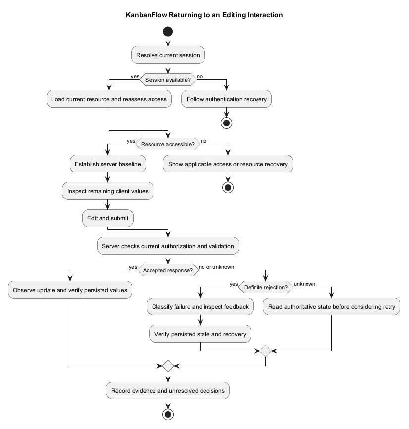
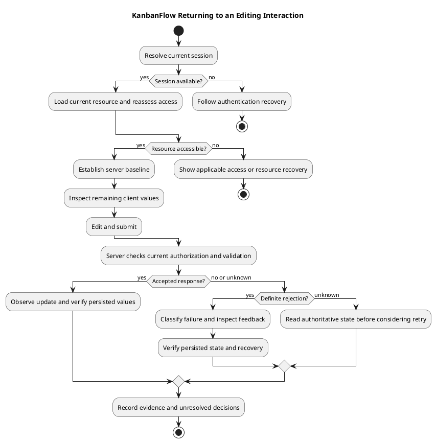

# KanbanFlow Resuming Editing Activity

The `resume-editing-activity.md` filename is retained from the requested structure. Here “resume” means returning to a KanbanFlow editing interaction; this document does not define a résumé/CV feature.

This activity is a conceptual failure/recovery analysis, not proof of automatic draft saving or offline support.

## Interaction boundaries

| Step | Analysis requirement |
| --- | --- |
| Return to an edit interaction | Check actual session and current resource access |
| Load current data | Distinguish server state from any stale client values |
| Edit and submit | Apply actual validation and authorization |
| Accepted mutation | Observe visible state and persisted result |
| Rejected mutation | Provide appropriate feedback and inspect actual recovery behavior |

If access expired or membership changed, do not assume the earlier editing permission remains valid. Specify recovery through actual authentication/navigation behavior. A requirement for draft retention must be separately proposed and agreed; it is not established here.

## Preconditions and authoritative state

Identify the actor, resource, parent workspace/project/board, and operation before evaluating recovery. Reading a resource and changing it are separate permissions. A previously opened form does not establish current permission to submit.

Use current server data as the persisted baseline. Any values still visible in a component are client state until an accepted mutation is verified. Refreshing or navigating away may discard those values; assess each actual form rather than promising automatic restoration.

Inspect the relevant page/form, API helper, controller, validation rules, and authorization policy together. For task interactions, include the board authorization and nested resource checks. See the [domain model](domain-model.md) and [business rules](business-rules-catalog.md).

## Activity and recovery decisions

1. Return to the resource and resolve the current session. Follow the implemented authentication flow if the session is unavailable.
2. Load the resource and check current access. If it is unavailable or access was removed, show the implemented recovery/navigation outcome without exposing restricted data.
3. Compare any remaining client values with the loaded baseline. Record whether the actual interface retains or discards edits; draft persistence is a separate proposed capability.
4. Edit and submit through the existing API. The server must evaluate authorization and validation for this request.
5. For an accepted response, observe the resulting interface and reload/read the resource to verify persisted values.
6. For a rejection, classify the cause and evaluate the implemented feedback and recovery. For an uncertain connection outcome, establish server state before deciding whether another submission is appropriate.

| Outcome | Analysis and verification focus |
| --- | --- |
| Invalid input | Correct actionable fields; verify the rejected request did not persist the invalid change |
| Expired session | Inspect authentication recovery and re-evaluate access after signing in |
| Membership or role changed | Verify the server rejects unauthorized mutation; earlier access is insufficient |
| Resource removed or parent mismatch | Verify actual response and navigation; do not silently recreate the resource |
| WIP or other domain rule rejection | Inspect the applicable operation and server rule; confirm state remains consistent |
| Connection loss or timeout | The response is unknown; inspect persisted state before retrying |
| Other actor changes the resource | Evaluate stale input behavior; conflict detection and merging require separate evidence |
| Cancel, refresh, or navigate away | Record actual edit retention and persisted state; do not assume unsaved values survive |

Automatic retries, saved drafts, conflict merging, and offline editing are not established by this activity model. If proposed, assign explicit requirements and acceptance cases before reporting them as supported.

## Verification scenarios

| Scenario | Evidence to capture |
| --- | --- |
| Authorized valid edit | Initial values, submitted values, response, visible update, and fresh persisted read |
| Invalid edit | Validation feedback and persisted baseline after rejection |
| Session expires while form is open | Submission response, authentication recovery, and subsequent access check |
| Access revoked while form is open | Actor membership/role before and after, denied request, and persisted result |
| Resource changes or disappears | Fresh resource state, submission result, and recovery navigation |
| Response interrupted | Whether the server committed the change and how duplicate submission is avoided or detected |
| Cancel or reload | Which client values survive and whether any mutation occurred |

Use isolated records and redact credentials, cookies, tokens, and private task content. Record the tested commit, environment, and exact form; one successful edit does not validate every resource or recovery path. A proposed scenario remains unverified until its observations are recorded.

## Handoff and open decisions

Route missing feedback or unsafe recovery to a scoped backlog item with reproduction steps, expected behavior, and an acceptance case. Record unresolved draft retention, concurrent edit, and retry decisions in [analysis decisions](analysis-decisions-and-open-questions.md). Link verification evidence through the [traceability guidance](../../Project-Management/traceability.md).

## Evidence record

Record candidate, actor, session/resource conditions, input, observed response, and persisted state. Test rejected input and relevant stale/removal cases in isolated data. A visible form alone does not demonstrate a successful accepted edit.

See [data flow](data-flow-diagram.md), [roles requirements](../02-requirements/roles-and-use-cases.md), and [acceptance guidance](../02-requirements/validation-and-acceptance-criteria.md).

## Related guidance

See the [analysis index](README.md), [requirements](../02-requirements/README.md), [design](../04-design/README.md), and [diagram guide](../../diagram-guide.md). Keep proposed behavior, inspected source, and actual check results distinct.

## PlantUML diagram

[PlantUML source](diagrams/resume-editing-activity.puml)

