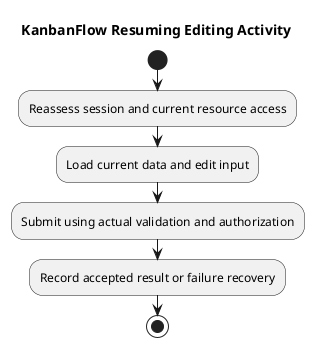

# KanbanFlow Resuming Editing Activity

The `resume-editing-activity.md` filename is retained from the requested structure. Here “resume” means returning to a KanbanFlow editing interaction; this document does not define a résumé/CV feature.

This activity is a conceptual failure/recovery analysis, not proof of automatic draft saving or offline support.

## Interaction boundaries

| Step | Analysis requirement |
| --- | --- |
| Return to an edit interaction | Check actual session and current resource access |
| Load current data | Distinguish server state from any stale client values |
| Edit and submit | Apply actual validation and authorization |
| Accepted mutation | Observe visible state and persisted result |
| Rejected mutation | Provide appropriate feedback and inspect actual recovery behavior |

If access expired or membership changed, do not assume the earlier editing permission remains valid. Specify recovery through actual authentication/navigation behavior. A requirement for draft retention must be separately proposed and agreed; it is not established here.

## Evidence record

Record candidate, actor, session/resource conditions, input, observed response, and persisted state. Test rejected input and relevant stale/removal cases in isolated data. A visible form alone does not demonstrate a successful accepted edit.

See [data flow](data-flow-diagram.md), [roles requirements](../02-requirements/roles-and-use-cases.md), and [acceptance guidance](../02-requirements/validation-and-acceptance-criteria.md).

## Related guidance

See the [analysis index](README.md), [requirements](../02-requirements/README.md), [design](../04-design/README.md), and [diagram guide](../../diagram-guide.md). Keep proposed behavior, inspected source, and actual check results distinct.

## PlantUML diagram

[PlantUML source](diagrams/resume-editing-activity.puml)

