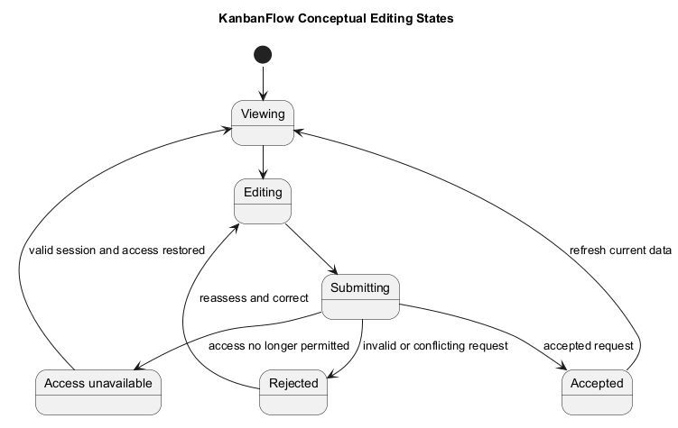
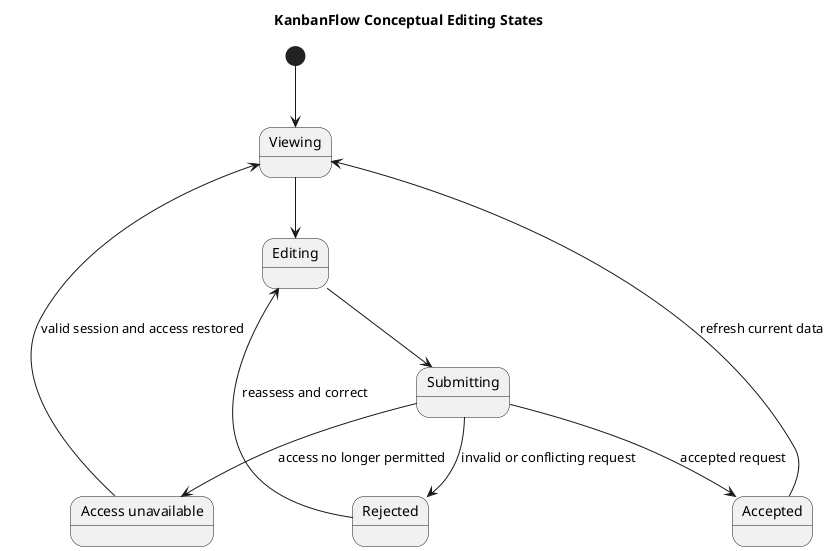

# KanbanFlow Resuming an Interaction — State Diagram

The requested `resume-state-diagram.md` filename describes resuming an interaction, not résumé document states. The states below are analysis labels; they are not stored task statuses or a implemented draft-resume feature.

## Conceptual states

| State | Meaning |
| --- | --- |
| Viewing | Permitted current resource is displayed |
| Editing | User changes candidate input |
| Submitting | Request is awaiting its result |
| Accepted | Server accepted the mutation; inspect refreshed/persisted state |
| Rejected | Validation/access/conflict failure is displayed |
| Access unavailable | Session/resource permission no longer permits interaction |

Resuming requires reassessing actual access and current data. Do not assume automatic draft restoration, offline persistence, or conflict merging. If needed, those require explicit requirements and evidence.

## Analysis questions

- What happens when membership or session changes during editing?
- How are pending requests, errors, and stale visible values handled?
- Does reload confirm accepted data or reveal an unresolved mismatch?
- Which actual recovery path lets the user safely continue?

Record observed behavior at the candidate revision. Link the [editing activity](resume-editing-activity.md) and [acceptance guidance](../02-requirements/validation-and-acceptance-criteria.md). Changes to task business states need their own sourced transition model.

## Related guidance

See the [analysis index](README.md), [requirements](../02-requirements/README.md), [design](../04-design/README.md), and [diagram guide](../../diagram-guide.md). Keep proposed behavior, inspected source, and actual check results distinct.

## PlantUML diagram

[PlantUML source](diagrams/resume-state-diagram.puml)

