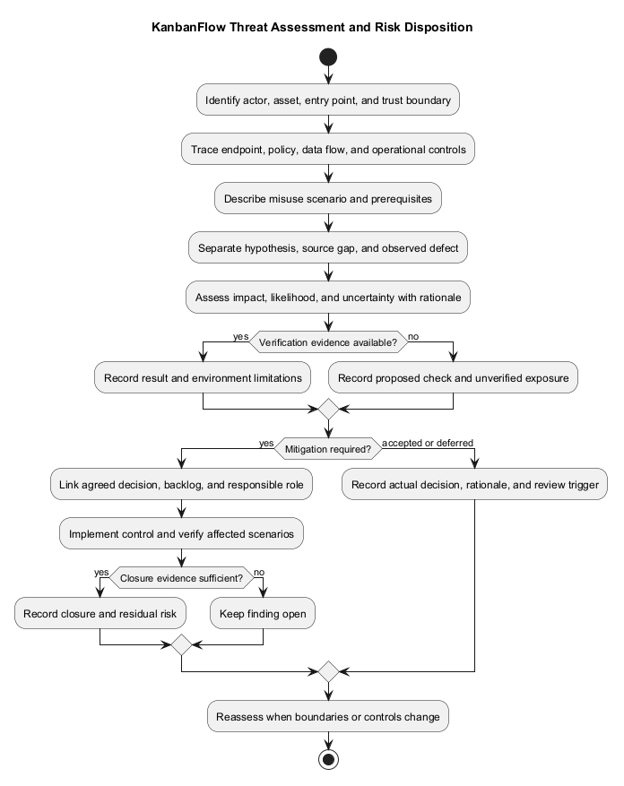
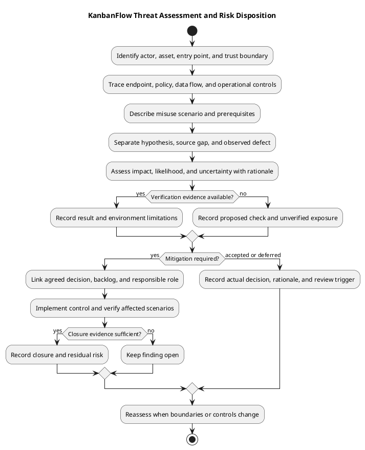

# KanbanFlow Security Threat Model and Risk Analysis

> **Policy amendment (2026-10-10):** Membership mutations are now owner-only; DEC-003/PB-001's bypass is fixed. Earlier open-policy text and diagrams below describe the preceding state. See [QA corrections](../06-testing/qa-corrections-2026-10-10.md) for the selected rule and regression evidence.

Use this bounded framework to assess affected actors, data, trust boundaries, and misuse scenarios. It is not a comprehensive audit, certification, or newly executed penetration test.

## Scope, assets, and actors

Assess the React browser client, Laravel session/API boundary, workspace authorization, database mutations, and operational configuration. Include direct API requests as well as normal navigation. External email delivery, offline synchronization, and third-party integrations are not assumed parts of this model.

| Asset | Security objective |
| --- | --- |
| Session credentials and account identity | Prevent impersonation and secret disclosure |
| Workspace membership and roles | Preserve the intended authority to read and mutate resources |
| Private boards, tasks, and comments | Prevent disclosure through detail, listing, activity, notification, or aggregate responses |
| Positions, WIP state, and task assignments | Preserve valid state during rejected or concurrent operations |
| Activity records and verification evidence | Support investigation without leaking sensitive content |
| Configuration, dependencies, and backups | Protect secrets and enable a verifiable operational recovery |

Actors include unauthenticated callers, ordinary members, managers, owners, removed members, and operators. An authenticated user may still be unauthorized for a particular resource. Account compromise and operator error are scenarios to assess, not established incidents.

## Trust boundaries and source evidence

| Boundary | Current source to inspect | Limit of the evidence |
| --- | --- | --- |
| Browser to session/API | `frontend/src/api/client.ts`, auth API helpers, `backend/routes/web.php`, `backend/routes/api.php` | Credential/XSRF request configuration and authenticated routes do not establish deployed cookie, origin, or transport settings |
| Actor to workspace resource | `WorkspacePolicy.php`, `BoardPolicy.php`, resource controllers | Policy declarations must be checked with endpoint invocation, membership, visibility, and nested ancestry |
| Application to persisted state | Task, column, and board controllers; migrations | Transaction/locking code needs relevant database and contention evidence |
| Application to operational environment | Environment configuration, logging, deployment and backup procedures | Repository publication does not prove secure runtime settings or tested restoration |

Paths for policies are relative to `backend/app/Policies/`; controller paths are under `backend/app/Http/Controllers/Api/`. Record the inspected commit when citing source. The API resource group uses `auth:sanctum`; login has `throttle:login`. These observations do not establish blanket throttling of all endpoints or a complete abuse-resistance assessment.

## Additional misuse scenarios

| ID | Threat and precondition | Control or investigation | Required evidence / current status |
| --- | --- | --- | --- |
| TM-01 | Authenticated caller requests another workspace's nested identifiers | Inspect ancestry and authorization together | Direct mismatched requests and absence of unauthorized read/write; verification required |
| TM-02 | Removed member retains an open form or comment authorship | Recheck board access at the endpoint | Denial and unchanged persisted state; previous authorship is insufficient evidence of access |
| TM-03 | Manager changes privileges indirectly through remove/re-add | Compare membership store/destroy with owner-only role update | Known unresolved DEC-003/PB-001; define policy and implement/verify the agreed fix |
| TM-04 | Private data leaks through secondary responses | Review lists, analytics, activities, and notification recipients/content | Evidence for each response path; detail-page denial alone is insufficient |
| TM-05 | Forged browser request or stolen session is used for mutation | Inspect CSRF/session configuration and actual request handling | Missing/invalid token and expired-session checks in the candidate environment; no new result claimed |
| TM-06 | Untrusted task/comment content executes in the browser | Inspect rendering paths and handling of rich/HTML content | Safe display tests for actual components; no assumption that arbitrary HTML is supported or sanitized |
| TM-07 | Concurrent operations bypass WIP or corrupt ordering | Review relevant locks, validation, and transaction boundaries | Isolated MySQL contention and final-state checks; SQLite alone is insufficient |
| TM-08 | Repeated calls exhaust resources or expose enumeration signals | Inspect login limiter, endpoint workload, pagination, and error responses | Bounded checks and deployed limits; rate limits outside login are not established here |
| TM-09 | Secrets/private content appear in logs, commits, or shared evidence | Review redacted configuration and necessary evidence only | Record a finding without copying secrets; verify removal/rotation if an exposure is confirmed |
| TM-10 | Delete, deployment, or rollback causes unrecoverable loss | Distinguish soft deletion, physical deletion, source rollback, and backup restore | Candidate-specific recovery evidence; soft deletion is not an erasure or retention policy |
| TM-11 | A vulnerable dependency or unsafe runtime setting weakens controls | Inspect dependency manifests/locks and environment-specific configuration | Dated advisory/configuration evidence and follow-up; no current vulnerability scan claimed |

## Risk assessment and disposition

For each scenario, record reachable entry points, attacker prerequisites, affected data, blast radius, existing controls, and uncertainty. Use qualitative likelihood and impact with a written rationale; do not assign a score merely because a threat category exists. Distinguish a plausible hypothesis, a source-observed gap, and a reproduced defect.

Prioritize credible unauthorized access, privilege escalation, and irreversible data loss according to the affected environment. Assign mitigation to an actual responsible person/role and link the backlog and decision record. An interim practice of restricting membership changes to owners does not enforce a server-side restriction or close TM-03.

A finding may be closed only when the agreed control is implemented and relevant positive/negative checks are recorded for the candidate. If risk is accepted or deferred, identify who made the decision, the rationale, remaining exposure, and the review trigger. Do not invent an acceptance decision or owner.

## Verification boundaries and review triggers

Use isolated test accounts and records. For denied mutations, capture both response and persisted state; for confidentiality, check returned data and secondary paths. Redact cookies, tokens, credentials, and private content. This document records analysis and source observations, not a fresh penetration test.

Revisit the model after changes to authentication, membership policy, private visibility, nested routes, rich content, notifications, concurrency controls, dependencies, deployment origins, or backup procedures. Carry unresolved findings into release verification rather than treating documentation completion as mitigation.

See [data flow](data-flow-diagram.md), [data classification](data-classification-and-lifecycle.md), [business rules](business-rules-catalog.md), and [analysis decisions](analysis-decisions-and-open-questions.md) for related boundaries and open questions.

## Threat and evidence register

| Scenario | Affected boundary | Analysis/check | Residual issue |
| --- | --- | --- | --- |
| Unauthorized private data read | Board/nested/aggregate visibility | Current membership, direct requests, and scoped responses | Record actual result or unverified gap |
| Removed user mutation | Membership and authorship | Access revocation and persisted state | Record actual result |
| Cross-resource request | Nested ancestry | Identifier mismatch and authorization guards | Record actual result |
| Indirect role escalation | Membership operations | Remove/re-add versus direct role-update policy | DEC-003/PB-001 remains unresolved |
| Stale/conflicting mutation | State and integrity | Relevant locking, rejection, and recovery checks | SQLite alone does not prove MySQL contention |
| Credential or private data leakage | Configuration/log/evidence | Inspect necessary content without exposing secrets | Pending or actual finding |

## Bounded assessment record

```text
Requirement, candidate, and environment:
Actors, assets, and trust boundaries:
Threat scenario and preconditions:
Existing control and source evidence:
Check performed or proposed:
Observed result and limitations:
Likelihood/impact rationale, if assessed:
Mitigation, dependency, and actual owner:
Residual risk and decision reference:
```

Avoid invented numerical risk scores or causal claims. Distinguish current controls from intended rules, hypotheses, and known defects. A proposed mitigation is not a closed finding.

## Verification and follow-up

Use authorized isolated scenarios and [verification records](../../Releases/verification-template.md). Keep required failures and missing checks visible. Link policy decisions and follow-up through the [decision register](../../Project-Management/decision-register.md) and [quality plan](../../Project-Management/quality-and-risk-plan.md).

Review [security/privacy requirements](../02-requirements/security-and-privacy-requirements.md) for owning constraints. Source publication does not establish secure deployment or recovery readiness.

## Related guidance

See the [analysis index](README.md), [requirements](../02-requirements/README.md), [design](../04-design/README.md), and [diagram guide](../../diagram-guide.md). Keep proposed behavior, inspected source, and actual check results distinct.

## PlantUML diagram



[PlantUML source](diagrams/security-threat-model-and-risk-analysis.puml)


