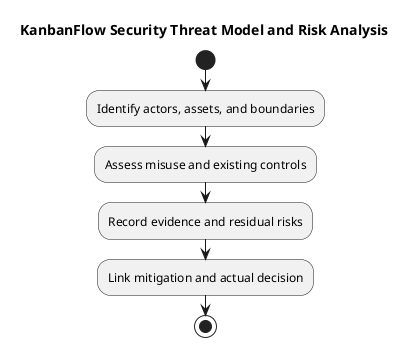

# KanbanFlow Security Threat Model and Risk Analysis

Use this bounded framework to assess affected actors, data, trust boundaries, and misuse scenarios. It is not a comprehensive audit, certification, or newly executed penetration test.

## Threat and evidence register

| Scenario | Affected boundary | Analysis/check | Residual issue |
| --- | --- | --- | --- |
| Unauthorized private data read | Board/nested/aggregate visibility | Current membership, direct requests, and scoped responses | Record actual result or unverified gap |
| Removed user mutation | Membership and authorship | Access revocation and persisted state | Record actual result |
| Cross-resource request | Nested ancestry | Identifier mismatch and authorization guards | Record actual result |
| Indirect role escalation | Membership operations | Remove/re-add versus direct role-update policy | DEC-003/PB-001 remains unresolved |
| Stale/conflicting mutation | State and integrity | Relevant locking, rejection, and recovery checks | SQLite alone does not prove MySQL contention |
| Credential or private data leakage | Configuration/log/evidence | Inspect necessary content without exposing secrets | Pending or actual finding |

## Bounded assessment record

```text
Requirement, candidate, and environment:
Actors, assets, and trust boundaries:
Threat scenario and preconditions:
Existing control and source evidence:
Check performed or proposed:
Observed result and limitations:
Likelihood/impact rationale, if assessed:
Mitigation, dependency, and actual owner:
Residual risk and decision reference:
```

Avoid invented numerical risk scores or causal claims. Distinguish current controls from intended rules, hypotheses, and known defects. A proposed mitigation is not a closed finding.

## Verification and follow-up

Use authorized isolated scenarios and [verification records](../../Releases/verification-template.md). Keep required failures and missing checks visible. Link policy decisions and follow-up through the [decision register](../../Project-Management/decision-register.md) and [quality plan](../../Project-Management/quality-and-risk-plan.md).

Review [security/privacy requirements](../02-requirements/security-and-privacy-requirements.md) for owning constraints. Source publication does not establish secure deployment or recovery readiness.

## Related guidance

See the [analysis index](README.md), [requirements](../02-requirements/README.md), [design](../04-design/README.md), and [diagram guide](../../diagram-guide.md). Keep proposed behavior, inspected source, and actual check results distinct.

## PlantUML diagram


[PlantUML source](diagrams/security-threat-model-and-risk-analysis.puml)


