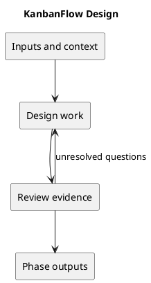

# Design

## Purpose and activities

Specify UI behavior, interfaces, data changes, and authorization boundaries. Prefer existing React/Laravel conventions. Document alternatives and consequences for material decisions; preserve consistent themes and keyboard behavior.

## Completion evidence

A reviewable design with error states, permission checks, acceptance criteria, and migration or rollback implications when applicable.

## Related guidance

- [Supporting documentation](../../Project-Management/decision-register.md)
- [SDLC index](../README.md)

## PlantUML workflow

[Editable source](diagrams/workflow.puml)

