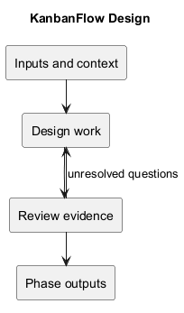
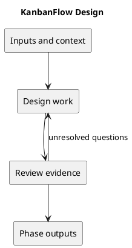

# KanbanFlow Design

## Purpose and evidence

This catalog connects requirements and analysis to frontend, API, authorization, data, and operational design. Documents distinguish source-observed behavior from proposed capabilities; documentation completion does not establish runtime verification.

The supplied image contains truncated names. This catalog uses descriptive full names for those topics. Retained resume filenames refer to KanbanFlow resource interactions. File, PDF, password-change, and public-sharing extensions are explicitly scoped as proposals where no current endpoint is established.

## Design catalog

| Document | Focus |
| --- | --- |
| [Authentication and Authorization](authentication-and-authorization.md) | Resolve session and CSRF state |
| [Authorization Decision Flow](authorization-decision-flow.md) | Resolve actor and nested resource ancestry |
| [Component Diagram](component-diagram.md) | Route pages and shared frontend components |
| [Data Model and ERD](data-model-and-erd.md) | Workspace and membership |
| [Design Decisions and Tradeoffs](design-decisions-and-tradeoffs.md) | Identify material design question |
| [Design Guide](design.md) | Read requirements and analysis |
| [Download Decision](download-decision.md) | Propose artifact and audience |
| [Editor Interaction Flow](editor-interaction-flow.md) | Load current resource and permission context |
| [Error Handling Design](error-handling-design.md) | Classify failure at its boundary |
| [File Storage and Update Design](file-storage-and-update-design.md) | Define proposed attachment ownership and lifecycle |
| [Password Change Sequence](password-change-sequence-diagram.md) | Define password change or recovery requirement |
| [PDF Rendering Design](pdf-rendering-design.md) | Define proposed report and visible data scope |
| [Private File Access Sequence](private-file-access-sequence-diagram.md) | Resolve proposed file and owning resource |
| [Public Access Sequence](public-access-sequence-diagram.md) | Identify public entry point |
| [Repository Layout](repository-layout.md) | Frontend pages features and shared components |
| [Resource Deletion Sequence](resume-deletion-sequence-diagram.md) | Resolve resource ancestry and deletion authority |
| [Resource Update Sequence](resume-update-sequence-diagram.md) | Load baseline and prepare allowed resource changes |
| [Route and Request Contracts](route-and-request-contracts.md) | Match frontend operation to backend route |
| [Schema Reference](schema-reference.md) | Read migration schema and foreign keys |
| [Site Map](site-map.md) | Home and guest login or registration |
| [System Architecture Diagram](system-architecture-diagram.md) | React browser and configured HTTP client |
| [UI and Accessibility Design](ui-and-accessibility-design.md) | Identify journey and shared UI patterns |

## Review sequence

1. Establish the requirement and current source behavior.
2. Trace the actor, route, component, authorization, and persisted resource.
3. Specify normal, rejected, unavailable, and uncertain outcomes.
4. Record material decisions, acceptance cases, and operational implications.
5. Verify the implemented candidate and retain unresolved gaps.

The membership remove/re-add authority issue remains DEC-003/PB-001. A diagram or proposed restriction does not resolve it.

## Related guidance

- [SDLC index](../README.md)
- [Analysis](../03-analysis/README.md)
- [Decision register](../../Project-Management/decision-register.md)
- [Diagram guide](../../diagram-guide.md)

## PlantUML workflow

[Editable source](diagrams/workflow.puml)

