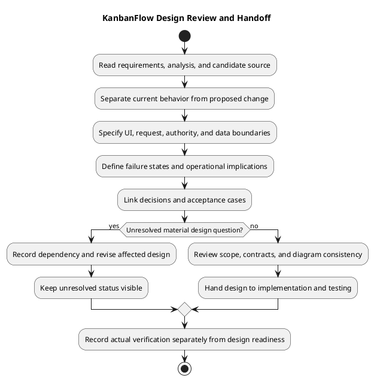

# KanbanFlow Design

> **Policy amendment (2026-10-10):** Membership mutations are now owner-only; DEC-003/PB-001's bypass is fixed. Earlier open-policy text and diagrams below describe the preceding state. See [QA corrections](../06-testing/qa-corrections-2026-10-10.md) for the selected rule and regression evidence.

## Purpose and evidence

This catalog connects requirements and analysis to frontend, API, authorization, data, and operational design. Documents distinguish source-observed behavior from proposed capabilities; documentation completion does not establish runtime verification.

Retained `resume-*` filenames refer to KanbanFlow resource interactions, not a resume/CV feature. File storage, downloads, PDF rendering, password change, and public resource sharing are proposed extensions where no current endpoint is established. Public entry pages are distinct from anonymous access to protected resources.

## Design catalog

| Document | Focus |
| --- | --- |
| [Authentication and Authorization](authentication-and-authorization.md) | Resolve session and CSRF state |
| [Authorization Decision Flow](authorization-decision-flow.md) | Resolve actor and nested resource ancestry |
| [Component Diagram](component-diagram.md) | Route pages and shared frontend components |
| [Data Model and ERD](data-model-and-erd.md) | Workspace and membership |
| [Design Decisions and Tradeoffs](design-decisions-and-tradeoffs.md) | Identify material design question |
| [Design Guide](design.md) | Read requirements and analysis |
| [Download Decision](download-decision.md) | Propose artifact and audience |
| [Editor Interaction Flow](editor-interaction-flow.md) | Load current resource and permission context |
| [Error Handling Design](error-handling-design.md) | Classify failure at its boundary |
| [File Storage and Update Design](file-storage-and-update-design.md) | Define proposed attachment ownership and lifecycle |
| [Password Change Sequence](password-change-sequence-diagram.md) | Define password change or recovery requirement |
| [PDF Rendering Design](pdf-rendering-design.md) | Define proposed report and visible data scope |
| [Private File Access Sequence](private-file-access-sequence-diagram.md) | Resolve proposed file and owning resource |
| [Public Access Sequence](public-access-sequence-diagram.md) | Identify public entry point |
| [Repository Layout](repository-layout.md) | Frontend pages features and shared components |
| [Resource Deletion Sequence](resume-deletion-sequence-diagram.md) | Resolve resource ancestry and deletion authority |
| [Resource Update Sequence](resume-update-sequence-diagram.md) | Load baseline and prepare allowed resource changes |
| [Route and Request Contracts](route-and-request-contracts.md) | Match frontend operation to backend route |
| [Schema Reference](schema-reference.md) | Read migration schema and foreign keys |
| [Site Map](site-map.md) | Home and guest login or registration |
| [System Architecture Diagram](system-architecture-diagram.md) | React browser and configured HTTP client |
| [UI and Accessibility Design](ui-and-accessibility-design.md) | Identify journey and shared UI patterns |

## Inputs and design boundaries

Use the [requirements catalog](../02-requirements/README.md) for intended behavior and acceptance constraints, and [analysis](../03-analysis/README.md) for domain rules, data flows, threats, and unresolved questions. Compare both with the candidate source before describing a control as implemented.

The design follows the workspace → project → board → column → task hierarchy. The React client presents interactions; Laravel endpoints enforce current authorization, validation, and domain constraints. Migrations define physical schema. Client route guards, diagrams, and policy declarations alone do not establish an endpoint's complete behavior.

## Choosing a starting document

| Change or question | Start here | Cross-check |
| --- | --- | --- |
| System or component boundary | [Architecture](system-architecture-diagram.md), [components](component-diagram.md) | Routes, repository layout, and actual deployment configuration |
| Identity or resource access | [Authentication](authentication-and-authorization.md), [authorization flow](authorization-decision-flow.md) | Current membership, private visibility, nested ancestry, and threat model |
| Data or migration change | [Data model](data-model-and-erd.md), [schema](schema-reference.md) | Migrations, existing rows, domain rules, and recovery plan |
| Form, navigation, or task interaction | [Editor flow](editor-interaction-flow.md), [site map](site-map.md), [UI/accessibility](ui-and-accessibility-design.md) | Request contract, errors, themes, keyboard behavior, and persisted state |
| Mutation or deletion | [Update sequence](resume-update-sequence-diagram.md), [deletion sequence](resume-deletion-sequence-diagram.md) | Actual controller path, transactions, soft deletion, and ordering effects |
| New extension | Relevant file/PDF/download/password topic | Scope approval, decision register, route/schema changes, and acceptance cases |

## Required design record

For a scoped change, record the following before treating the design as ready for implementation:

- Requirement or backlog reference, actor, operation, and expected outcome.
- Current source behavior and candidate commit, separated from the proposed change.
- Affected UI components, routes, request/response contracts, policies, and persisted resources.
- Loading, empty, success, validation, denied-access, unavailable-resource, and uncertain-response behavior where applicable.
- Theme, keyboard, focus, and announcement expectations for affected interactions.
- Data migration, transaction, contention, backup, and rollback implications where applicable.
- Material alternatives, actual decision status, acceptance cases, and unresolved dependencies.

Do not invent an owner, approved decision, runtime measurement, or completed check. Capture missing evidence explicitly and link the responsible work item when one exists.

## Completion and handoff criteria

| Criterion | Review evidence |
| --- | --- |
| Scope is explicit | Existing behavior, proposed change, and excluded capabilities are distinguishable |
| Interfaces agree | Client calls and endpoint contracts align; failures and nested identifiers are specified |
| Authority is enforced | Actual server path applies the required visibility and mutation checks |
| Data consequences are understood | Constraints, concurrency, deletion, migration, and recovery impacts are documented as applicable |
| Interaction is reviewable | Normal and failure states include theme and keyboard expectations |
| Decisions are traceable | Alternatives, selected direction, remaining questions, and references are recorded |
| Documentation is consistent | Relative links resolve; embedded PlantUML matches its source; preview renders |
| Verification is planned | Relevant positive/negative cases and environment limitations are identified |

Passing a design review authorizes neither a claim that implementation passes tests nor a deployment. Hand the scoped package to [implementation](../05-implementation/README.md), connect its acceptance cases to [testing](../06-testing/README.md), and record actual results with the [verification template](../../Releases/verification-template.md). Source rollback does not restore deleted data; SQLite checks do not establish MySQL contention behavior.

## Maintenance and diagram conventions

Update related design documents when authentication, membership, private visibility, nested contracts, schema, component boundaries, or interaction behavior changes. Revisit proposed extensions when a concrete requirement is approved; retain their proposed status until implementation evidence exists.

Each topic contains an embedded PlantUML block, an editable `.puml` file, and a PNG preview under `diagrams/`. Keep the block and source identical, regenerate the preview after a source change, and inspect its readability. Conceptual entity diagrams are not complete physical schema specifications; proposed sequence diagrams are not proof of existing endpoints.

Use [documentation traceability](../../Project-Management/documentation-traceability.md) and the [diagram guide](../../diagram-guide.md) to keep changes connected to their source and evidence.

## Review sequence

1. Establish the requirement and current source behavior.
2. Trace the actor, route, component, authorization, and persisted resource.
3. Specify normal, rejected, unavailable, and uncertain outcomes.
4. Record material decisions, acceptance cases, and operational implications.
5. Verify the implemented candidate and retain unresolved gaps.

The membership remove/re-add authority issue remains DEC-003/PB-001. A diagram or proposed restriction does not resolve it.

## Related guidance

- [SDLC index](../README.md)
- [Analysis](../03-analysis/README.md)
- [Decision register](../../Project-Management/decision-register.md)
- [Diagram guide](../../diagram-guide.md)

## PlantUML workflow

[Editable source](diagrams/workflow.puml)

