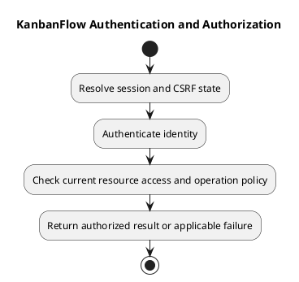

# KanbanFlow Authentication and Authorization

## Scope and design

The browser uses the configured Axios API client with credentials and XSRF support. Auth helpers obtain the Sanctum CSRF cookie before login/register/logout. Backend web routes expose guest login/register and authenticated logout; API resource routes use `auth:sanctum`.

Authentication establishes identity, while policies and controller ancestry checks establish resource access. Route guards improve navigation but cannot enforce API permissions. Assess expired sessions, missing CSRF state, removed membership, and direct unauthorized requests separately.

Inspect `frontend/src/features/auth/api.ts`, `frontend/src/api/client.ts`, `backend/routes/web.php`, `backend/routes/api.php`, and relevant policies/controllers. Verify deployed origin/cookie settings rather than inferring them from local success. Manager membership remove/re-add versus owner-only role update remains DEC-003/PB-001.

## Review and evidence

Record the candidate commit, actor, environment, affected source paths, proposed change, observed checks, and remaining questions. Link implementation and acceptance evidence; keep untested behavior explicit. This document adds no application feature or newly executed security/behavior test.

## Related guidance

- [Design catalog](README.md)
- [Requirements](../02-requirements/README.md)
- [Analysis](../03-analysis/README.md)
- [Decision register](../../Project-Management/decision-register.md)
- [Verification record](../../Releases/verification-template.md)
- [Diagram guide](../../diagram-guide.md)

## PlantUML diagram

[Editable PlantUML source](diagrams/authentication-and-authorization.puml)

