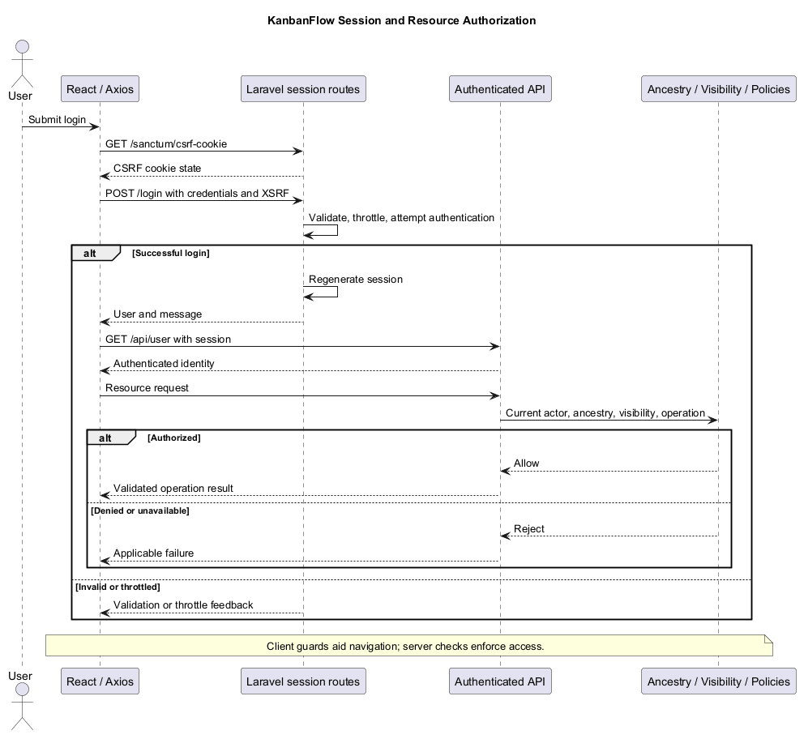
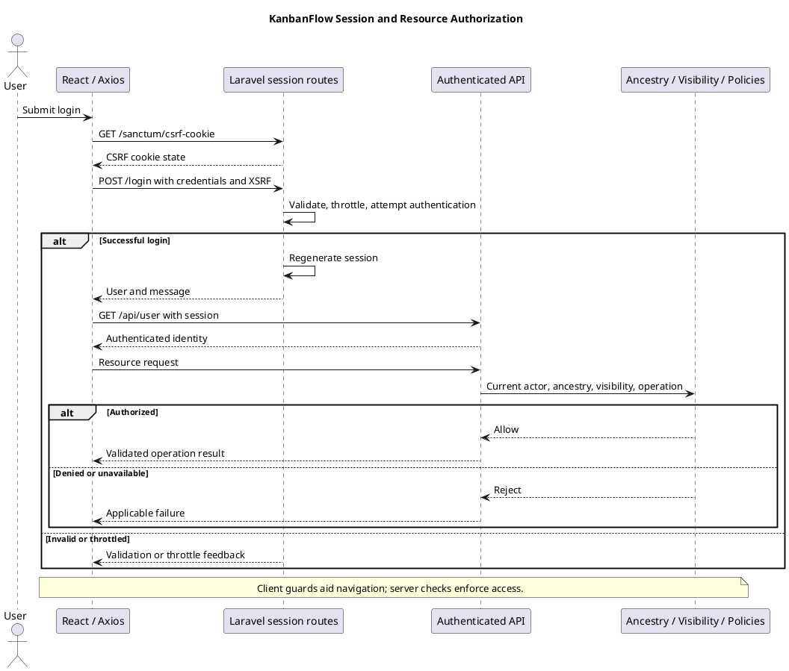

# KanbanFlow Authentication and Authorization

> **Policy amendment (2026-10-10):** Membership mutations are now owner-only; DEC-003/PB-001's bypass is fixed. Current guidance below reflects this rule; historical records retain their original scope. See [QA corrections](../06-testing/qa-corrections-2026-10-10.md) for the selected rule and regression evidence.

## Scope and design

The browser uses the configured Axios API client with credentials and XSRF support. Auth helpers obtain the Sanctum CSRF cookie before login/register/logout. Backend web routes expose guest login/register and authenticated logout; API resource routes use `auth:sanctum`.

Authentication establishes identity, while policies and controller ancestry checks establish resource access. Route guards improve navigation but cannot enforce API permissions. Assess expired sessions, missing CSRF state, removed membership, and direct unauthorized requests separately.

Inspect `frontend/src/features/auth/api.ts`, `frontend/src/api/client.ts`, `backend/routes/web.php`, `backend/routes/api.php`, and relevant policies/controllers. Verify deployed origin/cookie settings rather than inferring them from local success. Manager membership remove/re-add versus owner-only role update remains DEC-003/PB-001.

## Session and request contract

| Operation | Current source behavior | Design boundary |
| --- | --- | --- |
| CSRF initialization | Client requests `/sanctum/csrf-cookie` before registration, login, and logout | Cookie/origin middleware configuration must agree with the browser environment |
| Registration | `POST /register`; name, lowercase unique email, confirmed password of at least eight characters; password hashed; user logged in; session regenerated; user/message response with 201 | Registration does not establish email verification or password recovery |
| Login | `POST /login`; validates email/password, passes optional remember flag to `Auth::attempt`, regenerates session after success | Incorrect credentials return validation feedback; remember behavior must be verified in the actual environment |
| Current user | `GET /api/user` under `auth:sanctum`; returns the authenticated user | Identity lookup is not authorization for every resource |
| Logout | `POST /logout` under auth; logs out web guard, invalidates session, regenerates CSRF token | Verify subsequent protected requests and client state; server code alone does not prove complete UI cleanup |

The Axios client requires `VITE_API_URL`, sends credentials, requests JSON, and uses `XSRF-TOKEN` / `X-XSRF-TOKEN`. Do not describe this browser workflow as a client-stored bearer-token design. Sanctum infrastructure or a personal-access-token migration does not prove a token issuance feature is exposed.

`AppServiceProvider` configures the login limiter as five requests per minute per lowercase email/IP key and thirty per minute per IP; `/login` applies `throttle:login`. These are source-defined limits, not measured deployment behavior or blanket limits for registration and all API routes.

## Frontend session resolution and failure states

Both route guards query `getCurrentUser` with `['current-user']` and retries disabled. `ProtectedRoute` shows a pending state and redirects to `/login` on any query error. This includes connection failures; the guard does not currently distinguish every error as a proven expired session.

`GuestRoute` redirects a successful session to `/dashboard`, displays the guest form on an Axios 401 response, and otherwise shows an unable-to-connect state with retry. Assess these different failure paths when changing navigation. A frontend redirect is not a server authorization control.

After login/logout or actor changes, inspect actual query/cache and page state. Define and verify whether stale private content remains visible, how failed submissions recover, and whether direct navigation rechecks the session. Do not claim automatic restoration of drafts or sessions.

## Resource authorization model

| Boundary | Source-observed rule | Review concern |
| --- | --- | --- |
| Workspace/project reads | Current workspace membership | Check actual endpoint calls and nested ancestry |
| Workspace update/delete | `owner_id` matches actor | Do not substitute manager authority for this rule |
| Membership management | Owner only | Add/remove and role updates share the owner boundary; managers retain project management separately |
| Direct membership role update | Owner only | Add/remove operations also use owner-only authority |
| Project update/delete | Owner or current manager | Endpoint context and parent consistency remain necessary |
| Board reads | Membership required; workspace visibility or creator/owner/current manager satisfies additional visibility condition | Creator/owner status alone does not bypass the membership condition in `visibleTo` |
| Board update/delete policy | Board view must pass, then owner/current manager | A private-board creator is not automatically permitted to mutate |
| Task and column operations | Relevant controllers authorize through board view or mutation rules | Inspect the specific operation and ancestry checks |
| Comment operations | Endpoints check board view; update/delete also use their applicable comment rules | Former authorship does not establish access after membership removal |

Evaluate endpoint invocation as well as policy methods. Restore/force-delete policy methods do not establish exposed restore/force-delete routes. List, analytics, activity, and notification paths must also preserve their required visibility and recipient scope.

## Configuration and operational dependencies

Review `backend/config/session.php`, Sanctum configuration, middleware, frontend API origin, and the actual environment together. Relevant session settings include driver, lifetime, domain, secure cookie, HTTP-only, and SameSite. Configuration defaults are not evidence of effective deployed values.

Use a consistent configured hostname and inspect cookie/origin behavior without copying tokens or credentials into evidence. Validate production transport and cookie settings against the actual deployment. No password-change/recovery, MFA, or public resource-sharing capability is established by the inspected route set.

## Verification matrix

| Case | Evidence required |
| --- | --- |
| Valid registration/login | Response, authenticated current-user lookup, session transition, and subsequent authorized request |
| Invalid input or credentials | Actionable feedback and absence of an authenticated session created by the rejected request |
| Login limit reached | Isolated bounded request evidence and observed throttle response for the candidate |
| Missing/invalid CSRF or expired session | Actual server response, client recovery, and persisted state for attempted mutation |
| Logout | Subsequent session lookup/protected request and visible cache/navigation behavior |
| Removed member or changed role | Direct request after the change, returned data, denied mutation, and persisted state |
| Private board / mismatched ancestry | Authorized and unauthorized actors plus direct identifier mismatch cases |
| Backend unavailable during session check | ProtectedRoute and GuestRoute behavior recorded separately |
| Membership remove/re-add | Owner-only policy under DEC-003/PB-001; regression-check denied manager requests and unchanged persisted membership |

Use isolated accounts/resources. Record candidate commit, browser/backend origin, environment, actor, endpoint, response, visible behavior, and persisted result; redact cookies, tokens, passwords, and private content. Source inspection in this document is not a newly executed security test.

## Open issue and change review

DEC-003/PB-001 is implemented locally: membership mutations are owner-only, including removal/re-addition. API regression checks cover denied manager requests and preserved owner operations.

Revisit this design after changes to session configuration, login limits, guards, membership rules, private visibility, nested endpoints, or account capabilities. Cross-check the [authorization flow](authorization-decision-flow.md), [request contracts](route-and-request-contracts.md), [error handling](error-handling-design.md), and [threat analysis](../03-analysis/security-threat-model-and-risk-analysis.md).

## Review and evidence

Record the candidate commit, actor, environment, affected source paths, proposed change, observed checks, and remaining questions. Link implementation and acceptance evidence; keep untested behavior explicit. This document adds no application feature or newly executed security/behavior test.

## Related guidance

- [Design catalog](README.md)
- [Requirements](../02-requirements/README.md)
- [Analysis](../03-analysis/README.md)
- [Decision register](../../Project-Management/decision-register.md)
- [Verification record](../../Releases/verification-template.md)
- [Diagram guide](../../diagram-guide.md)

## PlantUML diagram

[Editable PlantUML source](diagrams/authentication-and-authorization.puml)

