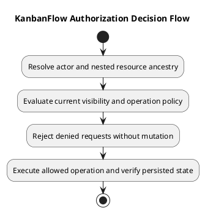

# KanbanFlow Authorization Decision Flow

## Scope and design

Resolve the authenticated actor and requested resource chain before evaluating the operation. Workspace membership is a read boundary; board visibility adds private-board restrictions. Board mutations require board visibility and owner/manager authority. Other resources must use their actual endpoint policy, not a blanket role assumption.

Nested identifiers must describe the same workspace/project/board/column/task chain. A valid identifier alone is insufficient. Comment endpoints also check board access, so former authorship does not establish continued access after membership removal.

Verify positive and negative cases for each operation, including mismatched parents and revoked membership. Keep the membership escalation decision open until server enforcement and regression evidence exist.

## Review and evidence

Record the candidate commit, actor, environment, affected source paths, proposed change, observed checks, and remaining questions. Link implementation and acceptance evidence; keep untested behavior explicit. This document adds no application feature or newly executed security/behavior test.

## Related guidance

- [Design catalog](README.md)
- [Requirements](../02-requirements/README.md)
- [Analysis](../03-analysis/README.md)
- [Decision register](../../Project-Management/decision-register.md)
- [Verification record](../../Releases/verification-template.md)
- [Diagram guide](../../diagram-guide.md)

## PlantUML diagram

[Editable PlantUML source](diagrams/authorization-decision-flow.puml)

