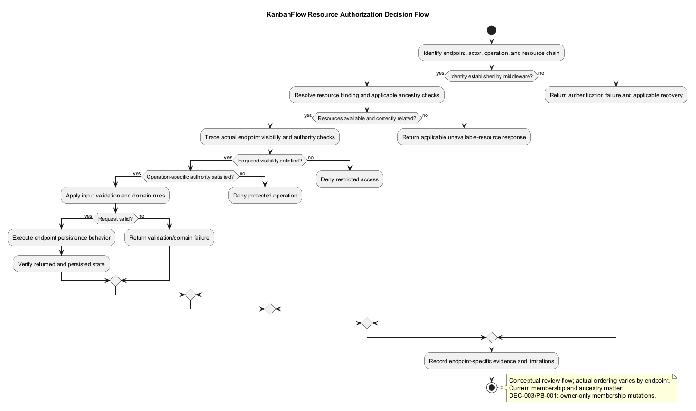
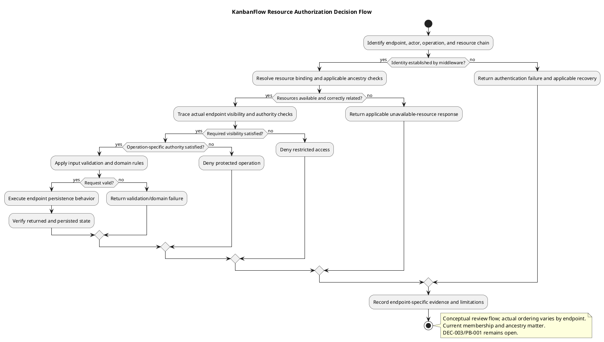

# KanbanFlow Authorization Decision Flow

> **Policy amendment (2026-10-10):** Membership mutations are now owner-only; DEC-003/PB-001's bypass is fixed. Earlier open-policy text and diagrams below describe the preceding state. See [QA corrections](../06-testing/qa-corrections-2026-10-10.md) for the selected rule and regression evidence.

## Scope and design

Resolve the authenticated actor and requested resource chain before evaluating the operation. Workspace membership is a read boundary; board visibility adds private-board restrictions. Board mutations require board visibility and owner/manager authority. Other resources must use their actual endpoint policy, not a blanket role assumption.

Nested identifiers must describe the same workspace/project/board/column/task chain. A valid identifier alone is insufficient. Comment endpoints also check board access, so former authorship does not establish continued access after membership removal.

Verify positive and negative cases for each operation, including mismatched parents and revoked membership. Keep the membership escalation decision open until server enforcement and regression evidence exist.

## Decision inputs and authoritative boundary

Identify the authenticated actor, current membership/role, requested operation, resource identifiers, and actual endpoint. Route middleware establishes identity; controller checks and invoked policies establish resource access. UI controls and previously loaded data are not authorization evidence.

For nested requests, resolve workspace → project → board → column → task → comment as applicable. A request containing individually valid identifiers may still have invalid ancestry. Check destination resources for movement as well as the original resource, using the actual controller path.

This flow is a review model, not a claim that every controller uses the same check order. Trace middleware, binding, ancestry checks, authorization, validation, and persistence in the selected endpoint. Authorization success does not establish that input or a domain constraint is valid.

## Operation-specific decisions

| Operation | Source-observed decision | Important distinction |
| --- | --- | --- |
| Workspace/project viewing | Current workspace membership | Successful login is insufficient |
| Workspace update/delete | Owner identifier matches actor | Manager role does not grant these policy operations |
| Membership add/remove | Owner or current manager through `manageMembers` | Indirect role escalation remains DEC-003/PB-001 |
| Direct member role update | Owner through `changeMemberRoles` | Does not close remove/re-add escalation |
| Project update/delete | Owner or current manager | Check invoked policy and matching parent |
| Board viewing | `visibleTo` requires membership, then workspace visibility or creator/owner/current manager | Private-board creation history alone does not bypass membership |
| Board update/delete policy | View must pass, then owner/current manager | Board creators are not automatically editors |
| Column/task operations | Relevant controllers authorize board view or update/delete according to operation | Inspect create, update, move, and delete separately |
| Comment list/show/create | Nested ancestry plus board view in the controller | Comment creation is not limited to board mutation authority by this endpoint |
| Comment update | Board view plus invoked update policy requiring authorship and workspace relationship | Moderation authority to delete does not imply permission to edit another author's text |
| Comment delete | Board view, then controller allows author or workspace owner/current manager | The controller implements this decision directly; isolated policy `delete` is not the complete endpoint contract |

Policy methods for restoration or permanent deletion do not prove corresponding routes exist. Aggregate, activity, listing, and notification endpoints need their own scope review; do not infer their safety from detail-route denial.

## Failure and recovery paths

| Failed decision | Design outcome and evidence |
| --- | --- |
| Identity unavailable | Follow actual authentication response and client recovery; a connection error is not proof of expired credentials |
| Resource missing or ancestry mismatched | Return the endpoint's unavailable-resource response; comment ancestry guards explicitly use 404 |
| Visibility or operation denied | Return the actual denial without executing the protected mutation; comment delete authority guard explicitly uses 403 |
| Input invalid or domain rule rejected | Distinguish validation from denied authority and verify persisted state remains consistent |
| Membership/role changes after form load | Re-evaluate server authority for the submitted request; stale client controls cannot grant access |
| Mutation response uncertain | Determine persisted state before deciding whether retry is appropriate; no universal idempotency contract is established |

Capture actual response codes for the selected route rather than assigning one uniform code to all failures. Define user-facing recovery with [error handling](error-handling-design.md). Do not expose private resource details in explanatory errors or verification records.

## Review examples

An ordinary current member may view a workspace-visible board and create a comment through its comment endpoint, but that does not grant task mutation authority. A private-board creator may satisfy board visibility while still failing owner/manager mutation checks.

A removed comment author fails the endpoint's board-view boundary even when a standalone policy method would allow deletion based on authorship. A current manager with board access can moderate deletion through the controller; editing another author's comment is a separate operation with different checks.

A caller authorized in workspace A cannot establish access to a task in workspace B merely by substituting its task identifier into A's nested URL. Review the complete ancestry and authorization combination, including movement destination checks where applicable.

## Verification and evidence matrix

| Case | Check and evidence |
| --- | --- |
| Authorized baseline | Valid ancestry, allowed actor/operation, returned data, and persisted result |
| Unauthenticated caller | Direct API request and actual authentication failure |
| Ordinary member versus manager/owner | Read and mutation tested separately for each relevant endpoint |
| Private board | Creator, unrelated member, manager, owner, and removed-member visibility cases |
| Cross-resource identifiers | Mismatch each applicable parent/child boundary; check absence of unauthorized data/change |
| Revoked membership or changed role | Submit after revocation/change with previously opened UI and inspect server result |
| Comment author/moderator | Create, edit, and delete evaluated separately; verify removed author is denied |
| Move operation | Origin/destination scope, authority, final parent, and ordering/state consistency |
| Membership escalation | Direct role update versus remove/re-add; close only after an agreed rule is implemented and verified |

Record candidate commit, endpoint/method, actor, resource chain, relevant membership/visibility, request, response, persisted state, environment, and limitations. Use isolated accounts and redact secrets/private content. These are verification criteria, not newly executed tests.

## Source references and maintenance

Trace `backend/routes/api.php`, `backend/app/Policies/WorkspacePolicy.php`, `ProjectPolicy.php`, `BoardPolicy.php`, `TaskCommentPolicy.php`, `backend/app/Models/Board.php`, and the selected controller under `backend/app/Http/Controllers/Api/`. A source reference must identify the inspected candidate when used as evidence.

Revisit this flow after policy, membership, private visibility, nested route, comment moderation, or movement changes. Keep [authentication design](authentication-and-authorization.md), [request contracts](route-and-request-contracts.md), [business rules](../03-analysis/business-rules-catalog.md), and [threat analysis](../03-analysis/security-threat-model-and-risk-analysis.md) aligned. DEC-003/PB-001 remains unresolved; this documentation update does not change enforcement.

## Review and evidence

Record the candidate commit, actor, environment, affected source paths, proposed change, observed checks, and remaining questions. Link implementation and acceptance evidence; keep untested behavior explicit. This document adds no application feature or newly executed security/behavior test.

## Related guidance

- [Design catalog](README.md)
- [Requirements](../02-requirements/README.md)
- [Analysis](../03-analysis/README.md)
- [Decision register](../../Project-Management/decision-register.md)
- [Verification record](../../Releases/verification-template.md)
- [Diagram guide](../../diagram-guide.md)

## PlantUML diagram

[Editable PlantUML source](diagrams/authorization-decision-flow.puml)

