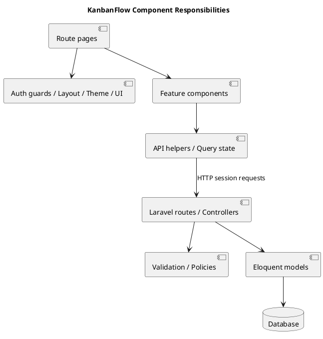

# KanbanFlow Component Diagram

## Scope and design

The frontend comprises route pages, auth guards, layout/theme/UI components, feature components, API helpers, and query state. Laravel comprises routes, controllers, validation, policies, Eloquent models, and persisted records. These are responsibility boundaries rather than independently deployed microservices.

Keep rendering and interaction in frontend components; keep authoritative authorization and domain constraints on the server. Trace a feature through its page, request helper, endpoint, policy, model, and evidence before changing a shared boundary.

Review dependencies for accidental duplication of server authority, mismatched request contracts, and stale query state after mutations. The diagram intentionally omits individual classes.

## Review and evidence

Record the candidate commit, actor, environment, affected source paths, proposed change, observed checks, and remaining questions. Link implementation and acceptance evidence; keep untested behavior explicit. This document adds no application feature or newly executed security/behavior test.

## Related guidance

- [Design catalog](README.md)
- [Requirements](../02-requirements/README.md)
- [Analysis](../03-analysis/README.md)
- [Decision register](../../Project-Management/decision-register.md)
- [Verification record](../../Releases/verification-template.md)
- [Diagram guide](../../diagram-guide.md)

## PlantUML diagram

[Editable PlantUML source](diagrams/component-diagram.puml)

