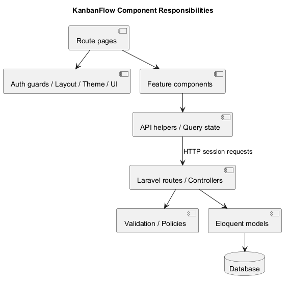
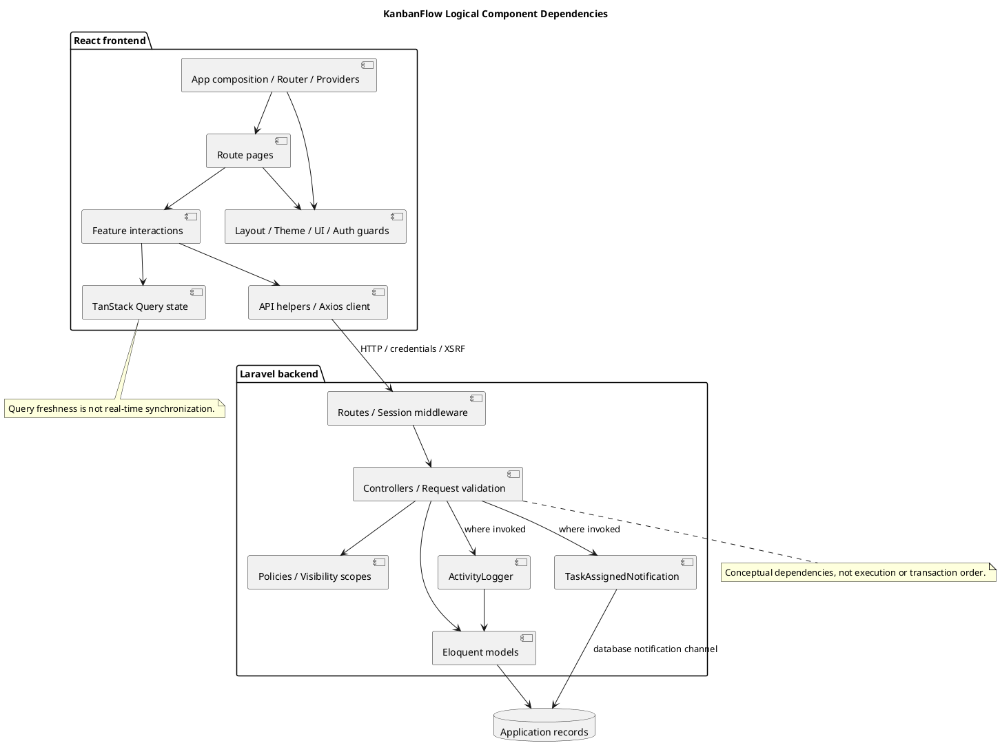

# KanbanFlow Component Diagram

> **Policy amendment (2026-10-10):** Membership mutations are now owner-only; DEC-003/PB-001's bypass is fixed. Current guidance below reflects this rule; historical records retain their original scope. See [QA corrections](../06-testing/qa-corrections-2026-10-10.md) for the selected rule and regression evidence.

## Scope and design

The frontend comprises route pages, auth guards, layout/theme/UI components, feature components, API helpers, and query state. Laravel comprises routes, controllers, validation, policies, Eloquent models, and persisted records. These are responsibility boundaries rather than independently deployed microservices.

Keep rendering and interaction in frontend components; keep authoritative authorization and domain constraints on the server. Trace a feature through its page, request helper, endpoint, policy, model, and evidence before changing a shared boundary.

Review dependencies for accidental duplication of server authority, mismatched request contracts, and stale query state after mutations. The diagram intentionally omits individual classes.

## Component inventory and ownership

| Component | Source location | Responsibility and boundary |
| --- | --- | --- |
| Application composition | `frontend/src/main.tsx`, `App.tsx` | Compose router, query provider, theme provider, shell, error boundary, lazy pages, and navigation guards |
| Route pages | `frontend/src/pages/` | Assemble workspace/project/board journeys; route identifiers are inputs, not proof of authorized access |
| Shared presentation | `frontend/src/components/layout`, `theme`, `ui` | Layout, appearance, reusable feedback and controls; no authoritative domain permission enforcement |
| Auth navigation | `frontend/src/components/auth/`, `features/auth/` | Resolve session, present login/register, and steer navigation |
| Feature interactions | `frontend/src/features/` | Workspace, project, board, column, task, and notification interactions and request helpers |
| Query state | TanStack Query provider and feature query/mutation usage | Cache server reads and refresh affected queries; browser state is not authoritative persistence |
| HTTP client | `frontend/src/api/client.ts` | Configured API origin, JSON requests, credentials, and XSRF cookie/header handling |
| Route/session boundary | `backend/routes/web.php`, `routes/api.php` | Map operations and apply authentication middleware; login applies its limiter |
| Controllers and validation | `backend/app/Http/Controllers/` | Resolve request context/ancestry, invoke authority checks, validate input, execute endpoint behavior, and construct responses |
| Policies and visibility | `backend/app/Policies/`, board visibility scope | Evaluate operation authority and relevant resource visibility |
| Persistence | `backend/app/Models/`, `database/migrations/` | Model relationships/casts, persisted records, and physical schema constraints |
| Activity logging | `backend/app/Services/ActivityLogger.php` | Write workspace-scoped actor/action/subject metadata to activity records where invoked |
| Assignment notification | `backend/app/Notifications/TaskAssignedNotification.php` | Define the assignment notification payload/channel; inspect call sites and recipient scope |

These are logical components within the existing frontend and Laravel application, not a claim of separate deployable services, workers, or an event bus. Framework job infrastructure does not prove a background pipeline is used for every mutation.

## Dependency and request flow

1. Application composition makes shared providers available to route pages and feature components.
2. A feature reads or submits through its API helper and configured HTTP client. Query state tracks request outcomes and refreshes affected server reads.
3. Backend middleware resolves identity; the selected controller checks ancestry, visibility/authority, input, and applicable domain rules.
4. The controller uses models and the actual transaction/locking path to persist changes. Activity logging or notifications occur only where the endpoint invokes them.
5. The response returns through the client helper. The interaction displays feedback and updates/refetches applicable queries; persisted state must be verified independently when needed.

The diagram shows dependency direction, not precise execution order, transaction scope, or complete class relationships. An allowed policy decision does not prove validation succeeds; a successful HTTP response does not prove every related cache was refreshed.

## State and failure contracts

`main.tsx` currently configures query defaults with one retry, a 30-second stale time, and window-focus refetch disabled; mutation retries are disabled. Per-query options can override these defaults, as session guards do. Do not infer continuous real-time synchronization, automatic safe mutation retries, or offline support.

| Boundary | Required review |
| --- | --- |
| Page to feature | Parent identifiers, loading/empty states, theme and keyboard behavior |
| Feature to API helper | Accepted fields, response types, pending state, failure feedback, and intended query invalidations |
| Browser to backend | Effective origin/session/CSRF behavior, identity failure, and direct unauthorized requests |
| Controller to policy/model | Actual invoked checks, ancestry, input validation, and operation-specific domain rules |
| Mutation to derived UI state | Affected lists, ordering, activities, analytics, and notifications as applicable; do not assume one invalidation covers all |
| Persistence to side effects | Actual call sites, recipient/visibility scope, transaction timing, and failure consequences |

ActivityLogger records subject type/id/name and optional properties, not a universal physical relationship to a task. Database notification behavior does not establish email/SMS delivery or streaming updates. Record source evidence before extending these contracts.

## Change impact and verification

| Change | Components to trace | Evidence to plan |
| --- | --- | --- |
| New field or validation rule | Form, types/helper, controller, model/migration | Valid and invalid input plus persisted values and compatibility |
| Permission or visibility rule | UI affordances, endpoint, policy/scope, secondary responses | Direct allowed/denied calls and private-data exclusion |
| Move/order/WIP behavior | Board/task interaction, move contract, transaction/locks | Final parent/order/state, rejection recovery, relevant MySQL contention |
| Session or origin change | Client, auth helpers/guards, middleware/configuration | Login/current-user/logout and unavailable-backend paths |
| Derived state or notification | Mutation call site, logger/notification, reader endpoint, cache | Actual recipients, visible freshness, and authorized response scope |
| Shared theme/UI change | Shared components and representative consuming pages | Both themes, narrow layout, keyboard/focus, and error states |

Record candidate commit, affected source paths, actor/resource scope, request and persisted results, UI observations, and remaining gaps. This document describes source responsibilities and verification planning; no fresh application test is claimed. Membership additions, removals, and role changes are owner-only under DEC-003/PB-001; the 2026-10-10 correction closes the manager remove/re-add bypass.

## Related component views

Use [system architecture](system-architecture-diagram.md) for runtime boundaries, [repository layout](repository-layout.md) for source organization, [request contracts](route-and-request-contracts.md) for interfaces, [authorization flow](authorization-decision-flow.md) for authority, and [data model](data-model-and-erd.md) for relationships. Update these together when a shared boundary changes.

## Review and evidence

Record the candidate commit, actor, environment, affected source paths, proposed change, observed checks, and remaining questions. Link implementation and acceptance evidence; keep untested behavior explicit. This document adds no application feature or newly executed security/behavior test.

## Related guidance

- [Design catalog](README.md)
- [Requirements](../02-requirements/README.md)
- [Analysis](../03-analysis/README.md)
- [Decision register](../../Project-Management/decision-register.md)
- [Verification record](../../Releases/verification-template.md)
- [Diagram guide](../../diagram-guide.md)

## PlantUML diagram

[Editable PlantUML source](diagrams/component-diagram.puml)

