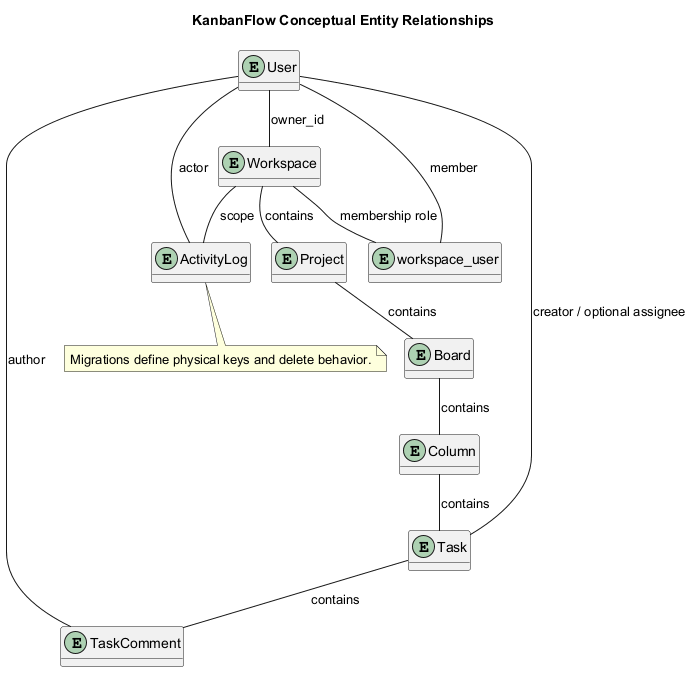
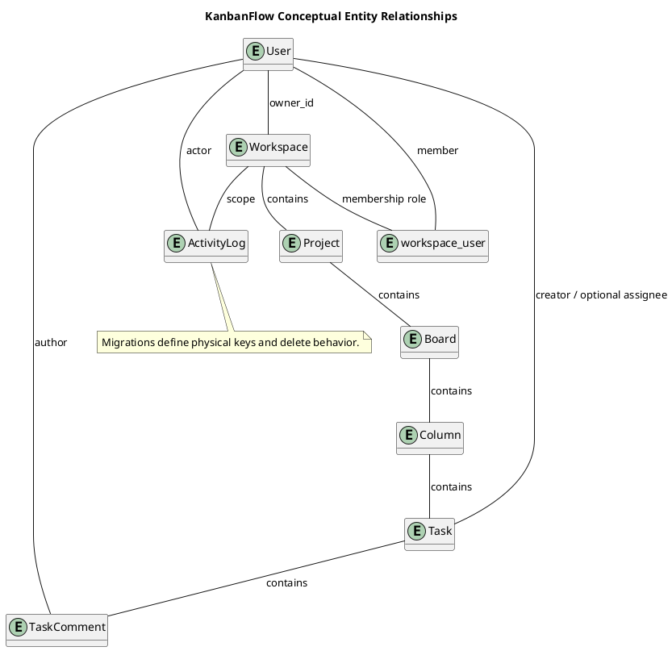

# KanbanFlow Data Model and ERD

## Scope and design

The core containment chain is Workspace → Project → Board → Column → Task → TaskComment. Users own workspaces, participate through `workspace_user`, create resources, and may be assigned tasks. Activity logs associate with workspace/user; notifications have their own recipient storage.

Use migrations for physical keys, nullability, indices, and delete actions; use models for relationships, casts, and soft deletion. Conceptual containment does not specify every cardinality or physical foreign key. Do not infer a task foreign key for activity logs.

Review any schema change for existing rows, authorization scope, migration failure, backup, and rollback consequences. Soft deletion and physical cascading are distinct operations. See the analysis domain model for the broader relationship discussion.

## Review and evidence

Record the candidate commit, actor, environment, affected source paths, proposed change, observed checks, and remaining questions. Link implementation and acceptance evidence; keep untested behavior explicit. This document adds no application feature or newly executed security/behavior test.

## Related guidance

- [Design catalog](README.md)
- [Requirements](../02-requirements/README.md)
- [Analysis](../03-analysis/README.md)
- [Decision register](../../Project-Management/decision-register.md)
- [Verification record](../../Releases/verification-template.md)
- [Diagram guide](../../diagram-guide.md)

## PlantUML diagram

[Editable PlantUML source](diagrams/data-model-and-erd.puml)

