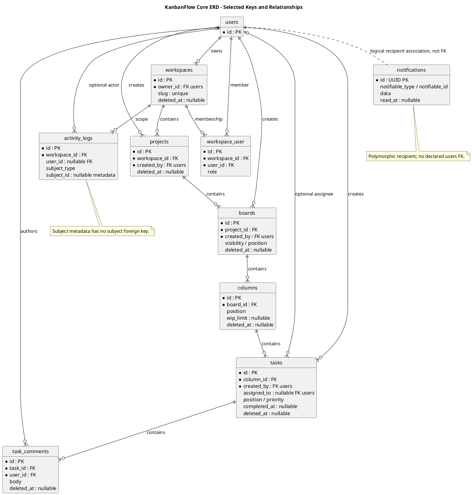

# KanbanFlow Data Model and ERD

## Scope and design

The core containment chain is Workspace → Project → Board → Column → Task → TaskComment. Users own workspaces, participate through `workspace_user`, create resources, and may be assigned tasks. Activity logs associate with workspace/user; notifications have their own recipient storage.

Use migrations for physical keys, nullability, indices, and delete actions; use models for relationships, casts, and soft deletion. Conceptual containment does not specify every cardinality or physical foreign key. Do not infer a task foreign key for activity logs.

Review any schema change for existing rows, authorization scope, migration failure, backup, and rollback consequences. Soft deletion and physical cascading are distinct operations. See the analysis domain model for the broader relationship discussion.

## Entity and key catalog

The following summarizes the inspected application migrations. Most domain tables use an integer `id`, timestamps, and the relationships shown below. Notifications use a UUID primary key. Consult migrations for exact types and all fields before implementing a change.

| Entity/table | Parent and actor keys | Important data |
| --- | --- | --- |
| Workspace / `workspaces` | Required `owner_id` → users | Name, globally unique slug, nullable description/logo_path, visibility default private |
| Membership / `workspace_user` | Required workspace_id and user_id | Role default member; unique workspace/user pair; timestamps |
| Project / `projects` | Required workspace_id and created_by → users | Name, workspace-scoped slug, status default active, nullable description/start_date/due_date |
| Board / `boards` | Required project_id and created_by → users | Project-scoped slug, visibility default workspace, position default zero |
| Column / `columns` | Required board_id | Name, position default zero, nullable unsigned wip_limit |
| Task / `tasks` | Required column_id and created_by; nullable assigned_to → users | Title, nullable description/due_date/completed_at, priority default medium, position default zero |
| Comment / `task_comments` | Required task_id and user_id | Body and timestamps |
| Activity / `activity_logs` | Required workspace_id; nullable user_id | Action, subject_type, nullable subject_id, subject_name, nullable JSON properties |
| Notification / `notifications` | Polymorphic notifiable_type/notifiable_id | UUID id, type, text data, nullable read_at, timestamps |

Workspace, project, board, column, task, and comment migrations include `deleted_at`; their models use soft deletion. Activity logs and notifications do not have a soft-delete column in the inspected migrations. A nullable `logo_path` field does not establish an upload workflow.

## Relationship cardinality and meaning

Each project belongs to one workspace, each board to one project, each column to one board, each task to one column, and each comment to one task. A parent may have zero or many children. These required foreign keys establish physical parent relationships; API ancestry checks must still ensure nested request identifiers describe that chain.

Workspace membership is many-to-many through `workspace_user`, with one row per workspace/user pair. Workspace ownership is a separate foreign key, not a database guarantee that an owner also has a membership row. Authorization code may depend on current membership in addition to owner/creator identity.

Creator references on projects, boards, and tasks are required. Task assignment is optional and distinct from creation. A user foreign key does not by itself prove the assignee is a workspace member or enforce who may assign work; inspect controller validation and authorization.

Activity subjects use type/id metadata, without a declared foreign key from `subject_id` to tasks or other subject tables. Deleted subjects may leave metadata references. Notification recipients use a polymorphic pair rather than a declared `users` foreign key in this migration; the ERD labels that as a logical association.

## Uniqueness, indexes, and domain rules

| Migration constraint/index | Meaning and limit |
| --- | --- |
| Workspace slug unique | Global uniqueness includes rows still physically present after soft deletion |
| Project workspace_id/slug unique | Slug uniqueness within a workspace, not globally |
| Board project_id/slug unique | Slug uniqueness within a project |
| Membership workspace_id/user_id unique | Prevents duplicate membership pairs; does not define acceptable role transitions |
| Parent/position indexes on boards, columns, tasks | Support scoped ordering queries; positions are not declared unique by these indexes |
| Project workspace_id/status index | Supports scoped status queries; a string default is not an enum constraint |
| Task assigned_to/due_date index | Supports assignment/date queries; does not validate assignment authority |
| Comment task_id/created_at index | Supports task-scoped chronological reads |
| Activity workspace_id/created_at and subject_type/subject_id indexes | Support scoped/history lookup; do not establish subject referential integrity |

WIP limits, contiguous ordering, private visibility, membership authority, and accepted status/priority values depend on application rules and validation. Do not represent them as database CHECK or uniqueness constraints unless the actual migration provides that enforcement. Date ordering likewise needs its actual validation evidence.

## Deletion and lifecycle consequences

Physical deletion of parent rows cascades through the core hierarchy and membership foreign keys. Required owner/creator/comment-author foreign keys use cascading deletion; deleting a user physically can therefore remove owned/created resources and comments, not merely clear attribution. Review the complete cascade graph before any account deletion feature.

The task assignee and activity actor foreign keys use `nullOnDelete`, preserving their containing rows when those specific referenced users are physically deleted. Those rows may still be removed through another cascading relationship. Polymorphic notification recipients and activity subject metadata need separate lifecycle handling because they are not equivalent foreign-key cascades.

A soft delete updates `deleted_at`; it is not a physical DELETE triggering those cascades. Inspect the selected controller and model behavior for actual child visibility and cleanup. Schema rollback, soft deletion, restoration policy methods, data erasure, and backup restoration are separate concepts; none implies an exposed restore endpoint or approved retention policy.

## Schema evolution and verification

Before changing a key, nullability, slug rule, or cascade action, identify existing records, source/API compatibility, backfill requirements, migration order, and recoverable backup. Avoid assuming a destructive `down()` restores removed data.

| Verification scenario | Evidence required |
| --- | --- |
| Required/optional relationships | Valid parent creation and invalid foreign-key attempts in isolated data |
| Scoped uniqueness | Duplicate within scope rejected; allowed distinct scopes; soft-deleted-row implications recorded |
| Membership pair | Duplicate pair rejected and role transitions separately checked at the endpoint |
| Soft versus physical deletion | Observed row/child behavior for each operation, with isolated fixtures |
| Assignee/actor deletion | Actual nulling and any competing cascade consequences |
| Activity/notification lifecycle | Subject/recipient removal behavior and authorized response scope |
| Ordering/WIP contention | Relevant controller paths and final state under the actual MySQL environment |
| Migration/recovery | Candidate/environment, before/after schema/data, failure handling, and actual recovery result |

This document reports migration inspection and design criteria, not newly run database tests. SQLite test success alone does not prove MySQL contention or every database-specific constraint behavior. Record candidate commit, database engine, operation, and final persisted state in verification evidence.

## Related model views

See [schema reference](schema-reference.md), [domain analysis](../03-analysis/domain-model.md), [data lifecycle](../03-analysis/data-classification-and-lifecycle.md), [business rules](../03-analysis/business-rules-catalog.md), and [authorization flow](authorization-decision-flow.md). The diagram shows selected keys/cardinalities, not every column, index, or operational rule.

## Review and evidence

Record the candidate commit, actor, environment, affected source paths, proposed change, observed checks, and remaining questions. Link implementation and acceptance evidence; keep untested behavior explicit. This document adds no application feature or newly executed security/behavior test.

## Related guidance

- [Design catalog](README.md)
- [Requirements](../02-requirements/README.md)
- [Analysis](../03-analysis/README.md)
- [Decision register](../../Project-Management/decision-register.md)
- [Verification record](../../Releases/verification-template.md)
- [Diagram guide](../../diagram-guide.md)

## PlantUML diagram

[Editable PlantUML source](diagrams/data-model-and-erd.puml)

