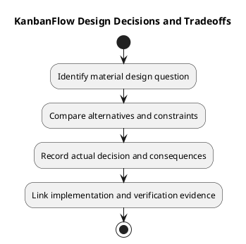

# KanbanFlow Design Decisions and Tradeoffs

## Scope and design

Record design choices in the project decision register with problem, alternatives, chosen direction, rationale, consequences, status, and evidence. Existing React/Laravel conventions are the starting point; a materially different interface or data boundary needs an explicit decision.

Evaluate client responsiveness against authoritative server state, reusable components against feature-specific behavior, and transaction scope against contention. Document actual consequences rather than invented performance numbers.

DEC-003/PB-001 membership authority is unresolved. PDF export, attachments, public sharing, saved drafts, and password change require new scoped decisions; their presence in this catalog does not approve implementation.

## Review and evidence

Record the candidate commit, actor, environment, affected source paths, proposed change, observed checks, and remaining questions. Link implementation and acceptance evidence; keep untested behavior explicit. This document adds no application feature or newly executed security/behavior test.

## Related guidance

- [Design catalog](README.md)
- [Requirements](../02-requirements/README.md)
- [Analysis](../03-analysis/README.md)
- [Decision register](../../Project-Management/decision-register.md)
- [Verification record](../../Releases/verification-template.md)
- [Diagram guide](../../diagram-guide.md)

## PlantUML diagram

[Editable PlantUML source](diagrams/design-decisions-and-tradeoffs.puml)

