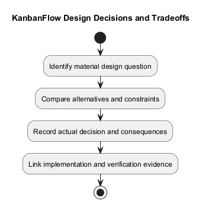
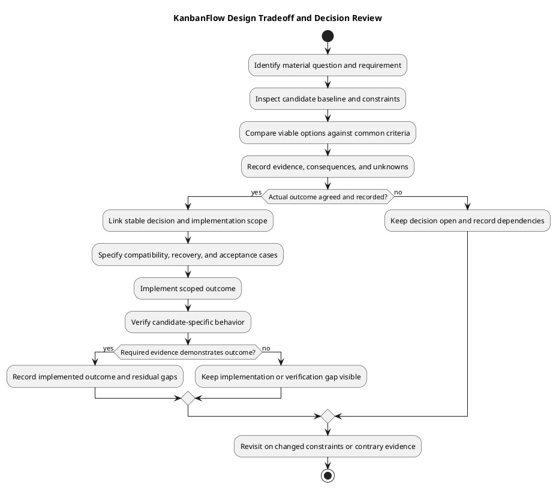

# KanbanFlow Design Decisions and Tradeoffs

> **Policy amendment (2026-10-10):** Membership mutations are now owner-only; DEC-003/PB-001's bypass is fixed. Earlier open-policy text and diagrams below describe the preceding state. See [QA corrections](../06-testing/qa-corrections-2026-10-10.md) for the selected rule and regression evidence.

## Scope and design

Record design choices in the project decision register with problem, alternatives, chosen direction, rationale, consequences, status, and evidence. Existing React/Laravel conventions are the starting point; a materially different interface or data boundary needs an explicit decision.

Evaluate client responsiveness against authoritative server state, reusable components against feature-specific behavior, and transaction scope against contention. Document actual consequences rather than invented performance numbers.

DEC-003/PB-001 membership authority is unresolved. PDF export, attachments, public sharing, saved drafts, and password change require new scoped decisions; their presence in this catalog does not approve implementation.

## Authority and decision status

The [decision register](../../Project-Management/decision-register.md) owns stable decision IDs and recorded outcomes. This guide explains how to compare design options; it does not create approval history or assign new decision IDs. Keep current source behavior, a suggested alternative, and an explicitly agreed outcome separate.

| Existing reference | Established state | Design consequence |
| --- | --- | --- |
| DEC-001: naming | Implemented: product KanbanFlow; repository/folder Web-KanbanFlow | Use consistent user-facing names and setup references without rewriting historical release facts |
| DEC-002: themes | Implemented: Light/Dark/System with browser-local preference | Review consuming UI for appearance, focus, and readability; account-wide cross-device preference is not established |
| DEC-003 / PB-001: membership authority | Open | Do not infer a chosen policy from the role name or from direct role-update restrictions |

An observed implementation without a separate approval record must retain that limitation. A diagram, published document, or completed source change does not establish that a material policy decision was approved or verified.

## Comparison dimensions

| Dimension | Questions to answer | Useful evidence |
| --- | --- | --- |
| User outcome | Which journey improves, and what burden or failure remains? | Requirement, actual interaction, loading/error/recovery behavior |
| Authorization and privacy | Who can read/change data, including indirect paths? | Endpoint/policy/visibility trace and positive/negative scenarios |
| Data integrity | What happens under rejection, movement, deletion, or concurrent updates? | Migrations, transaction/lock paths, persisted results, relevant database checks |
| Compatibility | Which client contracts, records, and environments must continue working? | Types/helpers, routes/controllers, existing data and migration plan |
| Interaction and accessibility | How do keyboard, focus, themes, and narrow layouts behave? | Representative browser observations tied to the candidate |
| Operations and recovery | What configuration, backup, rollback, or cleanup is required? | Actual environment and recovery evidence, not source rollback alone |
| Maintainability and scope | Does the option duplicate authority or introduce unnecessary boundaries? | Affected components, ownership, change impact, and scoped implementation plan |

Compare alternatives against the same requirement and constraints. Label unknowns rather than assigning invented performance numbers, risk scores, cost estimates, or unsupported advantages.

## Project-specific tradeoff catalog

These comparisons are review prompts, not records of rejected options or new selected decisions.

| Question | Current baseline | Alternative and consequences to evaluate |
| --- | --- | --- |
| Client feedback versus authoritative state | Feature UI/query state presents requests; server validates and persists | Optimistic updates may improve perceived responsiveness but need rollback/reconciliation and denied/uncertain-response handling |
| Query freshness versus request volume | Current query defaults include 30-second stale time, one retry, no focus refetch; per-query overrides exist | More refetching or polling changes traffic and freshness; streaming requires an explicit new contract and evidence |
| Shared UI versus feature specialization | Layout/theme/UI components coexist with feature components | More reuse can improve consistency but can obscure operation-specific states; specify which behavior belongs in each component |
| Delegated membership versus owner control | Direct role updates are owner-only; manager add/remove path leaves DEC-003 open | Owner-exclusive or explicitly constrained manager operations need agreed rules and direct/indirect enforcement |
| Transaction scope versus contention | Relevant board/column/task paths use transactions/locks | Broader locks may simplify invariants but affect contention; narrower locks require evidence that ordering/WIP remains valid |
| Soft deletion versus physical cleanup | Core resource models use soft deletion; physical foreign keys have cascade/null actions | Retention, restore, or erasure changes need explicit lifecycle rules, migration implications, and recoverable evidence |
| Local theme versus account preference | DEC-002 stores preference in the browser | Account persistence introduces server/profile contracts and cross-device behavior; it is not implied by tab synchronization |
| Existing application versus new export/storage capability | No established PDF/file-download/attachment endpoint in inspected routes | New generation/storage/share boundaries add privacy, cleanup, limits, and failure contracts; define scope before selecting technology |

For concurrency comparisons, SQLite results alone do not establish MySQL contention behavior. For lifecycle comparisons, soft deletion is not automatic retention compliance or backup restoration. For API comparisons, a hidden button is not server-side authorization.

## DEC-003 worked comparison

The unresolved problem is indirect role change through manager removal/re-addition. The decision register identifies two candidate directions: owners manage membership exclusively, or managers have an explicitly constrained subset of operations. Neither is selected by this document.

Compare each direction against permitted add/remove/assigned roles, protection of owners and existing members, current-membership checks, delegated administration needs, and failure feedback. Then define regression scenarios for direct role update, removal, re-addition, denied actors, and owner protections. A frontend restriction or owner-only operating practice cannot close a backend authorization gap.

Once an actual outcome is recorded, link PB-001 implementation and candidate-specific checks. Preserve the open state until the required decision and enforcement evidence exist.

## Decision record template

```text
Stable decision reference and specific question:
Requirement/backlog reference and user outcome:
Candidate/source baseline and affected components:
Constraints and non-negotiable boundaries:
Options compared against the same criteria:
Evidence for each consequence; unknowns:
Actual selected outcome or unresolved status:
Rationale and actual authorization/date, if recorded:
Dependencies and implementation scope:
Compatibility, data migration, and recovery implications:
Positive/negative acceptance cases and environment:
Delivered commit/PR and actual verification:
Residual gaps and review/superseding trigger:
```

If a field is unknown, mark it unrecorded or unresolved. Do not reconstruct approvers, discussion dates, rejected alternatives, or test results. Use the register's Open, Decided, Implementing, Implemented, Superseded, and Withdrawn states consistently; observed implementation is not an invented transition history.

## Review, handoff, and maintenance

1. Identify a material question and collect the current source and requirement evidence.
2. Compare viable options using the dimensions above, including failure and operational effects.
3. Record the actual outcome or keep the question open with its dependencies.
4. Hand the agreed scope to implementation with request/data/UI consequences and acceptance cases.
5. Verify the delivered candidate before reporting the outcome implemented; record gaps explicitly.
6. Update related design/traceability documents and preserve superseded decision history.

Revisit a decision when a constraint changes, verification contradicts the rationale, or a new requirement changes its compatibility/privacy/operational impact. A decision record does not automatically authorize deployment or unrelated implementation.

See [design review criteria](README.md), [component boundaries](component-diagram.md), [data model](data-model-and-erd.md), [authorization flow](authorization-decision-flow.md), and [documentation traceability](../../Project-Management/documentation-traceability.md).

## Review and evidence

Record the candidate commit, actor, environment, affected source paths, proposed change, observed checks, and remaining questions. Link implementation and acceptance evidence; keep untested behavior explicit. This document adds no application feature or newly executed security/behavior test.

## Related guidance

- [Design catalog](README.md)
- [Requirements](../02-requirements/README.md)
- [Analysis](../03-analysis/README.md)
- [Decision register](../../Project-Management/decision-register.md)
- [Verification record](../../Releases/verification-template.md)
- [Diagram guide](../../diagram-guide.md)

## PlantUML diagram



[Editable PlantUML source](diagrams/design-decisions-and-tradeoffs.puml)


