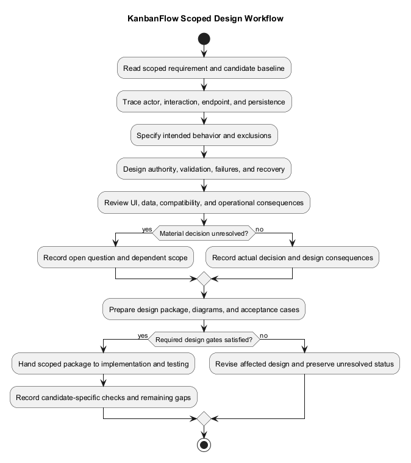
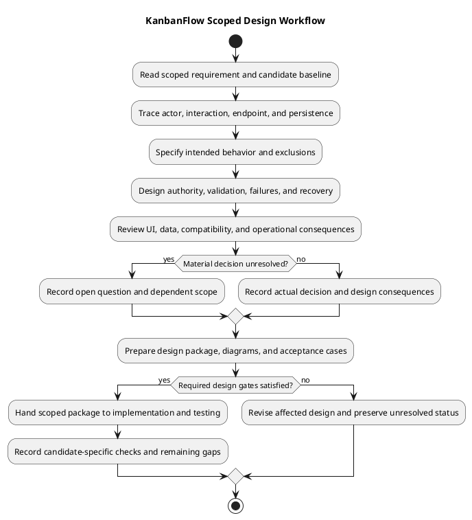

# KanbanFlow Design Guide

> **Policy amendment (2026-10-10):** Membership mutations are now owner-only; DEC-003/PB-001's bypass is fixed. Current guidance below reflects this rule; historical records retain their original scope. See [QA corrections](../06-testing/qa-corrections-2026-10-10.md) for the selected rule and regression evidence.

## Scope and design

Translate requirements and analysis into interfaces, data boundaries, failure behavior, and verification criteria. Start with an actor and operation, identify the resource chain, then trace UI interaction to authoritative server validation and persistence.

A design package identifies current behavior versus proposed change, affected routes/components/schema, loading/empty/error states, permissions, acceptance criteria, and rollback implications. Include theme and keyboard behavior for interface changes.

Review against requirements, business rules, threat analysis, and the decision register. A rendered diagram is documentation evidence; it does not prove the implemented behavior passes its checks.

## Inputs and readiness

Begin with a scoped requirement/backlog item, actor, expected outcome, acceptance constraints, and the candidate source. Use [requirements](../02-requirements/README.md), [business rules](../03-analysis/business-rules-catalog.md), [data flow](../03-analysis/data-flow-diagram.md), and [threat analysis](../03-analysis/security-threat-model-and-risk-analysis.md) to identify affected boundaries.

Record missing information and material policy questions before choosing an implementation. Membership additions, removals, and role changes are owner-only under DEC-003/PB-001; the 2026-10-10 correction closes the manager remove/re-add bypass. Do not invent approval, an assigned owner, or a completed check.

## Design workflow

1. **Establish the baseline.** Identify the selected actor, endpoint/journey, candidate commit, and current source behavior. Separate a defect, proposed feature, and documentation clarification.
2. **Trace the operation.** Follow route page → feature/API helper → session/API route → controller checks → model/persistence, including secondary responses and side effects where applicable.
3. **Specify the intended change.** State fields, contracts, authority, domain constraints, visible behavior, and exclusions. Explain the requirement satisfied by each material change.
4. **Design failure and recovery.** Cover loading, invalid input, denied access, missing resources, stale state, and uncertain responses. Specify how visible and persisted state are reconciled.
5. **Evaluate consequences.** Review themes/accessibility, compatibility, migrations, contention, deletion, backup, and rollback as relevant. Compare material alternatives in the decision register.
6. **Make the design reviewable.** Link diagrams, source evidence, acceptance cases, and unresolved dependencies. Keep PlantUML blocks, sources, and previews consistent.
7. **Hand off and verify.** Provide scoped implementation steps and relevant checks; record actual results for the delivered candidate rather than reporting design readiness as test success.

## Required outputs by boundary

| Boundary | Required design content | Supporting guide |
| --- | --- | --- |
| User interaction | Fields/actions, navigation, pending/empty/error states, focus, keyboard, and themes | [Editor flow](editor-interaction-flow.md), [UI/accessibility](ui-and-accessibility-design.md), [site map](site-map.md) |
| Client/server interface | Method/path, identifiers, payload, response, errors, side effects, and query refresh | [Request contracts](route-and-request-contracts.md), [components](component-diagram.md) |
| Identity/authorization | Current session, ancestry, visibility, and operation-specific authority | [Authentication](authentication-and-authorization.md), [authorization flow](authorization-decision-flow.md) |
| Persisted data | Relationships, keys, nullability, constraints, existing rows, migration, and lifecycle | [Data model](data-model-and-erd.md), [schema](schema-reference.md) |
| Domain mutation | WIP/order/assignment/completion effects and actual transaction/lock boundaries | [Business rules](../03-analysis/business-rules-catalog.md), [update sequence](resume-update-sequence-diagram.md) |
| Deletion/recovery | Soft versus physical behavior, child effects, cleanup, backup, and recovery limits | [Deletion sequence](resume-deletion-sequence-diagram.md), [data lifecycle](../03-analysis/data-classification-and-lifecycle.md) |
| Material choice | Alternatives, constraints, actual decision status, rationale, and review triggers | [Tradeoffs](design-decisions-and-tradeoffs.md), [decision register](../../Project-Management/decision-register.md) |

## Cross-cutting design rules

Server checks remain authoritative. Client guards, hidden controls, cached role values, or earlier access cannot establish permission for a new request. Match nested resource identifiers and inspect operation-specific policies; private board visibility must also protect secondary data paths.

Treat schema constraints and application rules separately. Parent/position indexes do not establish unique contiguous positions, and a nullable WIP field does not enforce limits without the relevant controller logic. Assess contention on the intended database; SQLite-only evidence does not establish MySQL locking behavior.

Browser query state and server persistence are distinct. Specify affected query invalidations/refetches and failure recovery; do not assume continuous synchronization, offline support, automatic drafts, conflict merging, or safe mutation retries. A lost response requires authoritative-state investigation before a retry decision.

Use shared UI/theme patterns while preserving feature-specific authority and errors. Review light/dark/system behavior, labels, focus, keyboard operation, and narrow layouts on affected journeys. Build/lint checks are not a usability or accessibility assessment.

Soft deletion does not trigger physical foreign-key cascades or establish erasure/retention policy. Source rollback does not restore deleted data. Any destructive migration or operational recovery needs its own concrete plan and evidence.

## Scoped design example: task movement

For a task move, identify actor, workspace/project/board, source column/task, and destination column. Inspect the actual move request and controller path; verify destination ancestry and the relevant board mutation authority rather than granting access from possession of an identifier.

Specify allowed destination/position, WIP and completion interactions, locking/transaction behavior, and final order. Define pending feedback, rejected-move recovery, and refresh of affected lists or derived views. Plan authorized movement, mismatched destination, denied actor, WIP rejection, stale movement, and relevant concurrent MySQL scenarios.

This example describes a design-review method for existing resource operations; it introduces no new task behavior and claims no fresh test results. Link the exact implemented candidate when evidence is available.

## Design package template

```text
Requirement/backlog reference and user outcome:
Candidate commit and current behavior:
Actor, operation, resource chain, and exclusions:
Affected components, source paths, and endpoints:
Proposed request/response and visible interaction:
Current authority and proposed rule, if any:
Input/domain constraints and failure recovery:
Data/schema/transaction consequences:
Theme, keyboard, focus, and layout expectations:
Alternatives and actual decision references/status:
Compatibility, migration, backup, and rollback implications:
Acceptance scenarios and intended environment:
Implementation scope and unresolved dependencies:
Actual verification evidence and remaining gaps:
```

## Review gates and handoff

| Gate | Completion evidence |
| --- | --- |
| Requirement alignment | Intended outcome and exclusions are explicit and traceable |
| Source alignment | Current behavior is accurately described; proposals are distinguishable |
| Interface agreement | Client fields/types and endpoint responses/failures align |
| Authority/integrity | Relevant ancestry, visibility, mutation, data, and domain constraints are specified |
| Interaction/recovery | Normal and failure states are reviewable, including keyboard/themes where affected |
| Operational consequences | Applicable migration, contention, deletion, backup, and rollback risks are recorded |
| Decision readiness | Material questions have actual outcomes or visible unresolved status |
| Evidence readiness | Acceptance cases, candidate/environment, links, and readable diagrams are present |

Provide the package to [implementation](../05-implementation/README.md) and connect acceptance cases to [testing](../06-testing/README.md). Record candidate-specific results through the [verification template](../../Releases/verification-template.md). If checks fail, revise the affected design/implementation and keep the gap visible. Design completion alone is not authorization for unrelated features or deployment.

## Maintenance and scope limits

Update affected diagrams and neighboring documents when routes, permissions, schema, shared components, or failure behavior change. Connect the change through [documentation traceability](../../Project-Management/documentation-traceability.md) and preserve historical release evidence.

The retained resume filenames refer to resource interactions. File storage/downloads, PDF rendering, password change, public resource sharing, and saved drafts require concrete requirements and approved design choices before implementation; their catalog entries do not establish current support.

## Review and evidence

Record the candidate commit, actor, environment, affected source paths, proposed change, observed checks, and remaining questions. Link implementation and acceptance evidence; keep untested behavior explicit. This document adds no application feature or newly executed security/behavior test.

## Related guidance

- [Design catalog](README.md)
- [Requirements](../02-requirements/README.md)
- [Analysis](../03-analysis/README.md)
- [Decision register](../../Project-Management/decision-register.md)
- [Verification record](../../Releases/verification-template.md)
- [Diagram guide](../../diagram-guide.md)

## PlantUML diagram



[Editable PlantUML source](diagrams/design.puml)


