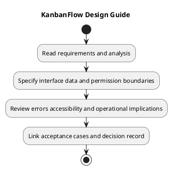

# KanbanFlow Design Guide

## Scope and design

Translate requirements and analysis into interfaces, data boundaries, failure behavior, and verification criteria. Start with an actor and operation, identify the resource chain, then trace UI interaction to authoritative server validation and persistence.

A design package identifies current behavior versus proposed change, affected routes/components/schema, loading/empty/error states, permissions, acceptance criteria, and rollback implications. Include theme and keyboard behavior for interface changes.

Review against requirements, business rules, threat analysis, and the decision register. A rendered diagram is documentation evidence; it does not prove the implemented behavior passes its checks.

## Review and evidence

Record the candidate commit, actor, environment, affected source paths, proposed change, observed checks, and remaining questions. Link implementation and acceptance evidence; keep untested behavior explicit. This document adds no application feature or newly executed security/behavior test.

## Related guidance

- [Design catalog](README.md)
- [Requirements](../02-requirements/README.md)
- [Analysis](../03-analysis/README.md)
- [Decision register](../../Project-Management/decision-register.md)
- [Verification record](../../Releases/verification-template.md)
- [Diagram guide](../../diagram-guide.md)

## PlantUML diagram

[Editable PlantUML source](diagrams/design.puml)

