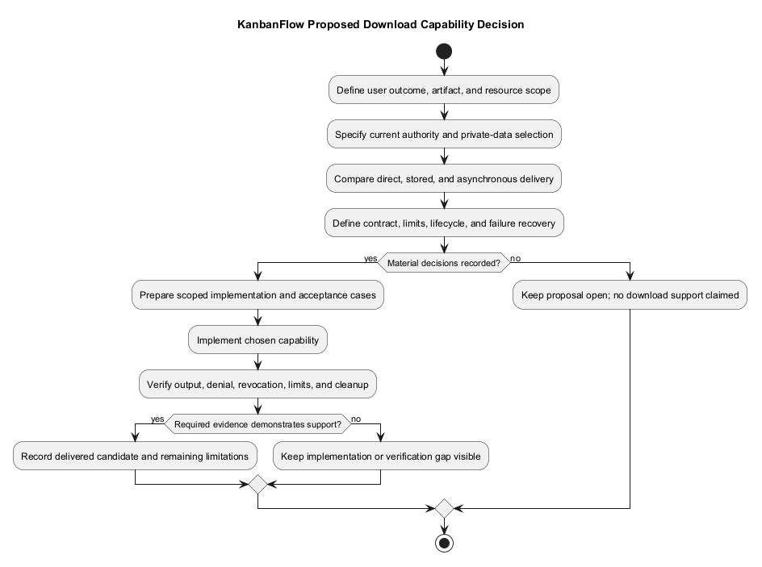
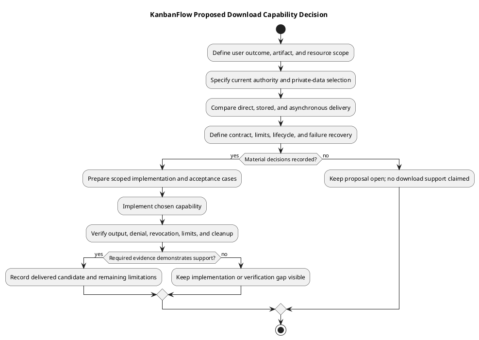

# KanbanFlow Download Decision

## Scope and design

No dedicated file-download or export endpoint is established in the inspected route catalog. This document is a future capability decision boundary. Browser display of task data does not imply permission to export or publish it.

Before adding downloads, decide supported artifact, audience, authorization, private-data filtering, size limits, generation behavior, content type, filename handling, caching, and failure responses. Define how revoked access affects an already generated artifact.

Acceptance must cover authorized export, denied cross-workspace/private export, unavailable resources, generation failures, and cleanup if temporary artifacts are introduced. No download capability is claimed by this document.

## Current status and decision ownership

The inspected application route catalog exposes authenticated resource operations, not a dedicated downloadable artifact contract. TypeScript `export` declarations are module syntax, not data-export functionality. A rendered documentation PNG or browser save operation is not an application download feature.

This guide supplies a decision framework for a proposed KanbanFlow export or attachment download. It selects no format, renderer, storage provider, new endpoint, or delivery mechanism. Record the actual requirement and outcome in the [decision register](../../Project-Management/decision-register.md) before implementing material new boundaries.

## Questions that define the capability

| Decision | Required definition |
| --- | --- |
| User outcome | Who needs the artifact, what task it supports, and why the current UI is insufficient |
| Artifact | Report/export versus stored attachment; format, fields, encoding, layout, and exclusions |
| Scope | Workspace/project/board/task and exact nested resource chain |
| Authority | Which actors may request, generate, and retrieve; whether read access alone is sufficient |
| Snapshot | Data captured at request, generation, or retrieval; how membership/visibility changes are handled |
| Delivery | Direct response versus stored artifact; synchronous versus asynchronous generation |
| Limits | Approved record/byte limits, timeouts, request limits, and concurrency behavior |
| Lifecycle | Storage/expiry/cleanup, failures, revocation, and backup implications |
| Contract | Method/path, payload, result/error shape, content type, disposition, and filename handling |
| Evidence | Positive/negative acceptance scenarios and actual candidate/environment results |

Unknown fields remain open decisions. Do not invent numerical limits, retention periods, signing support, or an approver.

## Alternatives and consequences

| Candidate approach | Consequences to evaluate | Status |
| --- | --- | --- |
| Generate and stream directly | Simpler artifact lifecycle; request duration, partial response, resource bounds, and repeated work need review | Not selected |
| Generate synchronously and store temporarily | Retrieval/cleanup contract required; stale artifacts and failed cleanup create additional privacy boundaries | Not selected |
| Generate asynchronously | Job status, identity/scope propagation, current authority at retrieval, failure/cancellation, and worker operations required | Not selected |
| Retrieve an existing attachment | Requires an approved attachment model/storage feature, owning resource, and current access control | Not established in current application |

Choose according to the agreed artifact and workload rather than introducing queues or storage by default. Existing framework job tables do not establish an export pipeline. An asynchronous design needs explicit evidence for authorization and partial failure across its stages.

## Authorization and data selection

Resolve current identity and ancestry on the server. Define download authority explicitly; possession of a resource identifier, client role value, or earlier authorized page view cannot grant a new request. Preserve current membership and private-board visibility when selecting data, including comments, activities, actor names, and derived aggregates.

For stored artifacts, decide authorization at generation and retrieval and what happens after role/membership/visibility changes or resource deletion. A stored snapshot may contain data no longer visible to its requester. Unpredictable identifiers or signed links, if later proposed, are not a replacement for an agreed access and revocation model.

A downloaded copy already held by a user cannot be recalled by denying future server retrieval. Describe that limitation clearly if the capability is approved. Public sharing is a separate scope decision, not an automatic consequence of enabling authenticated downloads.

## Response, safety, and failure contract

| Concern | Design requirement to specify |
| --- | --- |
| File response | Correct media type, encoding, safe filename/disposition, and an explicit cache policy |
| Untrusted content | Format-specific safe handling; if CSV is chosen, assess spreadsheet formula interpretation; if HTML/PDF is chosen, assess rendering inputs and resource access |
| Resource bounds | Enforce agreed workload limits on the server; large output and repeated generation must have defined outcomes |
| Rejection | Distinguish authentication, denied authority, unavailable resources, invalid filters, and generation failures using the actual chosen endpoint contract |
| Partial delivery | Define client feedback and retry behavior when a transfer fails; do not promise exactly-once generation |
| Stored generation failure | Define orphan metadata/artifact cleanup and its retry/operational handling |
| Logging/evidence | Record useful identifiers/results without credentials, tokens, full private content, or unrestricted artifact links |

The browser needs pending/success/failure feedback and an accessible control with predictable focus behavior. A blob or response beginning to arrive is not proof of a complete usable file. Any binary client handling must be designed alongside the existing JSON-oriented API helpers.

## Lifecycle and recovery

If artifacts are persisted, specify ownership, storage isolation, expiry, cleanup scheduling, failed-cleanup reporting, and deletion/revocation effects. Temporary output and backups have different lifecycles; neither should silently extend access to private content.

Define whether repeated requests reuse or regenerate output and how data changes affect results. If generation creates state, assess duplicate requests and uncertain responses. Source rollback does not remove leaked copies or restore deleted artifacts; provide a capability-specific recovery plan before release.

## Acceptance matrix

| Scenario | Evidence required after implementation |
| --- | --- |
| Authorized artifact | Agreed fields/format, correct scope, complete transfer, and readable/parseable output |
| Cross-workspace or mismatched identifiers | Direct denied request with no unauthorized artifact/data returned |
| Private board filtering | Allowed and denied actors; output and any aggregate/secondary data inspected |
| Removed member/role change | Request and retrieval after change, including stored snapshot behavior if used |
| Deleted/unavailable resource | Actual failure or agreed snapshot behavior without silent resource recreation |
| Empty/large/malformed input | Defined empty output, enforced limits, safe serialization/rendering, and actionable feedback |
| Generation or transfer failure | No falsely reported success; actual persisted artifact/job state and recovery |
| Repeated/concurrent request | Agreed reuse/regeneration semantics and bounded final state |
| Expiry/cleanup failure | Retrieval after expiry and observable cleanup/recovery behavior if storage is used |
| UI/themes/keyboard | Pending/result/error feedback and operation on representative supported views |

Record candidate commit, actual actor/resource/format, environment, checks, results, and remaining gaps using the [verification template](../../Releases/verification-template.md). This matrix is proposed verification, not a fresh runtime test or proof of download support.

## Handoff and related designs

The design is ready for scoped implementation only when artifact, authority, contract, limits, lifecycle, and material decisions are concrete and reviewable. Preserve unresolved choices in the register and backlog instead of marking the capability delivered.

Cross-check [file storage](file-storage-and-update-design.md), [PDF rendering](pdf-rendering-design.md), [private file access](private-file-access-sequence-diagram.md), [public access](public-access-sequence-diagram.md), [request contracts](route-and-request-contracts.md), [error handling](error-handling-design.md), and [data lifecycle](../03-analysis/data-classification-and-lifecycle.md). Update these if an actual capability is implemented.

## Review and evidence

Record the candidate commit, actor, environment, affected source paths, proposed change, observed checks, and remaining questions. Link implementation and acceptance evidence; keep untested behavior explicit. This document adds no application feature or newly executed security/behavior test.

## Related guidance

- [Design catalog](README.md)
- [Requirements](../02-requirements/README.md)
- [Analysis](../03-analysis/README.md)
- [Decision register](../../Project-Management/decision-register.md)
- [Verification record](../../Releases/verification-template.md)
- [Diagram guide](../../diagram-guide.md)

## PlantUML diagram

[Editable PlantUML source](diagrams/download-decision.puml)

