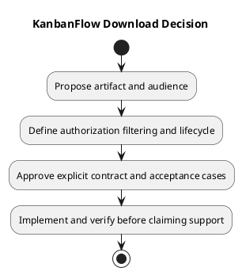

# KanbanFlow Download Decision

## Scope and design

No dedicated file-download or export endpoint is established in the inspected route catalog. This document is a future capability decision boundary. Browser display of task data does not imply permission to export or publish it.

Before adding downloads, decide supported artifact, audience, authorization, private-data filtering, size limits, generation behavior, content type, filename handling, caching, and failure responses. Define how revoked access affects an already generated artifact.

Acceptance must cover authorized export, denied cross-workspace/private export, unavailable resources, generation failures, and cleanup if temporary artifacts are introduced. No download capability is claimed by this document.

## Review and evidence

Record the candidate commit, actor, environment, affected source paths, proposed change, observed checks, and remaining questions. Link implementation and acceptance evidence; keep untested behavior explicit. This document adds no application feature or newly executed security/behavior test.

## Related guidance

- [Design catalog](README.md)
- [Requirements](../02-requirements/README.md)
- [Analysis](../03-analysis/README.md)
- [Decision register](../../Project-Management/decision-register.md)
- [Verification record](../../Releases/verification-template.md)
- [Diagram guide](../../diagram-guide.md)

## PlantUML diagram

[Editable PlantUML source](diagrams/download-decision.puml)

