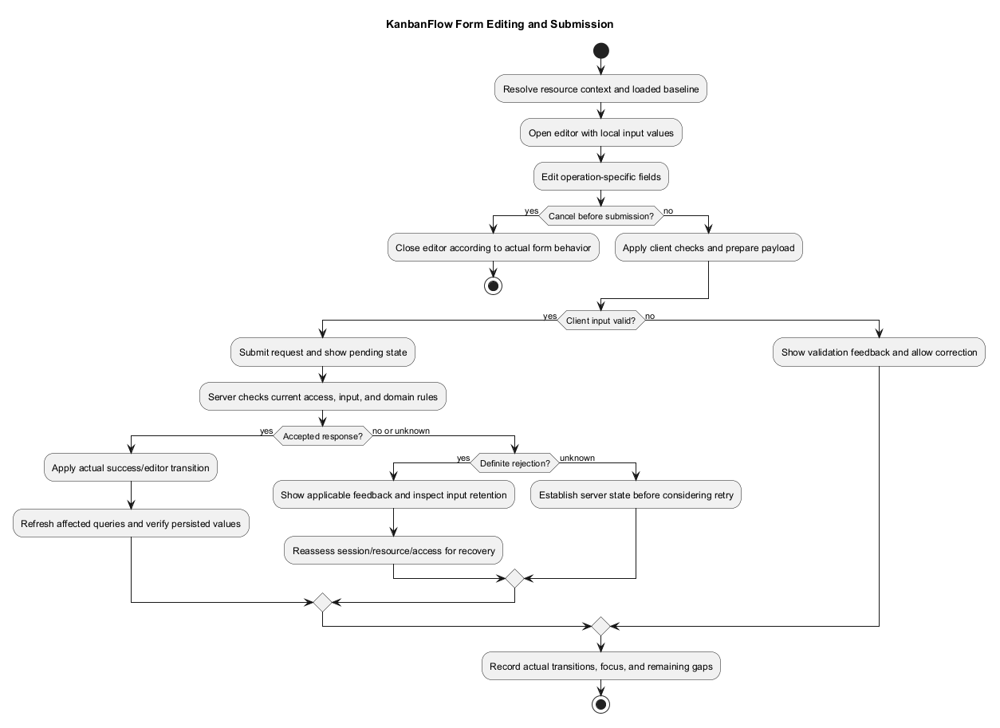
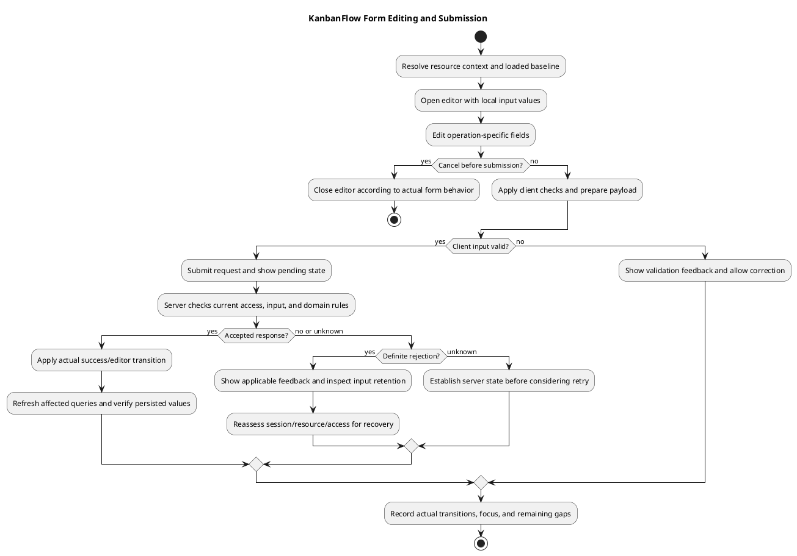

# KanbanFlow Editor Interaction Flow

## Scope and design

Here editor means a KanbanFlow form or task interaction, not a résumé editor. Load current resource data, present editable fields for the applicable operation, validate input, and submit through the existing API.

Account for loading, invalid input, permission failure, cancellation, and uncertain network outcomes. A visible form is not proof of permission to mutate. Re-read authoritative state when a response is uncertain before deciding whether a retry is appropriate.

Assess each actual form for retained values, focus handling, pending submission, and refresh behavior. Automatic drafts, offline editing, and conflict merging are not established. See the analysis editing activity for recovery cases.

## Interaction scope and state ownership

The editor is an operation-specific form or task control assembled by route pages and feature components. The selected resource, its parent identifiers, loaded server values, editable local values, request state, and feedback are separate concerns. Do not treat browser values as persisted data.

The source examples below refer to `frontend/src/features/projects/components/ProjectList.tsx` and `frontend/src/features/tasks/components/TaskList.tsx`. They establish representative behavior, not a uniform guarantee for every form or board interaction.

## Source-observed examples

| Interaction | Current source behavior | Limit |
| --- | --- | --- |
| Open project editing | Sets editing project ID, clears error, and copies name/description/status/dates into local edit state | Loaded query data may be stale; opening the editor is not a fresh server permission check |
| Project client validation | Trims name, requires a nonempty name, and rejects due date before start date when both dates exist | Server validation and authorization remain necessary |
| Project payload | Trims description and converts empty description/dates to null | Document actual API field contracts, not a universal normalization rule |
| Cancel project editing | Clears editing ID and error; no update submission in `cancelEditing` | Closing a form does not guarantee rollback of an already submitted request |
| Project update success | Clears editor/error and invalidates project list and workspace analytics queries | Query invalidation is not proof that every related view is current |
| Task update success | Clears editor/error and invalidates task query, workspace analytics, notifications, and unread count | Other derived queries need their own source/behavior review |
| Update failure in both examples | Handles 403 permission feedback, 401 session feedback, first available validation error, then backend/fallback message | Connection failure and all validation fields are not individually modeled by this generic feedback path |

Mutation retries are disabled in the application query defaults. This does not prevent users from submitting another request manually and does not establish an exactly-once mutation contract.

## Interaction state model

| State | Design and review focus |
| --- | --- |
| Loading/unavailable | Show applicable status or recovery before presenting an assumed editable baseline |
| Viewing | Display persisted/query values and distinguish metadata from editable controls |
| Editing | Identify resource/parent context; track local input and applicable field constraints |
| Client validation failed | Keep actionable feedback; assess input retention, error association, and focus |
| Submitting | Provide pending feedback; inspect actual disabled controls and duplicate submission behavior |
| Accepted | Observe success, editor closure as implemented, query refresh, and authoritative persisted values |
| Rejected | Distinguish input, permission, session, missing resource, and domain-rule failures |
| Outcome uncertain | A timeout/lost response does not prove no server change; inspect current server state before deciding on retry |
| Cancelled/navigation changed | Record actual client retention and server consequences; no automatic draft persistence is established |

Each form must be reviewed for its actual transitions. Do not infer unsaved-change warnings, request abort, draft retention, conflict detection, or merging without source and runtime evidence.

## Submission and server boundary

1. Establish the resource and parent chain and inspect the loaded baseline.
2. Collect operation-specific fields and apply the actual client checks/normalization.
3. Submit through the feature helper with session/XSRF behavior from the configured client.
4. The backend evaluates current identity, ancestry, visibility/authority, validation, and relevant domain rules in its actual endpoint order.
5. On acceptance, refresh the appropriate reads and verify visible and persisted results.
6. On rejection or uncertainty, provide applicable feedback and assess current resource/access state before further action.

For tasks, review assignment, priority/dates/completion, and WIP effects where relevant. Task movement and drag/keyboard controls use their own contract and ordering behavior; saving a text form does not validate those paths. Current membership can change while a form is open, so the server must remain authoritative.

## Recovery and accessibility design

Specify labels, error placement, pending announcements, visible focus, keyboard operation, theme contrast, and layout for each affected form. Assess focus after opening, saving, cancelling, and rejection instead of assuming editor closure restores it correctly.

Keep a distinction between requested improvements and observed behavior. Evaluate whether validation feedback identifies all actionable fields, whether input survives rejected submissions, and whether refreshing/navigation loses unsaved values. If draft retention or dirty-state warnings are needed, create explicit requirements and acceptance cases.

For permission/session changes, do not silently convert a failed save into resource recreation or a broader operation. For uncertain responses, avoid presenting a repeated submission as automatically safe. A source rollback or closing the form cannot reverse a committed database change.

## Acceptance and evidence matrix

| Scenario | Evidence to capture |
| --- | --- |
| Authorized valid edit | Baseline, submitted fields, response, editor transition, refreshed view, and fresh persisted read |
| Invalid project name/date or server validation | Actual feedback, retained input/focus, and rejected persisted change |
| Task assignment/completion/domain rejection | Actual relevant rules and final task/column state |
| Session expires while editing | Submission response and actual login/recovery behavior |
| Membership/role revoked | Previously open editor, denied direct request, returned data, and persisted baseline |
| Resource removed or parent mismatch | Unavailable/denied response and applicable navigation without recreation |
| Cancel before submission | No save request and actual reopen/input behavior |
| Navigate/cancel while request pending | Whether request continues and final persisted/UI outcome; no abort guarantee assumed |
| Connection loss or repeated submission | Established server outcome and actual recovery/duplicate behavior |
| Other actor updates the resource | Actual stale-input outcome; merging/conflict detection not assumed |
| Keyboard/themes/narrow layout | Labels, focus, submission/cancellation, feedback, and readability on representative forms |
| Related data refresh | Relevant lists, analytics, notifications, and ordering reflect the accepted mutation as applicable |

Use isolated records, redact secrets/private content, and record candidate commit, actor, endpoint, environment, steps, observed responses, and persisted values. Source observations above are not fresh browser tests or proof that all acceptance cases pass.

## Handoff and related guidance

Link specific interaction defects to a scoped backlog item with expected transition, source path, and acceptance case. Material changes to draft retention, retry, concurrency, or shared editor behavior need a recorded design decision.

Cross-check [editing activity analysis](../03-analysis/resume-editing-activity.md), [update sequence](resume-update-sequence-diagram.md), [request contracts](route-and-request-contracts.md), [authorization flow](authorization-decision-flow.md), [error handling](error-handling-design.md), and [UI/accessibility](ui-and-accessibility-design.md).

## Review and evidence

Record the candidate commit, actor, environment, affected source paths, proposed change, observed checks, and remaining questions. Link implementation and acceptance evidence; keep untested behavior explicit. This document adds no application feature or newly executed security/behavior test.

## Related guidance

- [Design catalog](README.md)
- [Requirements](../02-requirements/README.md)
- [Analysis](../03-analysis/README.md)
- [Decision register](../../Project-Management/decision-register.md)
- [Verification record](../../Releases/verification-template.md)
- [Diagram guide](../../diagram-guide.md)

## PlantUML diagram

[Editable PlantUML source](diagrams/editor-interaction-flow.puml)

