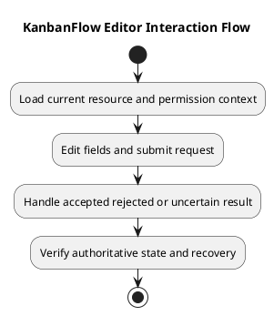

# KanbanFlow Editor Interaction Flow

## Scope and design

Here editor means a KanbanFlow form or task interaction, not a résumé editor. Load current resource data, present editable fields for the applicable operation, validate input, and submit through the existing API.

Account for loading, invalid input, permission failure, cancellation, and uncertain network outcomes. A visible form is not proof of permission to mutate. Re-read authoritative state when a response is uncertain before deciding whether a retry is appropriate.

Assess each actual form for retained values, focus handling, pending submission, and refresh behavior. Automatic drafts, offline editing, and conflict merging are not established. See the analysis editing activity for recovery cases.

## Review and evidence

Record the candidate commit, actor, environment, affected source paths, proposed change, observed checks, and remaining questions. Link implementation and acceptance evidence; keep untested behavior explicit. This document adds no application feature or newly executed security/behavior test.

## Related guidance

- [Design catalog](README.md)
- [Requirements](../02-requirements/README.md)
- [Analysis](../03-analysis/README.md)
- [Decision register](../../Project-Management/decision-register.md)
- [Verification record](../../Releases/verification-template.md)
- [Diagram guide](../../diagram-guide.md)

## PlantUML diagram

[Editable PlantUML source](diagrams/editor-interaction-flow.puml)

