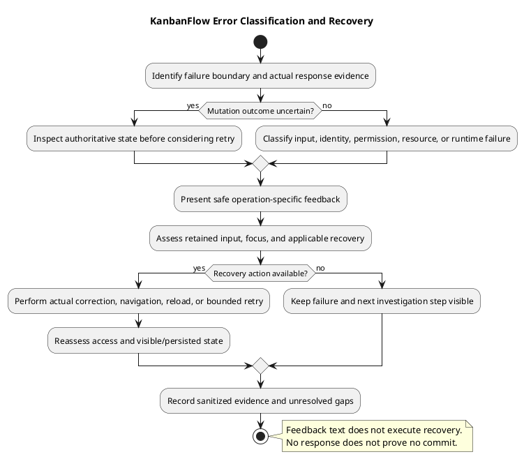

# KanbanFlow Error Handling Design

## Scope and design

Separate field validation, authentication/session failure, authorization denial, unavailable resources, request failure, and unexpected rendering errors. Inspect actual response handling rather than assigning universal status codes without endpoint evidence.

Frontend route content has an ErrorBoundary and a not-found page; auth errors have feature-specific messaging. These do not establish that every API failure has consistent recovery. Preserve actionable context without exposing backend internals or secrets.

Define visible feedback, focus/announcement behavior, retained input, and recovery for affected journeys. If a mutation response is lost, inspect persisted state before retrying. Verify rejected mutations do not leave inconsistent optimistic UI or database state.

## Boundaries and current source behavior

| Boundary/source | Observed behavior | Limitation to retain |
| --- | --- | --- |
| `components/ui/ErrorBoundary.tsx` | React error fallback uses role alert, reload action, and wording that work may still be saved | Does not establish interception of every asynchronous request/event error or preservation of local unsaved input |
| `App.tsx` | Route content is inside the error boundary and Suspense; catch-all renders NotFoundPage | Unmatched frontend route is distinct from missing/denied backend resource |
| NotFoundPage | Provides navigation to dashboard/workspaces | Does not guarantee that destination session/resource access succeeds |
| `features/auth/errorMessage.ts` | No response: server unreachable; 419: session refresh suggestion; 429: wait; 5xx: server problem; otherwise backend message/fallback | This helper is feature-specific; message text does not itself refresh a session, schedule retry, or identify the cause of every no-response error |
| ProtectedRoute | Any current-user query error redirects to login | Connection/server failure is not necessarily an expired session |
| GuestRoute | 401 opens guest form; successful lookup redirects to dashboard; other failures show connection retry | Inspect this separately from protected-route recovery |
| Project/task update handlers | Specific 401/403 feedback, first available validation message, then backend/fallback text | Does not establish full field-level error mapping or consistent treatment across every feature |

Paths above are relative to `frontend/src/` unless stated otherwise. Record the inspected candidate when using source as evidence. Do not describe these separate handlers as a universal error interceptor.

## Error classification and recovery contract

| Failure category | Design expectation | Verification focus |
| --- | --- | --- |
| Client input invalid | Explain the actionable constraint before submission where implemented | Actual request absence, retained input, and accessible feedback |
| Server validation/domain rejection | Distinguish rejected fields/domain rule from access denial | Actual response, input retention, and unchanged/consistent persisted state |
| Unauthenticated request | Follow the actual authentication contract | Session lookup, submitted mutation outcome, and navigation recovery |
| CSRF/session-state failure | Inspect actual token/cookie/session context without exposing secrets | Correct recovery flow; 419 wording alone does not prove credential expiry |
| Unauthorized operation | Safe permission feedback without restricted resource details | Direct denial and no protected mutation/data disclosure |
| Missing or mismatched resource | Appropriate unavailable-resource handling | Actual endpoint code, ancestry, and navigation; no silent recreation |
| Rate limiting | Explain delay and prevent uncontrolled retry behavior | Observed response and effective limiter; suggested wait is not proof of exact retry timing |
| Server failure | Safe feedback and operation-specific recovery | Actual persisted outcome and whether response was sent after any mutation |
| No response/transfer failure | Describe connection uncertainty accurately | Server outcome before retry; no response is not proof that the request was never committed |
| Rendering failure | Provide readable fallback and recovery | Affected subtree, reload consequence, and any committed/unsaved work |

Use observed endpoint codes and contracts. A 401/403/404/419/422/429/5xx classification must be supported for the actual route, not inferred solely from a general category.

## Mutation consistency and retry

Before declaring a failed mutation harmless, distinguish a definite rejection from an uncertain response. Authorization/validation failures should be checked for absence of protected/invalid change; transaction/domain failures require final-state inspection. A timeout or rendering crash can occur after a server commit.

The application query defaults disable mutation retries; individual read-query behavior can differ. This does not establish exactly-once mutation semantics or make manual resubmission automatically safe. Establish current persisted state before choosing retry/reconciliation where the outcome is unknown.

Review any optimistic or local movement state for rollback/refetch after rejection. Include ordering, WIP, analytics, activities, and notification state where relevant. Closing an editor, reloading, or reverting source does not undo a committed database change.

## Feedback and accessibility requirements

For each affected journey, specify where feedback appears, the recovery action, whether input remains, and focus behavior. Use plain operation-specific wording; avoid implying that access was granted, data was saved, or recovery completed when that result is unknown.

Review label/error associations, appropriate announcements, keyboard access to recovery controls, visible focus, narrow layouts, and light/dark/system readability. Existing role alert/status markup is source evidence, not a complete accessibility assessment.

Backend message passthrough exists in several helpers. Review those messages for private content and operational detail. Do not expose stack traces, credentials, cookies, tokens, unrestricted artifact URLs, or private task text through user feedback or shared evidence.

## Logging and investigation record

Record candidate commit, environment, actor role, endpoint/method, resource scope, reproduction steps, response/status when present, visible feedback, and final persisted state. Include sanitized request/correlation identifiers only where actually available; do not invent central telemetry or correlation-ID infrastructure.

Application activity logging is not a universal technical error log. Distinguish domain activity, runtime diagnostics, and verification evidence, and inspect actual logging paths before claiming coverage. Redact sensitive values and retain only what is necessary to reproduce the issue.

## Acceptance matrix

| Scenario | Required observations |
| --- | --- |
| Invalid input | Client/server error path, retained values, field/actionable feedback, and persisted baseline |
| Denied actor/removed member | Direct denial, safe output, applicable navigation, and no unauthorized mutation |
| Session/CSRF state changes | Actual request result and recovery; no assumed automatic refresh |
| Missing resource or nested mismatch | Endpoint failure and frontend recovery without resource recreation |
| Backend unavailable at session lookup | ProtectedRoute and GuestRoute behavior recorded separately |
| Login throttle/server failure | Helper feedback and actual response; retry behavior checked rather than assumed |
| Response lost after submission | Authoritative outcome established before repeated operation |
| Render fallback | Readable fallback, working reload, and observed unsaved/persisted-state consequences |
| Query refresh fails after accepted mutation | Saved server values versus stale/error UI; no false report that the mutation was rejected |
| Keyboard/themes/layout | Focus, announcements, recovery operation, and readable feedback |

Use isolated data and [verification records](../../Releases/verification-template.md). These are criteria and source observations, not newly executed runtime tests. Report actual results and unresolved gaps rather than claiming uniform recovery.

## Handoff and maintenance

For a concrete failure, create a scoped reproduction and acceptance case before changing shared handlers. Review effects on auth navigation, form retention, query refresh, and server message contracts. Do not replace one error message with a new implied capability.

Cross-check [authentication](authentication-and-authorization.md), [authorization flow](authorization-decision-flow.md), [editor interactions](editor-interaction-flow.md), [request contracts](route-and-request-contracts.md), and [UI/accessibility](ui-and-accessibility-design.md). Revisit this guide when those contracts or shared error components change.

## Review and evidence

Record the candidate commit, actor, environment, affected source paths, proposed change, observed checks, and remaining questions. Link implementation and acceptance evidence; keep untested behavior explicit. This document adds no application feature or newly executed security/behavior test.

## Related guidance

- [Design catalog](README.md)
- [Requirements](../02-requirements/README.md)
- [Analysis](../03-analysis/README.md)
- [Decision register](../../Project-Management/decision-register.md)
- [Verification record](../../Releases/verification-template.md)
- [Diagram guide](../../diagram-guide.md)

## PlantUML diagram

[Editable PlantUML source](diagrams/error-handling-design.puml)

