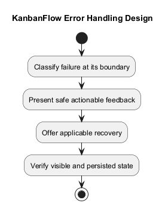
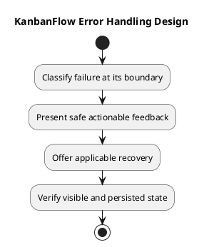

# KanbanFlow Error Handling Design

## Scope and design

Separate field validation, authentication/session failure, authorization denial, unavailable resources, request failure, and unexpected rendering errors. Inspect actual response handling rather than assigning universal status codes without endpoint evidence.

Frontend route content has an ErrorBoundary and a not-found page; auth errors have feature-specific messaging. These do not establish that every API failure has consistent recovery. Preserve actionable context without exposing backend internals or secrets.

Define visible feedback, focus/announcement behavior, retained input, and recovery for affected journeys. If a mutation response is lost, inspect persisted state before retrying. Verify rejected mutations do not leave inconsistent optimistic UI or database state.

## Review and evidence

Record the candidate commit, actor, environment, affected source paths, proposed change, observed checks, and remaining questions. Link implementation and acceptance evidence; keep untested behavior explicit. This document adds no application feature or newly executed security/behavior test.

## Related guidance

- [Design catalog](README.md)
- [Requirements](../02-requirements/README.md)
- [Analysis](../03-analysis/README.md)
- [Decision register](../../Project-Management/decision-register.md)
- [Verification record](../../Releases/verification-template.md)
- [Diagram guide](../../diagram-guide.md)

## PlantUML diagram

[Editable PlantUML source](diagrams/error-handling-design.puml)

