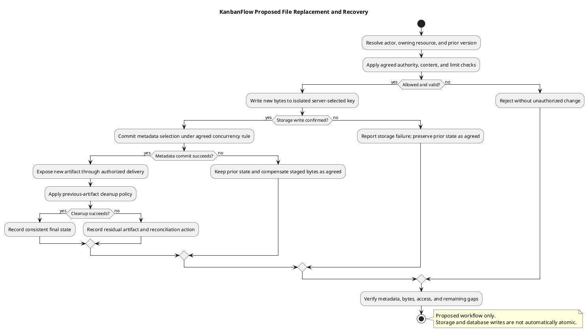

# KanbanFlow File Storage and Update Design

## Scope and design

No attachment upload/storage workflow is established for the current application. Persisted task text and application source files are not an attachment service. This is a proposed design topic, not an implemented storage contract.

Before introducing files, decide ownership, allowed types/sizes, validation, storage isolation, access checks, replacement semantics, retention, deletion, and backup behavior. Avoid deriving private-file access from a predictable storage URL.

Specify failure handling when metadata succeeds but storage fails, or replacement cleanup fails. Verify denied upload/read/delete cases, resource revocation, and recovery using isolated artifacts if the feature is approved.

## Current source and capability boundary

`backend/config/filesystems.php` provides a default disk selected by `FILESYSTEM_DISK` (local fallback), a local private root, a public disk/storage-link configuration, and an S3 disk configuration. These are framework facilities, not evidence of a configured cloud bucket, public link, or authorized attachment workflow.

The workspace migration/model contains nullable `logo_path`. The inspected routes/controllers do not establish an upload/replace endpoint for it. Do not interpret a path field as validation, lifecycle, or file-delivery support. The current database hierarchy has no attachment entity in the inspected application migrations.

This document proposes design requirements if file support is scoped later. It selects no provider, route, size/type allowlist, retention period, signed-link contract, scanner, or cleanup worker. Record material choices in the [decision register](../../Project-Management/decision-register.md).

## Ownership and metadata decisions

| Decision | Required specification |
| --- | --- |
| Artifact purpose | Workspace logo, task attachment, generated export, or other explicitly scoped artifact |
| Owning resource | Workspace/project/board/task relationship and required ancestry |
| Actors | Who may upload, retrieve, replace, delete, and administer the artifact |
| Metadata | Stable identifier, owner relation, storage key/disk, display name, type, byte size, and any agreed integrity/version fields |
| Source of truth | Which fields are server-derived and how metadata/storage disagreement is reconciled |
| Replacement | New artifact versus new version; expected prior version and concurrency rule |
| Lifecycle | Temporary, active, replaced, deleted, and cleanup-failed states as needed |
| Operational policy | Capacity/quota, backup, retention/expiry, cleanup, and recovery evidence |

These fields and states are candidates, not a proposed migration already approved. Define minimal metadata from the requirement rather than treating every candidate field as mandatory.

## Storage and retrieval boundary

Compare local/private storage, object storage, and public delivery against the agreed artifact, environment, and access rules. A public disk URL can bypass application authorization; private artifacts require a delivery design that preserves current resource visibility.

Resolve current session and resource ancestry for upload/replacement/deletion and retrieval. Specify whether artifact permission follows board read authority or requires a separate operation rule. A user-provided key/path, earlier page access, or unpredictable identifier is not authority.

If temporary/signed retrieval is proposed, define expiry and revocation limitations and verify the actual storage/delivery contract. The local disk's `serve` option does not establish the application's ownership policy. Files already downloaded by an authorized user cannot be recalled by later server denial.

## Upload and content handling

Define allowed formats, size/count/quota limits, safe display names, server-generated storage keys, and content verification appropriate to the artifact. Do not trust filename extensions or client media types alone. Prevent user-supplied paths from selecting arbitrary storage locations.

Decide how untrusted content is stored and served, whether inline rendering is permitted, and whether additional scanning or transformation is required. Those capabilities are not currently established. For generated PDFs or spreadsheet exports, use their format-specific safety design rather than treating them as generic uploads.

The configured disks use `throw: false` and `report: false`. A future implementation must inspect actual storage-operation success/failure semantics instead of assuming failures throw or are automatically reported. Do not record credentials, storage secrets, private file contents, or unrestricted links in shared evidence.

## Proposed replacement workflow

1. Resolve actor, owning resource, current authority, and the applicable prior version.
2. Validate the new artifact and agreed workload limits.
3. Write the replacement to an isolated server-selected key; confirm the storage operation succeeded.
4. Commit metadata selection using the agreed concurrency/transaction approach. Storage writes and relational database transactions are not automatically one atomic operation.
5. Make the new artifact available only under the selected delivery/access contract.
6. Remove or expire the previous/staged artifacts according to the agreed lifecycle; record failures and reconciliation work.

Prefer preserving a usable prior artifact until replacement succeeds if that is the agreed requirement. Do not claim this workflow is implemented, universally atomic, or supported by distributed transactions. Decide failure compensation and concurrent-replacement behavior explicitly.

## Failure and reconciliation matrix

| Failure | Required design outcome |
| --- | --- |
| Input/authority rejection | No unauthorized write or metadata switch; actionable safe feedback |
| New storage write fails | Keep valid prior metadata/artifact where applicable; report actual failure |
| Storage succeeds, metadata commit fails | Staged orphan is tracked/cleaned under the agreed compensation rule |
| Metadata references missing bytes | Safe unavailable response and observable reconciliation; do not silently report a usable artifact |
| Prior artifact cleanup fails | New state and residual storage exposure remain explicit; retry/operational handling defined |
| Concurrent replacements | Agreed winner/conflict behavior; no accidental deletion of the currently selected artifact |
| Access/resource changes during processing | Reassess applicable authority before publishing/retrieval; avoid orphan private artifacts |
| Response lost | Establish metadata/storage outcome before retry; no exactly-once guarantee assumed |
| Capacity/provider outage | Bounded failure and recovery, without leaking operational secrets |

Define who investigates cleanup/reconciliation failures using an actual assigned role when agreed. Framework job infrastructure alone does not establish a scheduled cleanup service.

## Deletion, backup, and recovery

Database soft deletion does not automatically remove storage bytes. Define how owning-resource soft/physical deletion affects access, metadata, current versions, temporary artifacts, and backups. Physical foreign-key cascades do not implement storage cleanup by themselves.

Choose retention and backup consistency for metadata and bytes together. Restore verification must establish that records resolve to the correct artifacts and that authorization remains intact. Source rollback does not recover deleted bytes, purge copies, or reconcile orphan metadata.

If a public artifact or export is introduced, treat publishing and private-to-public transitions as explicit decisions. Do not infer public sharing from a filesystem configuration or from download support.

## Acceptance matrix

| Scenario | Evidence required after implementation |
| --- | --- |
| Authorized upload/retrieve | Agreed metadata, confirmed bytes, usable output, and correct owning scope |
| Invalid content/path/limits | Safe rejection and absence of unauthorized storage/metadata change |
| Cross-resource/private access | Direct denied retrieval/mutation for mismatched or restricted resources |
| Removed member/role change | Actual access revocation and processing/retrieval behavior |
| Successful replacement | Correct selected artifact and observed prior-version lifecycle |
| Storage or metadata failure | Actual final state, preserved prior usability where agreed, and compensation evidence |
| Concurrent replacement | Agreed conflict/winner behavior and no deletion of selected bytes |
| Cleanup/expiry/deletion | Access, metadata, bytes, and residual failures checked separately |
| Backup restoration | Restored metadata/bytes consistency and authorization behavior |
| Client pending/error/retry | Accessible feedback and actual outcome established for uncertain requests |

Use isolated artifacts and [verification records](../../Releases/verification-template.md). Record candidate, environment/provider, actor, resource, operation, sanitized identifiers, metadata/byte results, and remaining gaps. These are proposed checks, not newly executed storage tests.

## Handoff and related designs

Before implementation, make artifact ownership, authority, storage choice, validation, replacement concurrency, cleanup, and recovery concrete and reviewable. Keep unanswered choices visible rather than reporting attachment support as delivered.

Cross-check [download decisions](download-decision.md), [private file access](private-file-access-sequence-diagram.md), [PDF rendering](pdf-rendering-design.md), [schema](schema-reference.md), [error handling](error-handling-design.md), and [data lifecycle](../03-analysis/data-classification-and-lifecycle.md). Update these when a real file capability is implemented.

## Review and evidence

Record the candidate commit, actor, environment, affected source paths, proposed change, observed checks, and remaining questions. Link implementation and acceptance evidence; keep untested behavior explicit. This document adds no application feature or newly executed security/behavior test.

## Related guidance

- [Design catalog](README.md)
- [Requirements](../02-requirements/README.md)
- [Analysis](../03-analysis/README.md)
- [Decision register](../../Project-Management/decision-register.md)
- [Verification record](../../Releases/verification-template.md)
- [Diagram guide](../../diagram-guide.md)

## PlantUML diagram

[Editable PlantUML source](diagrams/file-storage-and-update-design.puml)

