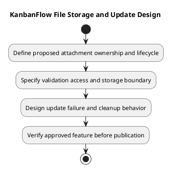

# KanbanFlow File Storage and Update Design

## Scope and design

No attachment upload/storage workflow is established for the current application. Persisted task text and application source files are not an attachment service. This is a proposed design topic, not an implemented storage contract.

Before introducing files, decide ownership, allowed types/sizes, validation, storage isolation, access checks, replacement semantics, retention, deletion, and backup behavior. Avoid deriving private-file access from a predictable storage URL.

Specify failure handling when metadata succeeds but storage fails, or replacement cleanup fails. Verify denied upload/read/delete cases, resource revocation, and recovery using isolated artifacts if the feature is approved.

## Review and evidence

Record the candidate commit, actor, environment, affected source paths, proposed change, observed checks, and remaining questions. Link implementation and acceptance evidence; keep untested behavior explicit. This document adds no application feature or newly executed security/behavior test.

## Related guidance

- [Design catalog](README.md)
- [Requirements](../02-requirements/README.md)
- [Analysis](../03-analysis/README.md)
- [Decision register](../../Project-Management/decision-register.md)
- [Verification record](../../Releases/verification-template.md)
- [Diagram guide](../../diagram-guide.md)

## PlantUML diagram

[Editable PlantUML source](diagrams/file-storage-and-update-design.puml)

