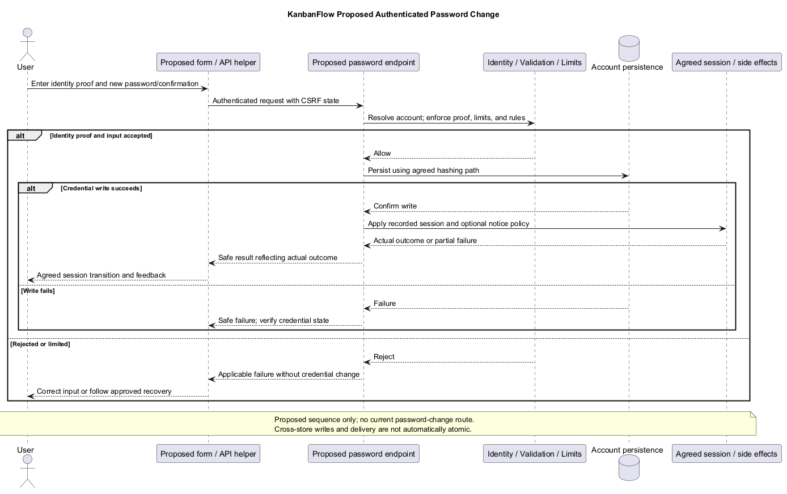
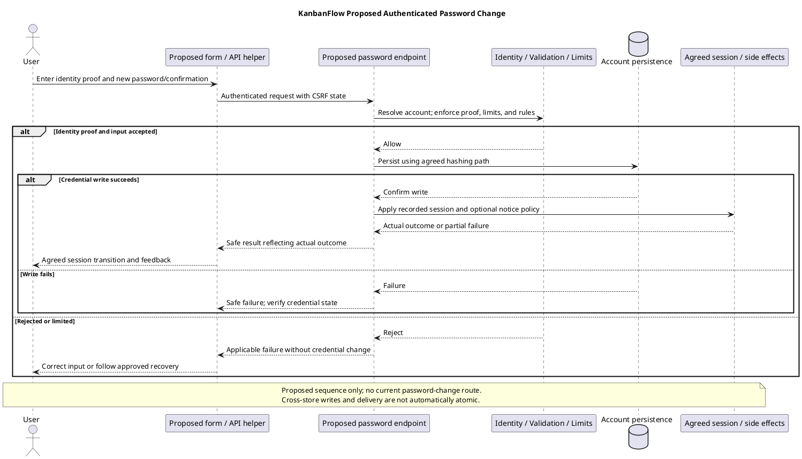

# KanbanFlow Password Change Sequence

## Scope and design

The inspected web routes provide registration, login, and logout; no password-change endpoint is established. Do not present a proposed sequence as existing functionality or claim forgotten-password recovery is available.

An approved design must specify authenticated versus recovery flows, identity verification, password validation, session consequences, CSRF/rate-limit controls, notification policy, and safe errors. Do not put real credentials into examples or evidence.

Verify successful change, incorrect proof of identity, invalid input, expired session, and session behavior after change against the chosen policy. Adding this document does not authorize a production account reset.

## Existing support and proposed scope

`backend/routes/web.php` exposes register/login/logout. `User` hides password and remember_token from serialization and casts password as hashed. Registration explicitly hashes the password. These facilities do not establish a password-change route, recovery delivery, session-revocation contract, or account settings page.

This document models a proposed authenticated self-service change. Forgotten-password recovery, administrative reset, MFA, and compromised-account recovery are separate requirements. A workspace owner or manager is not automatically authorized to change another user's account password.

No method/path, rate limit, approver, notification channel, or session invalidation policy is selected here. Record actual choices in the [decision register](../../Project-Management/decision-register.md) before implementation. Do not reuse registration validation as an assumed complete change-password policy.

## Required contract decisions

| Decision | Required definition |
| --- | --- |
| Actor and target | Authenticated account changing its own credential; derive target identity on the server |
| Identity proof | Agreed current-password/reauthentication requirement and behavior if proof fails |
| Input | Current proof, new password, confirmation, and agreed password rules; server enforcement |
| Endpoint | Actual method/path, session/CSRF middleware, response shape, and safe failure contract |
| Abuse controls | Dedicated effective limits and repeated-attempt behavior; login limits are not automatically applied here |
| Current session | Preserve, regenerate, or require sign-in according to an explicit policy |
| Other sessions | Whether/how to revoke sessions and persistent remember state; choose implementable mechanism |
| Tokens | Assess only actually issued tokens; Sanctum trait/table presence does not prove an exposed token workflow |
| Notifications | Whether a change notice is required, recipient/channel, and failure consequences |
| Concurrent changes | Conflict/serialization behavior and proof freshness |

Unknowns remain unresolved rather than being converted into assumed defaults. Define recovery when the actor cannot provide the required identity proof separately from this authenticated flow.

## Proposed sequence and invariant

1. Present the approved password-change form without displaying stored password material.
2. Submit the agreed fields through the configured authenticated/CSRF-protected client contract.
3. Resolve the server-side account identity and enforce the selected abuse controls and identity proof.
4. Validate the new password/confirmation against the agreed rule. Do not persist a plaintext credential.
5. Persist the credential using the chosen hashing path; verify its behavior rather than inventing a hash algorithm or changing model casting blindly.
6. Apply the recorded session/remember/token consequences and any approved notification behavior.
7. Return a safe result and transition the UI according to the actual resulting session state.

Rejected identity proof or invalid input must not change the credential. A successful password write does not prove that all other sessions were revoked or that notification delivery succeeded; verify those consequences separately. The sequence is conceptual and not current functionality.

## Failure and partial-success handling

| Outcome | Design requirement |
| --- | --- |
| Session unavailable | Actual authentication recovery; do not accept a client-supplied target account as a substitute |
| Invalid CSRF state | Applicable safe failure/recovery; message text alone does not refresh the token |
| Identity proof incorrect | Reject without credential/session changes beyond the agreed attempt policy |
| Password/confirmation invalid | Actionable input feedback with no persisted credential change |
| Rate limit reached | Defined delay/retry behavior without exposing credential validity |
| Credential write fails | Safe feedback and verified original credential state |
| Session revocation or notification fails after write | Record partial outcome; do not report that the password is unchanged without evidence |
| Response lost | Establish outcome through the agreed sign-in/session recovery process; do not blindly retry with stale identity proof |
| Concurrent request | Agreed final credential and session state; avoid claiming exactly-once execution |

Do not promise one atomic transaction across database writes, session stores, and external delivery. Define compensation or partial-success reporting according to actual storage/delivery choices. Source rollback does not restore an earlier credential or recall delivered notices.

## User interaction and evidence privacy

Specify labelled password fields, confirmation/proof feedback, pending actions, keyboard/focus behavior, and supported theme readability. If a show/hide control is provided, review its label/state and keyboard behavior. Define when sensitive field values are cleared; no autosaved password draft is implied.

Do not return hashes or credentials in responses, logs, analytics, screenshots, or test records. Capture sanitized result metadata and account identifiers only as needed. Backend message passthrough must not disclose account internals. A local demo credential or manual account repair is not evidence of a password-change UI.

## Acceptance matrix

| Scenario | Evidence required after implementation |
| --- | --- |
| Successful self-service change | Actual response, new credential authentication, old credential rejection, and intended session consequences |
| Wrong proof of identity | Rejection and unchanged credential; applicable attempt handling |
| Invalid new password/confirmation | Agreed validation and no mutation |
| Expired session/missing CSRF | Actual denied request and accessible recovery |
| Attempt to target another account | Server-derived identity and absence of cross-account mutation |
| Rate limit | Bounded isolated attempts and observed effective limit/feedback |
| Current/other/remember sessions | Each consequence checked separately against the recorded policy |
| Issued tokens, if applicable | Actual token inventory and agreed revocation behavior; no token feature assumed |
| Write/side-effect failure | Final credential/session state and explicit partial-success handling |
| Concurrent/lost-response cases | Agreed final state and usable recovery without blind resubmission |
| Notification, if approved | Actual delivery/channel outcome and failure handling |
| UI and serialization | Keyboard/focus/themes, sensitive-value handling, and absence of secret output |

Use isolated accounts and [verification records](../../Releases/verification-template.md). Record candidate/environment, actor, sanitized scenario, response, authentication/session observations, and remaining gaps. No password-change implementation or new runtime tests are delivered by this document.

## Handoff and related designs

Scope implementation only after identity proof, password rules, session consequences, endpoint, limits, failure contract, and acceptance cases are concrete. Keep unapproved recovery or notification features out of delivery claims.

Cross-check [authentication](authentication-and-authorization.md), [request contracts](route-and-request-contracts.md), [error handling](error-handling-design.md), [UI/accessibility](ui-and-accessibility-design.md), and [security requirements](../02-requirements/security-and-privacy-requirements.md). Revisit the sequence when those boundaries or actual account capabilities change.

## Review and evidence

Record the candidate commit, actor, environment, affected source paths, proposed change, observed checks, and remaining questions. Link implementation and acceptance evidence; keep untested behavior explicit. This document adds no application feature or newly executed security/behavior test.

## Related guidance

- [Design catalog](README.md)
- [Requirements](../02-requirements/README.md)
- [Analysis](../03-analysis/README.md)
- [Decision register](../../Project-Management/decision-register.md)
- [Verification record](../../Releases/verification-template.md)
- [Diagram guide](../../diagram-guide.md)

## PlantUML diagram

[Editable PlantUML source](diagrams/password-change-sequence-diagram.puml)

