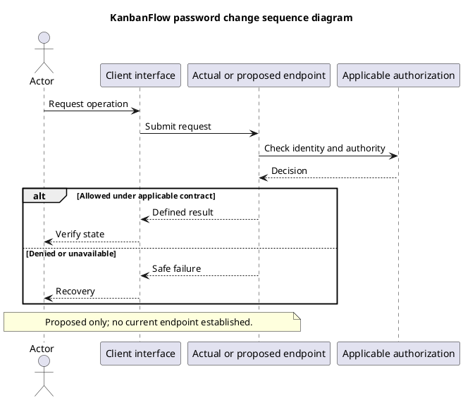

# KanbanFlow Password Change Sequence

## Scope and design

The inspected web routes provide registration, login, and logout; no password-change endpoint is established. Do not present a proposed sequence as existing functionality or claim forgotten-password recovery is available.

An approved design must specify authenticated versus recovery flows, identity verification, password validation, session consequences, CSRF/rate-limit controls, notification policy, and safe errors. Do not put real credentials into examples or evidence.

Verify successful change, incorrect proof of identity, invalid input, expired session, and session behavior after change against the chosen policy. Adding this document does not authorize a production account reset.

## Review and evidence

Record the candidate commit, actor, environment, affected source paths, proposed change, observed checks, and remaining questions. Link implementation and acceptance evidence; keep untested behavior explicit. This document adds no application feature or newly executed security/behavior test.

## Related guidance

- [Design catalog](README.md)
- [Requirements](../02-requirements/README.md)
- [Analysis](../03-analysis/README.md)
- [Decision register](../../Project-Management/decision-register.md)
- [Verification record](../../Releases/verification-template.md)
- [Diagram guide](../../diagram-guide.md)

## PlantUML diagram

[Editable PlantUML source](diagrams/password-change-sequence-diagram.puml)

