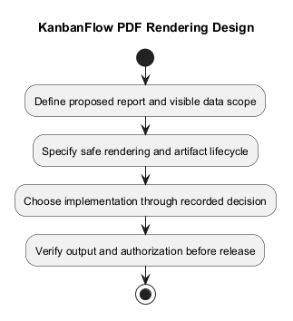
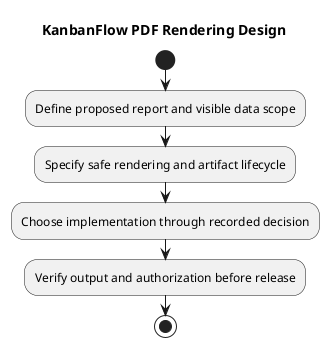

# KanbanFlow PDF Rendering Design

## Scope and design

No server PDF rendering or résumé export feature is established. This retained topic documents a possible KanbanFlow reporting/export extension. No renderer, job pipeline, or template is selected here.

Define report purpose and fields, authorization/private-board filtering, pagination, layout, fonts, resource bounds, generated-file lifecycle, and safe rendering inputs before choosing a renderer. Export must preserve the applicable visibility rules.

If approved, verify representative large/empty reports, private-data exclusion, malformed content, rendering errors, and download authorization. A browser screenshot or PlantUML PNG is not evidence of application PDF support.

## Review and evidence

Record the candidate commit, actor, environment, affected source paths, proposed change, observed checks, and remaining questions. Link implementation and acceptance evidence; keep untested behavior explicit. This document adds no application feature or newly executed security/behavior test.

## Related guidance

- [Design catalog](README.md)
- [Requirements](../02-requirements/README.md)
- [Analysis](../03-analysis/README.md)
- [Decision register](../../Project-Management/decision-register.md)
- [Verification record](../../Releases/verification-template.md)
- [Diagram guide](../../diagram-guide.md)

## PlantUML diagram

[Editable PlantUML source](diagrams/pdf-rendering-design.puml)

