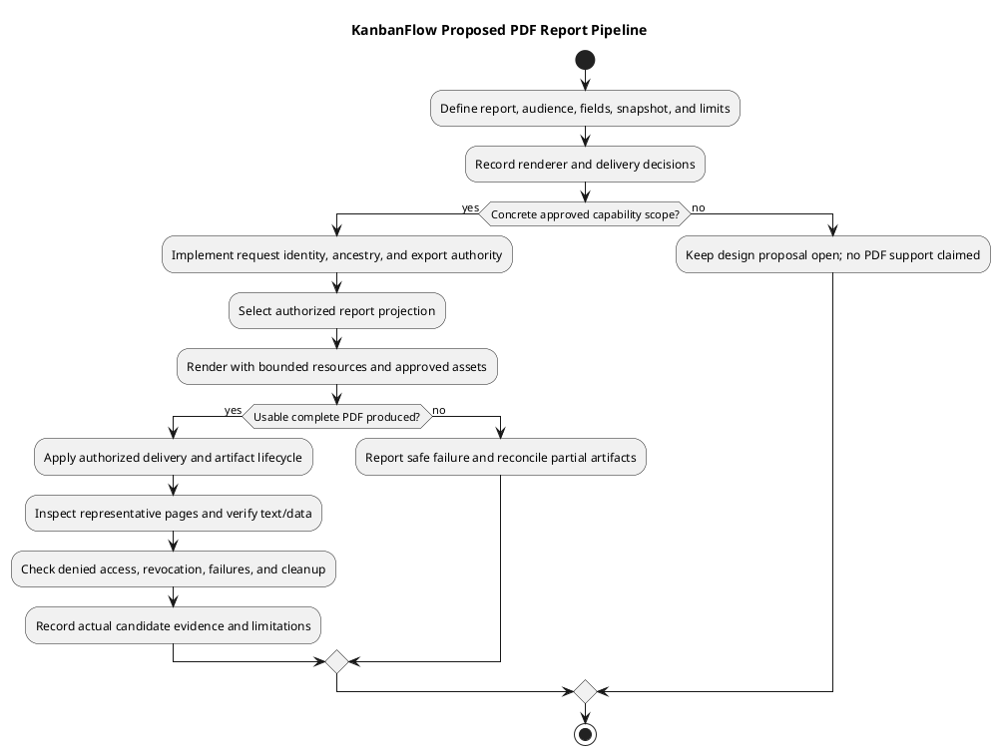

# KanbanFlow PDF Rendering Design

## Scope and design

No server PDF rendering or résumé export feature is established. This retained topic documents a possible KanbanFlow reporting/export extension. No renderer, job pipeline, or template is selected here.

Define report purpose and fields, authorization/private-board filtering, pagination, layout, fonts, resource bounds, generated-file lifecycle, and safe rendering inputs before choosing a renderer. Export must preserve the applicable visibility rules.

If approved, verify representative large/empty reports, private-data exclusion, malformed content, rendering errors, and download authorization. A browser screenshot or PlantUML PNG is not evidence of application PDF support.

## Current support and scope

The inspected backend dependency manifest declares Laravel/Sanctum and no selected application PDF renderer. The application route catalog does not establish a PDF-generation/download endpoint. Framework queue infrastructure, browser printing, and documentation diagrams do not constitute an implemented reporting pipeline.

This design concerns a proposed KanbanFlow report, not a resume/CV artifact. It selects no library, browser runtime, external service, template, route, storage provider, or scheduled job. Record an actual requirement and material choices in the [decision register](../../Project-Management/decision-register.md) before implementation.

## Report contract and content

| Decision | Required definition |
| --- | --- |
| Purpose and audience | The user task served by the report and its authorized recipients |
| Resource scope | Workspace/project/board/task hierarchy and selected filters |
| Fields | Exact titles, dates, statuses, task details, actor data, comments, and aggregates included or excluded |
| Snapshot | Data captured at request/generation/retrieval and behavior during changes |
| Presentation | Page size, orientation, margins, section order, tables, headers/footers, and pagination |
| Locale | Date/time interpretation, language, Unicode text, and required fonts |
| Delivery | Direct versus stored download and synchronous versus asynchronous generation |
| Limits | Approved record/byte/time/concurrency limits and oversized-report behavior |
| Lifecycle | Expiry, cleanup, revocation, backup, and generation failure outcomes |
| Accessibility | Intended document structure/read order and any actual tagged-PDF requirement |

Do not invent output limits, retention periods, accessibility certification, or a selected template. Define handling of empty datasets and unavailable resources explicitly rather than equating both with a blank successful report.

## Authorization and data projection

Resolve current identity, requested ancestry, and agreed export authority before collecting report data. Apply current membership and private-board visibility to every included detail, aggregate, activity, and actor field. Reading one visible board does not authorize a workspace-wide export.

Build a deliberate report projection of authorized fields rather than serializing entire database models into a template. Avoid credentials, tokens, internal configuration, and unrelated private metadata. Record whether the output includes historical activity data and what lifecycle rules apply to it.

For delayed/stored generation, decide access at request, generation, and retrieval and how revocation/deletion affects snapshots. A stored PDF is a copy of potentially sensitive data; signing or obscuring a URL, if later proposed, does not establish the agreed authorization model. Copies already downloaded cannot be recalled by later retrieval denial.

## Renderer alternatives and operational consequences

| Candidate approach | Questions to evaluate | Status |
| --- | --- | --- |
| Server library with explicit layout | Unicode/font support, table/pagination behavior, dependency/runtime compatibility, and document structure | Not selected |
| HTML-to-PDF rendering | Supported CSS, deterministic fonts/assets, untrusted markup, network/filesystem isolation, process limits, and runtime deployment | Not selected |
| Browser print-oriented view | Authorized data selection, print styles, output differences, and whether this satisfies the requirement for a downloadable artifact | Not selected |
| External rendering service | Data exposure, credentials, availability, cost, cleanup, and an explicit service boundary | Not selected or authorized |

Compare options against the same report and environment; use a representative prototype if needed. Do not claim renderer performance, current version support, or compatibility without dated evidence. No dependency installation or external data transfer is introduced by this documentation change.

## Layout and content handling

Design for long titles, multiline descriptions, Unicode, missing optional values, long tables, and page boundaries. Specify whether rows split across pages, how repeated headers appear, and how empty sections are represented. Avoid silent truncation of required fields.

If HTML-based rendering is chosen, escape untrusted content and define whether rich content is permitted. Restrict renderer-controlled resource access according to the chosen mechanism; user-controlled URLs or paths must not select arbitrary internal resources. Fonts/images need explicit packaging and licensing/usage decisions where relevant; none is selected here.

PDF generation success does not prove readable layout, correct text encoding, or accessible document structure. Define visual and text checks for the actual report. A screenshot-only check cannot establish tagged reading order or all accessibility requirements.

## Generation, delivery, and failure model

| Stage | Required design contract |
| --- | --- |
| Request | Current identity/scope, validated filters, agreed limits, and safe errors |
| Data selection | Authorized projection and defined snapshot consistency |
| Rendering | Bounded resources, explicit runtime/assets, and observable failure |
| Artifact handling | Correct bytes/media type, safe filename, private storage/delivery, and explicit cache policy |
| Completion | Report complete only after output is usable under the delivery contract |
| Cleanup | Temporary/stored artifact lifecycle and observable residual failures |

If asynchronous generation is chosen, define job status, retries, identity/scope propagation, cancellation, concurrency, and current retrieval access. A queue table or development queue command does not prove those contracts exist.

If rendering/storage succeeds but metadata or delivery fails, define compensation and partial-success feedback. Cross-store operations are not automatically atomic. A lost response does not prove no artifact was generated; repeated requests need agreed reuse/regeneration behavior. Source rollback does not remove leaked PDFs or recover deleted artifacts.

## Acceptance and visual verification

| Scenario | Evidence required after implementation |
| --- | --- |
| Authorized baseline | Correct scope/fields, usable PDF bytes, complete transfer, and agreement with source data |
| Private/cross-resource data | Allowed/denied actors, filters, aggregates, and stored retrieval checked for leakage |
| Revoked access or resource deletion | Actual request/generation/retrieval behavior against the snapshot policy |
| Empty and large report | Agreed empty output, enforced workload limits, and pagination without missing required content |
| Long/Unicode/multiline content | Correct glyphs, wrapping, page breaks, dates, and readable tables |
| Untrusted input/resource reference | Safe content handling and renderer access restrictions where applicable |
| Render/storage/transfer failure | Safe feedback, actual artifact/metadata state, and compensation/cleanup |
| Repeated/concurrent generation | Agreed reuse/regeneration and bounded final state |
| Expiry and cleanup | Artifact access, residual bytes, and observed recovery failures |
| Accessibility requirement | Actual text structure/read-order/tag checks required by the agreed scope; no certification assumed |
| UI download interaction | Pending/error/result feedback, keyboard access, and supported themes |

For implemented reports, render representative PDFs to page previews and inspect every page for clipping, overlap, wrapping, missing glyphs, and incorrect headers/page breaks. Also verify extracted text/data and authorized scope. Record actual candidate, renderer/runtime, fonts, dataset, output, checks, and limitations in [verification records](../../Releases/verification-template.md).

This document is design guidance; no application PDF or fresh renderer test is generated here. The PNG below validates only the documentation diagram.

## Handoff and related designs

Make report scope, renderer choice, safety boundary, contract, limits, lifecycle, and acceptance cases concrete before scoped implementation. Preserve unresolved decisions and avoid reporting export support as delivered because this guide is complete.

Cross-check [download decisions](download-decision.md), [file storage](file-storage-and-update-design.md), [private access](private-file-access-sequence-diagram.md), [request contracts](route-and-request-contracts.md), [error handling](error-handling-design.md), and [data lifecycle](../03-analysis/data-classification-and-lifecycle.md). Revisit the design when report fields, visibility rules, renderer, or environment changes.

## Review and evidence

Record the candidate commit, actor, environment, affected source paths, proposed change, observed checks, and remaining questions. Link implementation and acceptance evidence; keep untested behavior explicit. This document adds no application feature or newly executed security/behavior test.

## Related guidance

- [Design catalog](README.md)
- [Requirements](../02-requirements/README.md)
- [Analysis](../03-analysis/README.md)
- [Decision register](../../Project-Management/decision-register.md)
- [Verification record](../../Releases/verification-template.md)
- [Diagram guide](../../diagram-guide.md)

## PlantUML diagram

[Editable PlantUML source](diagrams/pdf-rendering-design.puml)

