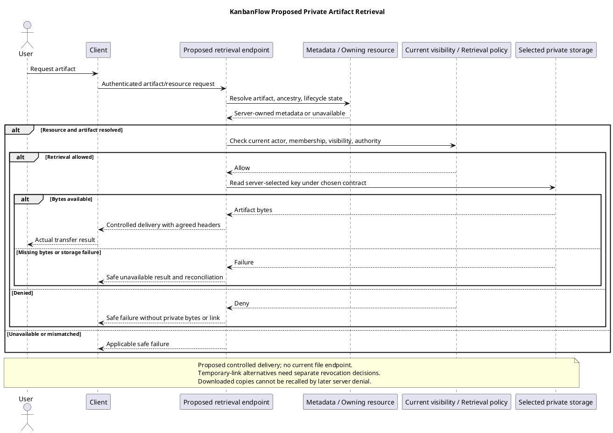

# KanbanFlow Private File Access Sequence

## Scope and design

Private boards exist as an authorization concept; private file storage is not an established feature. A future attachment design must resolve the owning resource and evaluate current visibility at the retrieval boundary.

Choose controlled delivery and cache behavior explicitly. Predictable identifiers, an earlier authorized download, or file ownership alone must not be assumed to establish current workspace access. Link expiry and revocation behavior require a concrete design.

Verify removed-member, mismatched-parent, private-board, and unauthorized direct retrieval scenarios if implemented. Do not invent signed URL support or claim a private-file endpoint already exists.

## Current support and proposed contract

The inspected application routes/schema do not establish an attachment entity or private-file retrieval endpoint. Filesystem configuration offers storage facilities but does not establish resource ownership, access enforcement, or an effective delivery deployment. This sequence is a proposed contract, not an existing request path.

Define the artifact and owning resource first: task attachment, workspace logo, or generated report have different scope and lifecycle requirements. Private-board visibility is a relevant existing rule, not a complete file policy. Select actual method/path, identifiers, retrieval authority, disposition, cache policy, and failure responses in the [decision register](../../Project-Management/decision-register.md).

## Trust boundaries and decision inputs

| Boundary | Required decision/check |
| --- | --- |
| Browser to application | Current identity and actual session/origin behavior |
| Request to metadata | Resolve server-owned artifact identifier and owning resource; reject arbitrary user paths |
| Resource to authority | Current membership, matching ancestry, private visibility, and any agreed file-specific permission |
| Metadata to storage | Server-selected disk/key and artifact state; verify metadata and bytes agree |
| Storage to delivery | Chosen controlled stream/link mechanism, safe media type/filename, and cache behavior |
| Retrieval to client copy | Defined pending/failure feedback and explicit limits on revocation of downloaded copies |

Uploading a file, possessing its identifier, or viewing its parent earlier cannot establish current retrieval authority. An owner/creator label must not bypass membership/visibility conditions where the chosen resource policy requires them.

## Proposed controlled retrieval sequence

1. Receive the authenticated request and resolve the artifact through its server-managed metadata.
2. Resolve the owning hierarchy and verify that the requested parent identifiers are consistent.
3. Apply current visibility and the explicitly agreed retrieval rule before exposing bytes or sensitive metadata.
4. Verify the artifact is available under the lifecycle policy and its referenced storage object exists.
5. Deliver through the selected mechanism with approved media type, filename/disposition, and cache behavior.
6. Record necessary sanitized evidence and handle missing bytes, transfer failure, or revoked access according to the contract.

This order is conceptual; implementation must specify actual middleware, binding, metadata, policy, and storage behavior. Do not report successful authorization as proof of a usable complete transfer.

## Delivery alternatives and revocation

| Candidate approach | Consequences to decide and verify | Status |
| --- | --- | --- |
| Application-controlled stream | Re-evaluates application authority per retrieval request; workload, interrupted transfer, range requests, and response headers require a contract | Not selected |
| Temporary storage link | Lifetime, issuance authority, bearer-link exposure, provider access, and effective revocation need explicit design | Not selected; no signed-link support claimed |
| Public disk/direct URL | Can bypass application checks; unsuitable as an assumed private delivery boundary | No private-delivery approval established |

Specify access after membership removal, role/visibility change, resource deletion, artifact replacement, and link expiry if used. A link already issued may remain usable until expiry unless the chosen mechanism supports and implements revocation. Do not promise immediate revocation without evidence.

Copies already downloaded cannot be recalled through later server denial. Define whether in-progress transfers continue and how cache/proxy/browser behavior affects subsequent access. Public sharing is a separate decision and cannot be inferred from private download support.

## Response and failure handling

| Outcome | Required contract |
| --- | --- |
| No valid session | Actual authentication failure and recovery; no anonymous artifact delivery |
| Wrong ancestry or unknown artifact | Safe unavailable response without revealing unrelated metadata |
| Visibility or retrieval denied | No file bytes, storage key, unrestricted link, or private content returned |
| Metadata exists but bytes missing | Observable unavailable/storage failure and reconciliation, not a false successful download |
| Deleted/replaced/expired artifact | Agreed lifecycle result; do not silently fall back to an unauthorized version |
| Provider/transfer failure | Safe feedback and actual outcome; repeat retrieval only under current authority |
| Link issuance or response uncertain | Investigate artifact/link exposure and effective validity; no guaranteed recall implied |

Define actual endpoint response codes rather than prescribing a universal 403/404 policy without a decision. Review content types, safe filenames, inline-rendering choice, cache directives, and any range/conditional request support. Each alternate response path must preserve authority if implemented.

## Privacy, lifecycle, and evidence

Do not expose private bytes through a storage link or shared cache that bypasses the agreed policy. Avoid logging bearer URLs, credentials, cookies, raw file content, or unrestricted storage locations. Record sanitized artifact/owner identifiers and outcomes only where needed; no audit/correlation infrastructure is established by this document.

Metadata soft deletion is not storage cleanup, and a database cascade does not delete bytes automatically. Define how resource/recipient removal affects current versions, generated snapshots, residual artifacts, and backups. Restore verification must cover authority and correct metadata/byte mapping as well as artifact existence.

## Acceptance matrix

| Scenario | Evidence required after implementation |
| --- | --- |
| Authorized retrieval | Correct owning scope, usable complete bytes, agreed headers, and safe client feedback |
| Unauthenticated or unrelated member | Direct denied retrieval with no private bytes/link/metadata leakage |
| Private board | Allowed creator/owner/manager/current-member conditions checked against the actual selected policy |
| Removed member/changed role | New request denied as appropriate; cached/issued-link behavior measured separately |
| Cross-resource identifiers | Mismatch each relevant parent/artifact boundary without disclosure |
| Arbitrary storage path | User input cannot select another key/disk or internal filesystem path |
| Artifact replaced/deleted/expired | Actual version/lifecycle response and no unauthorized fallback |
| Missing bytes/provider failure | Safe unavailable result and observable reconciliation |
| Shared cache/conditional/range paths | Authority and private content boundaries preserved for supported paths |
| Issued temporary link, if chosen | Effective expiry, sharing exposure, and actual revocation limits |
| Transfer interrupted | Actual completion/failure feedback and rechecked authority on repeated retrieval |
| UI keyboard/themes | Accessible pending/result/error controls and readable feedback |

Use isolated artifacts/accounts and [verification records](../../Releases/verification-template.md). Record candidate, delivery mechanism/provider, actor/resource scope, response, bytes/headers, lifecycle conditions, and limitations. This document supplies proposed acceptance cases, not newly executed file tests.

## Handoff and related designs

Implement only after ownership, authority, delivery/cache, lifecycle, failure, and acceptance decisions are concrete. Keep file support marked proposed until source and actual verification demonstrate it.

Cross-check [storage and replacement](file-storage-and-update-design.md), [download decisions](download-decision.md), [PDF reports](pdf-rendering-design.md), [authorization flow](authorization-decision-flow.md), [public access](public-access-sequence-diagram.md), and [error handling](error-handling-design.md). Revisit retrieval after changes to membership, visibility, storage, caching, or link semantics.

## Review and evidence

Record the candidate commit, actor, environment, affected source paths, proposed change, observed checks, and remaining questions. Link implementation and acceptance evidence; keep untested behavior explicit. This document adds no application feature or newly executed security/behavior test.

## Related guidance

- [Design catalog](README.md)
- [Requirements](../02-requirements/README.md)
- [Analysis](../03-analysis/README.md)
- [Decision register](../../Project-Management/decision-register.md)
- [Verification record](../../Releases/verification-template.md)
- [Diagram guide](../../diagram-guide.md)

## PlantUML diagram

[Editable PlantUML source](diagrams/private-file-access-sequence-diagram.puml)

