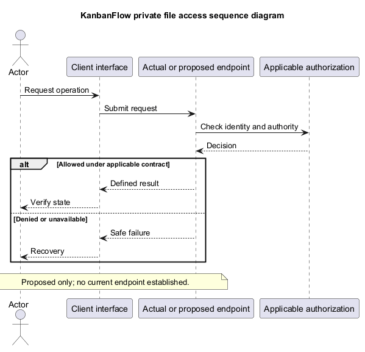
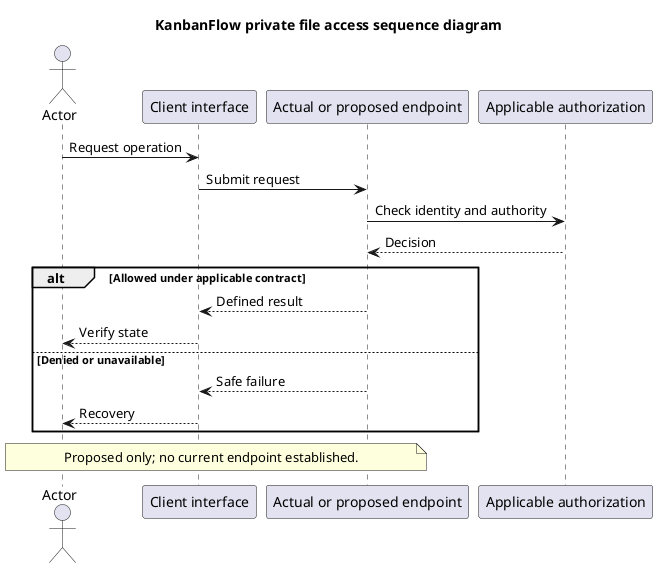

# KanbanFlow Private File Access Sequence

## Scope and design

Private boards exist as an authorization concept; private file storage is not an established feature. A future attachment design must resolve the owning resource and evaluate current visibility at the retrieval boundary.

Choose controlled delivery and cache behavior explicitly. Predictable identifiers, an earlier authorized download, or file ownership alone must not be assumed to establish current workspace access. Link expiry and revocation behavior require a concrete design.

Verify removed-member, mismatched-parent, private-board, and unauthorized direct retrieval scenarios if implemented. Do not invent signed URL support or claim a private-file endpoint already exists.

## Review and evidence

Record the candidate commit, actor, environment, affected source paths, proposed change, observed checks, and remaining questions. Link implementation and acceptance evidence; keep untested behavior explicit. This document adds no application feature or newly executed security/behavior test.

## Related guidance

- [Design catalog](README.md)
- [Requirements](../02-requirements/README.md)
- [Analysis](../03-analysis/README.md)
- [Decision register](../../Project-Management/decision-register.md)
- [Verification record](../../Releases/verification-template.md)
- [Diagram guide](../../diagram-guide.md)

## PlantUML diagram

[Editable PlantUML source](diagrams/private-file-access-sequence-diagram.puml)

