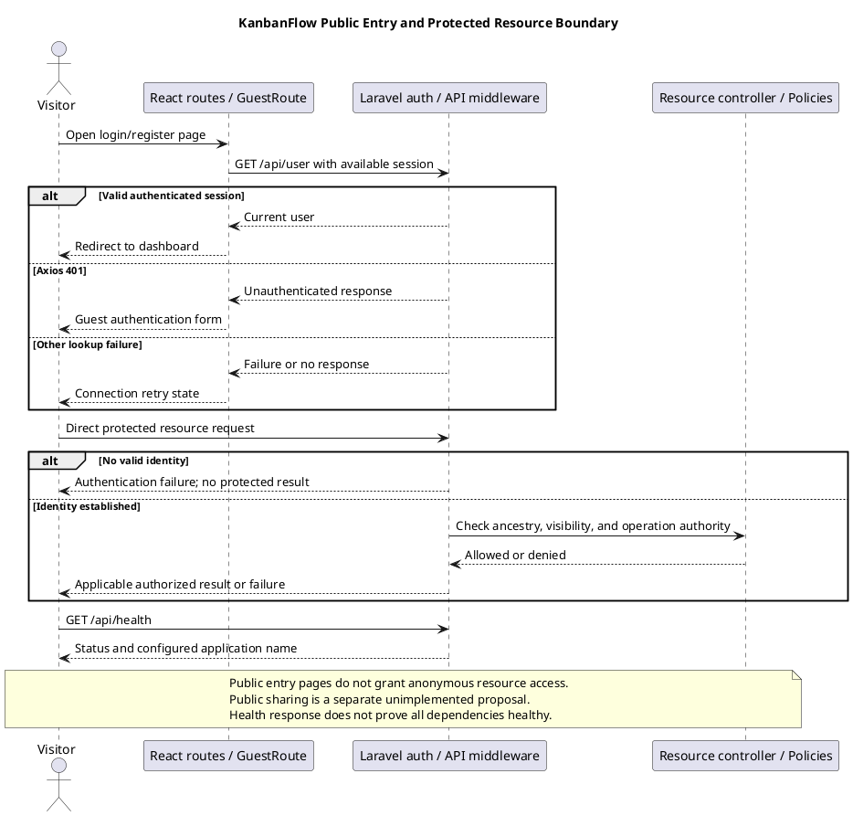

# KanbanFlow Public Access Sequence

> **Policy amendment (2026-10-10):** Membership mutations are now owner-only; DEC-003/PB-001's bypass is fixed. Earlier open-policy text and diagrams below describe the preceding state. See [QA corrections](../06-testing/qa-corrections-2026-10-10.md) for the selected rule and regression evidence.

## Scope and design

Frontend home/login/register routes provide public entry points; the backend health endpoint is outside the authenticated resource group. Workspace/project/board/task API resources remain authenticated. Public resource sharing is not established by public landing pages.

For current entry points, review exposed content and safe error behavior. For proposed public sharing, define exact fields, consent/ownership, revocation, discovery/indexing, cache behavior, and abuse limits before implementation.

Verify unauthenticated resource requests are denied by the actual API and ensure the frontend guard is not the sole boundary. Do not infer share links or anonymous board access from this document.

## Current entry points and contracts

| Entry point | Source-observed boundary | Limit |
| --- | --- | --- |
| Frontend `/` | Home route in `frontend/src/App.tsx` | A public landing page does not grant resource API access |
| Frontend `/login`, `/register` | GuestRoute resolves current user: success redirects to dashboard; Axios 401 permits guest content; other failures show connection retry | These routes are not a public workspace browser |
| Backend `POST /login`, `POST /register` | Guest web routes; client obtains CSRF cookie first; login has its dedicated throttle | Public entry does not mean bypassing CSRF/validation or establishing blanket rate limits |
| Backend `/api/health` | Outside `auth:sanctum` resource group; returns status ok and configured application name | Does not verify database, every dependency, or release readiness |
| Protected frontend pages | ProtectedRoute resolves session; redirects on query error | Navigation guard does not replace API authorization |
| Resource API, user, notifications, analytics, activities | Declared within the authenticated API group | Current identity is only the first boundary; resource-specific authority remains necessary |

Route publication and configured visibility strings do not establish anonymous sharing. Board visibility `workspace` means visibility under the existing membership model, not internet-public access. Workspace visibility metadata must not be interpreted as an exposed sharing endpoint without actual route/policy evidence.

## Existing visitor sequence

1. A visitor opens home or a guest authentication page.
2. For login/register navigation, GuestRoute checks `/api/user` and distinguishes a valid session, Axios 401, and other lookup failures.
3. An authentication submission obtains CSRF cookie state, then uses the actual guest endpoint and input validation.
4. On successful authentication, subsequent resource requests cross the authenticated API boundary and applicable ancestry/visibility/operation checks.
5. A direct unauthenticated resource request is handled by authentication middleware, even if the visitor bypasses frontend navigation.

This sequence describes current source boundaries, not fresh runtime verification or a guaranteed navigation transition after every auth outcome. Record actual browser and direct-request results for the candidate.

## Public resource-sharing proposal

No share-token route, anonymous board/task reader, public artifact delivery, or publishing contract is established. If sharing is requested, define it as a separate capability rather than removing authentication from existing resource routes.

| Decision | Required specification |
| --- | --- |
| Publisher | Actor authorized to publish and revoke; workspace roles alone do not imply a new publish privilege |
| Resource and fields | Exact selected resource, details, aggregates, comments, actor identities, and exclusions |
| Audience | Internet-public, unlisted link, or another explicitly defined model |
| Snapshot | Live projection versus stored snapshot, with update/deletion/visibility consequences |
| Identifier/link | Discovery, guessability, sharing exposure, expiry, and effective revocation |
| Operations | Read-only or explicitly scoped actions; no inherited mutation access assumed |
| Privacy | Intentional disclosure, redaction, recipient expectations, and downloaded-copy limits |
| Delivery/cache/indexing | Browser/proxy caching, search indexing, preview behavior, and stale copies |
| Abuse controls | Concrete workload limits, enumeration/repeated access, and error behavior |
| Evidence | Positive/negative tests and actual candidate/environment before support is claimed |

Unlisted is not confidential merely because a link is hard to guess. Search exclusion is not authorization, and later revocation cannot recall already copied/downloaded content. Keep unidentified limits, retention periods, and approval/status explicit in the decision register.

## Data and authority safeguards

For existing entry points, inspect response content and avoid exposing private resource metadata through errors, health output, registration/login feedback, or cached client state. Login creates identity; it does not authorize every workspace or private board.

For a future share projection, select allowed fields intentionally rather than serializing full models or reusing unrestricted aggregate queries. Define what happens when parents, private visibility, membership, publication authority, or included actor data change. Public read and authenticated mutation must remain separate contracts.

If tokens, snapshots, or public files are introduced, connect them to their lifecycle and storage design. Do not claim automatic cleanup, revocation, or signed-link support from existing configuration. DEC-003/PB-001 membership authority remains unresolved and must not be used as an assumed publish policy.

## Failure, caching, and user interaction

| Case | Design/review focus |
| --- | --- |
| Session lookup unavailable | Guest connection-retry state versus ProtectedRoute redirect; distinguish source behavior from a proposed improvement |
| Invalid login/registration | Actual validation/authentication feedback without credential disclosure |
| Direct unauthenticated resource request | Authentication failure with no protected data/mutation |
| Authenticated unauthorized resource | Resource-specific denial; login alone does not bypass scope |
| Frontend route missing | NotFoundPage differs from backend missing/denied data |
| Proposed share expired/revoked/missing | Agreed safe response and effective cache/link behavior; not currently implemented |
| Proposed public output stale | Defined live/snapshot contract; no assumption that every cached copy disappears |

Review pending/failure feedback, keyboard access, focus, and light/dark/system readability for current public entry pages. For future publication, make the intended audience and included data concrete before submission and verify the actual revoke outcome. Define cache and indexing behavior against real delivery infrastructure, not a documentation assertion.

## Acceptance matrix

| Scenario | Evidence to capture |
| --- | --- |
| Guest home/auth page | Visible entry content, GuestRoute lookup result, and accessible navigation |
| Authenticated visitor to guest page | Actual redirect and subsequent session/resource behavior |
| Backend unavailable during guest lookup | Connection state and retry behavior, not assumed logged-out identity |
| Register/login submission | CSRF, validation, actual result, and session transition |
| Health request | Only the documented response; no inferred dependency health |
| Direct unauthenticated read/mutation | Actual denial and absence of protected output/change |
| Logged-in unrelated/removed member | Endpoint-specific scope/visibility denial |
| Future publication, if implemented | Actual publisher authority, exact fields, and deliberate privacy boundary |
| Future revoked/expired share | Direct access, link/snapshot/cache consequences, and residual copy limitations |
| Future nested/aggregate leakage | Unauthorized identifiers and secondary data excluded from public projection |
| UI keyboard/themes/layout | Actual entry/recovery interactions on representative supported views |

Use isolated accounts/resources and [verification records](../../Releases/verification-template.md). Mark future-sharing checks proposed. Record candidate, actor/session state, endpoint, response, visible behavior, persisted consequences, and limitations; redact secrets/private content. No new public-sharing implementation or fresh runtime test is claimed here.

## Handoff and related designs

Changes to existing entry points require source-aligned auth/session and error contracts. New sharing requires explicit scope, authority, projection, lifecycle, delivery, and acceptance decisions before implementation.

Cross-check [authentication](authentication-and-authorization.md), [authorization flow](authorization-decision-flow.md), [site map](site-map.md), [request contracts](route-and-request-contracts.md), [private file access](private-file-access-sequence-diagram.md), and [error handling](error-handling-design.md). Update the sequence when actual public capabilities change.

## Review and evidence

Record the candidate commit, actor, environment, affected source paths, proposed change, observed checks, and remaining questions. Link implementation and acceptance evidence; keep untested behavior explicit. This document adds no application feature or newly executed security/behavior test.

## Related guidance

- [Design catalog](README.md)
- [Requirements](../02-requirements/README.md)
- [Analysis](../03-analysis/README.md)
- [Decision register](../../Project-Management/decision-register.md)
- [Verification record](../../Releases/verification-template.md)
- [Diagram guide](../../diagram-guide.md)

## PlantUML diagram

[Editable PlantUML source](diagrams/public-access-sequence-diagram.puml)

