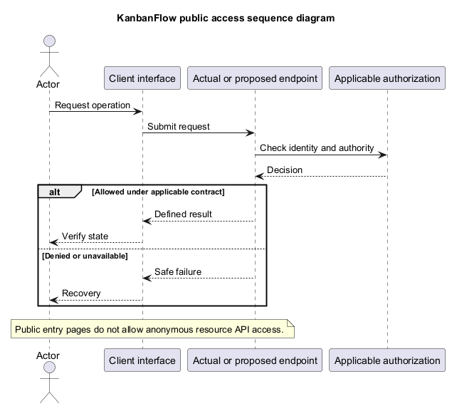
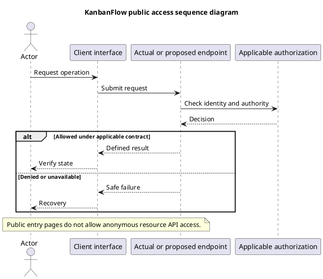

# KanbanFlow Public Access Sequence

## Scope and design

Frontend home/login/register routes provide public entry points; the backend health endpoint is outside the authenticated resource group. Workspace/project/board/task API resources remain authenticated. Public resource sharing is not established by public landing pages.

For current entry points, review exposed content and safe error behavior. For proposed public sharing, define exact fields, consent/ownership, revocation, discovery/indexing, cache behavior, and abuse limits before implementation.

Verify unauthenticated resource requests are denied by the actual API and ensure the frontend guard is not the sole boundary. Do not infer share links or anonymous board access from this document.

## Review and evidence

Record the candidate commit, actor, environment, affected source paths, proposed change, observed checks, and remaining questions. Link implementation and acceptance evidence; keep untested behavior explicit. This document adds no application feature or newly executed security/behavior test.

## Related guidance

- [Design catalog](README.md)
- [Requirements](../02-requirements/README.md)
- [Analysis](../03-analysis/README.md)
- [Decision register](../../Project-Management/decision-register.md)
- [Verification record](../../Releases/verification-template.md)
- [Diagram guide](../../diagram-guide.md)

## PlantUML diagram

[Editable PlantUML source](diagrams/public-access-sequence-diagram.puml)

