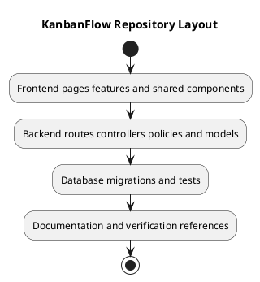

# KanbanFlow Repository Layout

## Scope and design

`frontend/` contains the React application, with route pages in `src/pages`, shared components in `src/components`, feature code in `src/features`, and API configuration in `src/api`. `backend/` contains Laravel routes, controllers, policies, models, migrations, and tests.

`docs/` organizes project definition, project management, releases, sprints, and SDLC guidance. Each design topic links a PlantUML source and rendered PNG in this directory's `diagrams/` folder.

Keep runtime secrets outside tracked source and avoid committing generated dependency/build directories unnecessarily. Consult existing scripts and lockfiles for verification commands; repository layout alone does not establish deployment topology.

## Review and evidence

Record the candidate commit, actor, environment, affected source paths, proposed change, observed checks, and remaining questions. Link implementation and acceptance evidence; keep untested behavior explicit. This document adds no application feature or newly executed security/behavior test.

## Related guidance

- [Design catalog](README.md)
- [Requirements](../02-requirements/README.md)
- [Analysis](../03-analysis/README.md)
- [Decision register](../../Project-Management/decision-register.md)
- [Verification record](../../Releases/verification-template.md)
- [Diagram guide](../../diagram-guide.md)

## PlantUML diagram

[Editable PlantUML source](diagrams/repository-layout.puml)

