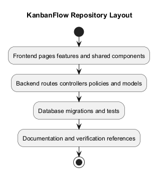
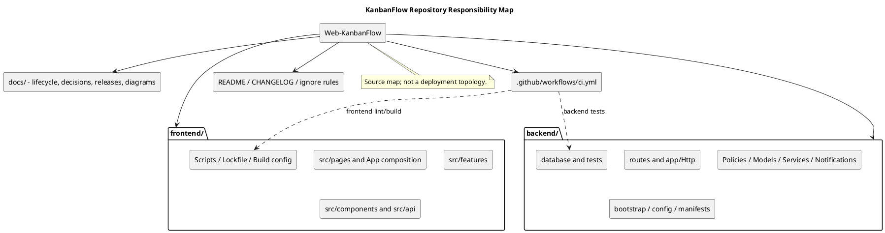

# KanbanFlow Repository Layout

> **Policy amendment (2026-10-10):** Membership mutations are now owner-only; DEC-003/PB-001's bypass is fixed. Earlier open-policy text and diagrams below describe the preceding state. See [QA corrections](../06-testing/qa-corrections-2026-10-10.md) for the selected rule and regression evidence.

## Scope and design

`frontend/` contains the React application, with route pages in `src/pages`, shared components in `src/components`, feature code in `src/features`, and API configuration in `src/api`. `backend/` contains Laravel routes, controllers, policies, models, migrations, and tests.

`docs/` organizes project definition, project management, releases, sprints, and SDLC guidance. Each design topic links a PlantUML source and rendered PNG in this directory's `diagrams/` folder.

Keep runtime secrets outside tracked source and avoid committing generated dependency/build directories unnecessarily. Consult existing scripts and lockfiles for verification commands; repository layout alone does not establish deployment topology.

## Top-level map

```text
Web-KanbanFlow/
├── .github/workflows/ci.yml
├── backend/
│   ├── app/{Http,Models,Notifications,Policies,Providers,Services}/
│   ├── bootstrap/ and config/
│   ├── database/{migrations,factories,seeders}/
│   ├── routes/, public/, resources/, storage/
│   ├── tests/{Feature,Unit}/ and phpunit.xml
│   └── artisan, composer.json, composer.lock, .env.example
├── frontend/
│   ├── src/{api,assets,components,features,pages}/
│   ├── public/, index.html
│   └── package.json, package-lock.json, TypeScript/Vite/ESLint config
├── docs/{Project-Definition,Project-Management,Releases,Sprints,SDLC}/
├── docker/
└── README.md, CHANGELOG.md, .gitignore
```

This is a selected source map, not every tracked or local file. `docker/` exists in the inspected checkout without listed assets; its presence does not establish a working container deployment. Locally installed dependencies, build outputs, and environment files may appear in directory listings without being tracked.

## Frontend responsibilities

| Path relative to frontend | Responsibility |
| --- | --- |
| `src/main.tsx` | Mount application; compose router, query, and theme providers |
| `src/App.tsx` | Lazy route pages, shell, error boundary, Suspense, and guest/protected navigation |
| `src/pages/` | Home/auth/dashboard and workspace/project/board route journeys |
| `src/components/auth/` | Guest/session navigation guards |
| `src/components/layout/`, `theme/`, `ui/` | Shared shell, appearance, controls, and feedback |
| `src/features/auth/` | Authentication helpers, types, and error messaging |
| `src/features/workspaces`, `projects`, `boards`, `columns`, `tasks`, `notifications` | Feature APIs/types and interaction components |
| `src/api/client.ts` | Configured Axios JSON/session/XSRF boundary |
| `src/index.css`, assets/public | Shared style/assets and served static content; no file-upload feature inferred |
| `package.json`, lockfile, config files | Declared scripts/dependencies and build/lint configuration |

The top-level React application is `frontend/`. Laravel also contains its own resources/package/Vite files; do not assume that installing/building the backend package produces the standalone React application.

## Backend responsibilities

| Path relative to backend | Responsibility |
| --- | --- |
| `routes/web.php` | Registration/login/logout session entry points |
| `routes/api.php` | Public health and authenticated resource/secondary API routes |
| `app/Http/Controllers/` | Auth and API endpoint behavior, ancestry, authorization invocation, validation, persistence, and responses |
| `app/Policies/`, relevant model scopes | Resource authority and visibility; inspect actual controller invocation |
| `app/Models/` | Relationships, casts, soft deletion, and model persistence |
| `app/Services/ActivityLogger.php` | Workspace-scoped activity recording where invoked |
| `app/Notifications/` | Assignment notification behavior; not proof of email or streaming |
| `app/Providers/`, `bootstrap/`, `config/` | Service/middleware composition, login limiter, runtime configuration |
| `database/migrations/` | Physical schema, keys, indexes, and delete actions |
| `database/factories/`, `seeders/` | Test/demo data construction; inspect selected environment before use |
| `tests/Feature/`, `tests/Unit/`, `phpunit.xml` | Automated test source and test configuration |
| `storage/`, `bootstrap/cache/` | Runtime outputs/state; not source-of-truth feature documentation |

Domain rules currently live in selected controller/model paths; do not assume a separate service exists for every feature because `Services/` exists. A policy method or migration table alone does not prove an exposed capability.

## Documentation map

| Area | Purpose |
| --- | --- |
| [Project Definition](../../Project-Definition/README.md) | Problem, goals, scope, stakeholders, constraints, and success criteria |
| [Project Management](../../Project-Management/README.md) | Backlog, decisions, roadmap, traceability, and milestone records |
| [Releases](../../Releases/README.md) | Historical versions, release/verification templates, upgrade/rollback guidance |
| [Sprints](../../Sprints/README.md) | Planning, ready/done, progress, review, retrospective, and metrics guidance |
| [SDLC](../README.md) | Planning through maintenance lifecycle documents |
| [Design catalog](README.md) | UI/API/data/authority/operational design topics and diagram previews |
| [Diagram guide](../../diagram-guide.md) | Source/embedded-block/preview consistency and rendering conventions |

Milestone records reside under `docs/Project-Management/Milestones/`. PlantUML sources and PNG previews belong in the relevant area's `diagrams/` folder. Documentation filenames retained for resume interactions describe KanbanFlow resources, not a CV feature.

## Locating a change

| Task | Start with | Continue through |
| --- | --- | --- |
| Form or page behavior | Route page and feature component | Types/API helper, endpoint, acceptance evidence |
| Session/login failure | Client/auth helpers and guards | Web routes, auth controller, middleware/configuration |
| Permission/privacy issue | Selected API endpoint and ancestry | Invoked policy/visibility scope, secondary responses, negative checks |
| Task order/WIP/move | Task/column feature interaction and controller | Transaction/lock/domain paths and final persisted state |
| Schema/lifecycle change | Migration and model | Existing rows, controller behavior, backup/recovery, compatibility |
| Theme/accessibility | Theme/shared UI and consuming views | Representative browser/keyboard/layout checks |
| Release claim | Version record/CHANGELOG | Exact tag/commit and its historical checks; later candidates need fresh evidence |

Use paths and source evidence to bound the change; avoid modifying unrelated files merely because they share a directory. Keep DEC-003/PB-001 membership authority open until its actual decision and implementation evidence exist.

## Verification entry points

| Working directory | Existing command/config | Meaning and limit |
| --- | --- | --- |
| `frontend/` | `npm run lint` | ESLint source checks; not browser behavior/accessibility validation |
| `frontend/` | `npm run build` | TypeScript build plus Vite bundle; not proof of API/runtime correctness |
| `frontend/` | `npm run dev`, `npm run preview` | Development or built-output preview; not production deployment evidence |
| `backend/` | `php artisan test`, `composer test` | Automated backend checks; composer test includes config clear before tests |
| Root | `.github/workflows/ci.yml` | Backend test and frontend lint/build jobs on main push/PR; inspected config uses PHP 8.4/SQLite extensions and Node 24 |

Dependency lockfiles describe resolved inputs; manifests and CI configuration define current constraints/checks. Do not claim all runtime versions are supported from a single CI environment. SQLite checks do not establish MySQL contention. This documentation update runs link/diagram/format checks, not the application test suite or a deployment.

## Tracked source and local output

The root ignore rules exclude environment files except `.env.example`, backend vendor/node_modules/runtime logs/cache/session/view outputs, frontend node_modules/dist/Vite cache, and common editor/log files. Never treat `.env.example` as a secret-free guarantee without reviewing its content; do not commit real credentials or private test evidence.

Generated PlantUML PNGs are intentional documentation previews alongside editable sources. Build bundles and installed dependencies serve a different purpose. An ignore rule does not remove a file already tracked, so inspect actual staged changes before publication.

Do not move directories or rename interfaces as part of documenting the layout. Any later reorganization must update imports, routes/scripts, configuration, documentation links, and relevant checks. A local folder layout does not establish server document roots or deployment topology.

## Maintenance and handoff

Update this map when responsibility boundaries or authoritative paths change. Pair it with [component dependencies](component-diagram.md), [system architecture](system-architecture-diagram.md), [request contracts](route-and-request-contracts.md), and [documentation traceability](../../Project-Management/documentation-traceability.md).

For a handoff, record candidate commit, branch/status, affected paths, checks actually run, unresolved issues, and next scoped action. Historical release counts and diagram rendering are not substitute evidence for a new application change.

## Review and evidence

Record the candidate commit, actor, environment, affected source paths, proposed change, observed checks, and remaining questions. Link implementation and acceptance evidence; keep untested behavior explicit. This document adds no application feature or newly executed security/behavior test.

## Related guidance

- [Design catalog](README.md)
- [Requirements](../02-requirements/README.md)
- [Analysis](../03-analysis/README.md)
- [Decision register](../../Project-Management/decision-register.md)
- [Verification record](../../Releases/verification-template.md)
- [Diagram guide](../../diagram-guide.md)

## PlantUML diagram



[Editable PlantUML source](diagrams/repository-layout.puml)


