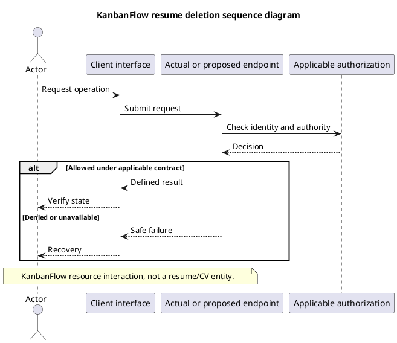

# KanbanFlow Resource Deletion Sequence

## Scope and design

The filename is retained from the supplied structure. KanbanFlow has no résumé/CV entity; this topic describes authorized resource deletion. Specify the actual workspace/project/board/column/task/comment endpoint before applying this sequence.

Resolve ancestry and operation permission, perform the implemented deletion behavior, and verify visible/persisted consequences. Relevant models use soft deletion; physical foreign-key cascades do not automatically describe a soft-delete operation. Ordering cleanup must be checked for the relevant endpoint.

Review denied deletion, removed membership, mismatched parents, repeated requests, and transaction failure. Do not claim restoration endpoints, physical erasure, retention compliance, or backup recovery without separate evidence.

## Review and evidence

Record the candidate commit, actor, environment, affected source paths, proposed change, observed checks, and remaining questions. Link implementation and acceptance evidence; keep untested behavior explicit. This document adds no application feature or newly executed security/behavior test.

## Related guidance

- [Design catalog](README.md)
- [Requirements](../02-requirements/README.md)
- [Analysis](../03-analysis/README.md)
- [Decision register](../../Project-Management/decision-register.md)
- [Verification record](../../Releases/verification-template.md)
- [Diagram guide](../../diagram-guide.md)

## PlantUML diagram

[Editable PlantUML source](diagrams/resume-deletion-sequence-diagram.puml)

