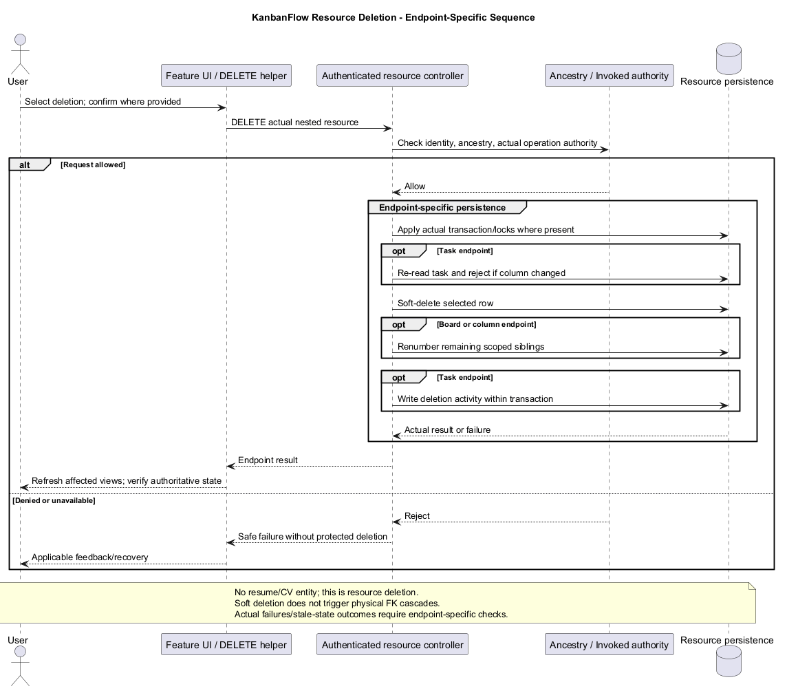
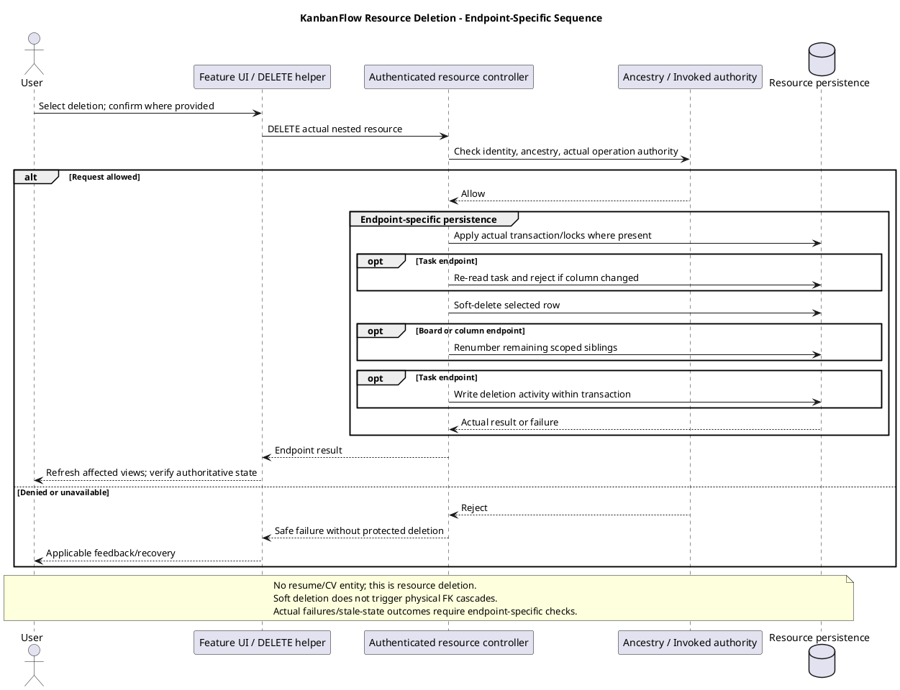

# KanbanFlow Resource Deletion Sequence

> **Policy amendment (2026-10-10):** Membership mutations are now owner-only; DEC-003/PB-001's bypass is fixed. Current guidance below reflects this rule; historical records retain their original scope. See [QA corrections](../06-testing/qa-corrections-2026-10-10.md) for the selected rule and regression evidence.

## Scope and design

The filename is retained from the supplied structure. KanbanFlow has no résumé/CV entity; this topic describes authorized resource deletion. Specify the actual workspace/project/board/column/task/comment endpoint before applying this sequence.

Resolve ancestry and operation permission, perform the implemented deletion behavior, and verify visible/persisted consequences. Relevant models use soft deletion; physical foreign-key cascades do not automatically describe a soft-delete operation. Ordering cleanup must be checked for the relevant endpoint.

Review denied deletion, removed membership, mismatched parents, repeated requests, and transaction failure. Do not claim restoration endpoints, physical erasure, retention compliance, or backup recovery without separate evidence.

## Endpoint-specific authority and persistence

The application resource DELETE routes are inside the authenticated API group. The following summarizes inspected `destroy` methods under `backend/app/Http/Controllers/Api/`; it is source evidence, not a fresh deletion test.

| Resource | Actual endpoint authority | Persistence and secondary behavior |
| --- | --- | --- |
| Workspace | Workspace `delete` policy: owner identifier | Calls workspace delete; no blanket descendant-delete workflow is established by this call |
| Project | Matching workspace/project; project `delete` policy: owner/current manager | Calls project delete |
| Board | Matching workspace/project/board; controller invokes project `update` authorization | Transaction locks project, deletes board, and renumbers remaining boards by position/id to one-based positions |
| Column | Matching ancestry; board `delete` authorization | Transaction locks board and column, deletes column, and renumbers remaining columns by position/id |
| Task | Matching ancestry; board `delete` authorization | Transaction locks column and fresh task, checks task still belongs to column, deletes task, and writes deletion activity/state |
| Comment | Matching ancestry and board view; controller permits author or workspace owner/current manager | Calls comment delete; controller decision is not identical to standalone comment delete policy |

BoardController's deletion path uses project authority; do not substitute BoardPolicy's delete method when describing this endpoint. Column/task deletion does invoke board authority, which requires board visibility. Endpoint invocation matters as much as available policy methods.

Task deletion explicitly rejects a task that moved after initial binding with 409 and refresh guidance. Its inspected destroy block does not renumber remaining task positions; do not claim a universal contiguous-position guarantee from board/column cleanup.

## Soft deletion and descendant consequences

Workspace, project, board, column, task, and comment models use SoftDeletes. These endpoint calls mark the selected row deleted rather than issuing a physical deletion that triggers foreign-key cascading. The inspected models do not establish a blanket cascading soft-delete hook.

Descendant rows may remain physically present. Their normal availability depends on parent resolution, model scopes, endpoint ancestry, and response queries. Verify detail, listing, aggregate, activity, and notification behavior after deleting a parent rather than assuming every descendant or historical record is erased.

Physical foreign-key cascades and nullable assignee/activity-actor actions are described in the [data model](data-model-and-erd.md). They apply to physical deletion, which is a different operation. Soft-deleted rows can also remain relevant to scoped unique slugs; deletion is not automatic release of a database uniqueness constraint.

No user-facing restore/force-delete endpoint, retention policy, storage cleanup, or erasure guarantee is established by the presence of SoftDeletes or restore policy methods. Future file cleanup needs its own implementation; database deletion does not remove storage bytes automatically.

## User request and server sequence

1. Identify the selected resource, parent chain, and intended operation. Show a concrete confirmation where the actual UI provides one; inspect the relevant component rather than assuming all deletes share a dialog.
2. Submit the feature's actual DELETE helper with configured session/XSRF behavior.
3. Resolve middleware/binding and applicable ancestry and operation checks in their actual endpoint order.
4. Execute the endpoint's soft-delete and relevant locking, stale-state check, ordering, or logging behavior.
5. Return the endpoint result and refresh affected frontend queries/navigation according to its implementation.
6. Verify selected-row state and relevant descendants, ordering, derived views, and activity outcomes.

Cancelling before submission should produce no delete request in the tested control. Cancelling navigation or closing a view after submission does not prove the request stopped or that a committed deletion was reversed.

## Failures, repeated requests, and recovery

| Case | Required review/evidence |
| --- | --- |
| Unauthenticated or denied actor | Actual safe failure and no protected deletion/secondary mutation |
| Missing resource or mismatched parent | Endpoint/binding result with no cross-resource deletion |
| Membership/role revoked | Current request authorization; previously visible delete control does not grant authority |
| Task moved while deletion pending | Actual 409/stale-state behavior under the locked recheck and final parent/state |
| Transaction or activity-write failure | Final deletion/order/activity state and applicable rollback behavior in the selected endpoint |
| Repeated request | Actual missing/denied/result response after the first operation; no universal idempotent-success contract assumed |
| Response lost or client rendering fails | Establish authoritative state before retrying or claiming deletion failed |
| Query refresh fails after success | Distinguish committed server deletion from stale/error UI |

A transaction boundary does not prove all endpoints or external effects are atomic. Workspace/project/comment deletes do not share the board/column/task transaction structure shown above. Source rollback does not restore deleted data; any recovery requires an explicitly designed and verified mechanism.

## Acceptance matrix

| Scenario | Evidence required |
| --- | --- |
| Authorized selected-resource deletion | Actual response, deleted_at state, normal lookup/list behavior, and unaffected peer resources |
| Denied ordinary member/private-board actor | Direct request denial and unchanged selected resource |
| Wrong nested identifiers | Rejection at each relevant ancestry boundary without unrelated mutation |
| Revoked membership or changed role | Request after change and persisted result under current authority |
| Board/column deletion | Remaining one-based positions in actual endpoint scope, including concurrent cases when relevant |
| Task deletion | Locked stale-parent outcome, selected-row state, remaining positions as actually implemented, and deletion activity |
| Comment author/moderator | Actual author/manager/owner versus denied-actor behavior and removed-author denial |
| Parent deletion with descendants | Physical descendant state and access/list/aggregate/secondary response behavior checked separately |
| Cancellation/repeated/lost-response | Actual request count, server outcome, and recovery without assumed reversal |
| Failure inside transaction | Final selected/order/activity state and recorded database/environment limitations |
| UI keyboard/themes | Confirmation where present, pending/error feedback, focus, and result navigation |

Use isolated records; do not run these scenarios against production data. Record candidate commit, actor, endpoint, parent identifiers, initial state, response, selected/peer/descendant results, environment, and limitations in [verification records](../../Releases/verification-template.md). These are planned scenarios and source observations, not newly executed runtime tests. SQLite evidence does not establish MySQL contention.

## Handoff and maintenance

If contiguous task ordering, descendant cleanup, restoration, permanent deletion, or retention is required, create an explicit scoped requirement and decision rather than changing the documented guarantee without implementation evidence. Preserve the DEC-003/PB-001 owner-only membership rule independently of deletion semantics.

Cross-check [authorization flow](authorization-decision-flow.md), [request contracts](route-and-request-contracts.md), [error handling](error-handling-design.md), [editor interaction](editor-interaction-flow.md), and [data lifecycle](../03-analysis/data-classification-and-lifecycle.md). Revisit after endpoint, ordering, logging, or lifecycle changes.

## Review and evidence

Record the candidate commit, actor, environment, affected source paths, proposed change, observed checks, and remaining questions. Link implementation and acceptance evidence; keep untested behavior explicit. This document adds no application feature or newly executed security/behavior test.

## Related guidance

- [Design catalog](README.md)
- [Requirements](../02-requirements/README.md)
- [Analysis](../03-analysis/README.md)
- [Decision register](../../Project-Management/decision-register.md)
- [Verification record](../../Releases/verification-template.md)
- [Diagram guide](../../diagram-guide.md)

## PlantUML diagram

[Editable PlantUML source](diagrams/resume-deletion-sequence-diagram.puml)

