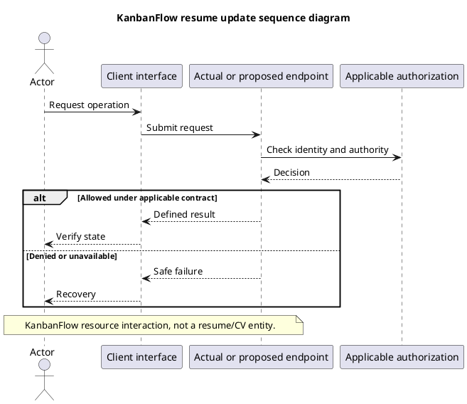

# KanbanFlow Resource Update Sequence

## Scope and design

The retained filename refers to updating a KanbanFlow resource, not a résumé/CV. Choose the real endpoint and resource before specifying editable fields, validation, authorization, and domain rules.

The client submits intended changes; the server remains authoritative. For task changes, inspect board authority, assignee validation, completion/WIP effects, and locking in the relevant controller path. Do not assume every update uses the same concurrency contract.

Verify accepted persisted changes, invalid input, denied actor, stale resource, and uncertain responses. Automatic merging and idempotent retry are not established by a generic update sequence.

## Review and evidence

Record the candidate commit, actor, environment, affected source paths, proposed change, observed checks, and remaining questions. Link implementation and acceptance evidence; keep untested behavior explicit. This document adds no application feature or newly executed security/behavior test.

## Related guidance

- [Design catalog](README.md)
- [Requirements](../02-requirements/README.md)
- [Analysis](../03-analysis/README.md)
- [Decision register](../../Project-Management/decision-register.md)
- [Verification record](../../Releases/verification-template.md)
- [Diagram guide](../../diagram-guide.md)

## PlantUML diagram

[Editable PlantUML source](diagrams/resume-update-sequence-diagram.puml)

