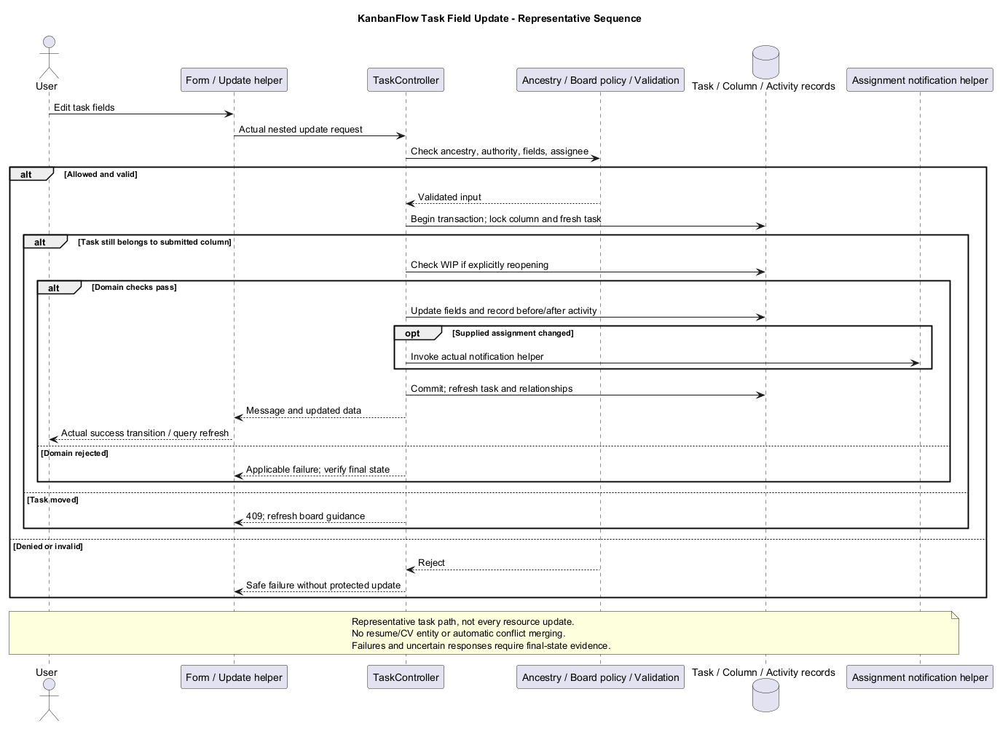
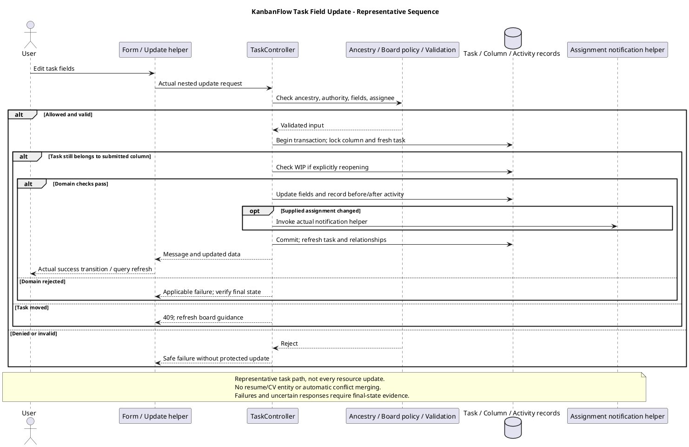

# KanbanFlow Resource Update Sequence

## Scope and design

The retained filename refers to updating a KanbanFlow resource, not a résumé/CV. Choose the real endpoint and resource before specifying editable fields, validation, authorization, and domain rules.

The client submits intended changes; the server remains authoritative. For task changes, inspect board authority, assignee validation, completion/WIP effects, and locking in the relevant controller path. Do not assume every update uses the same concurrency contract.

Verify accepted persisted changes, invalid input, denied actor, stale resource, and uncertain responses. Automatic merging and idempotent retry are not established by a generic update sequence.

## Endpoint and field catalog

Resource update routes belong to the authenticated API group. Inspect the selected helper/controller for its actual method and payload; do not infer a universal full-object replacement contract. The examples below summarize inspected update methods under `backend/app/Http/Controllers/Api/`.

| Resource | Actual authority and context | Selected validation/persistence behavior |
| --- | --- | --- |
| Workspace | Workspace update policy: owner | Name/description/visibility; name changes can regenerate globally scoped slug; visibility accepts private/public metadata but does not establish anonymous sharing |
| Project | Matching workspace/project; project update policy: owner/current manager | Name/description/status/dates; status active/completed/archived; due_date has after_or_equal:start_date validation; changed name regenerates scoped slug |
| Board | Matching ancestry; controller invokes project update authority | Name/description/visibility workspace/private; position prohibited in update; slug regenerated when name included |
| Column | Matching ancestry; board update authority | Name, nullable integer WIP limit at least one; position prohibited; transaction locks board and column |
| Task | Matching ancestry; board update authority | Title/description/priority/assignee/dates/completion; position prohibited; workspace assignee check and task/column locking |
| Comment | Matching ancestry and board view, then comment update policy | Author update rule; body required string max 5000; update and refresh/load user |

BoardController invokes project authority for board updates; do not substitute BoardPolicy's update path when describing this endpoint. Comment moderation deletion does not grant editing of another author's comment.

Several task/board/column fields use `sometimes` rules. Omitted input and explicit null have different meanings; nullable fields can be cleared where accepted, while prohibited position fields require the separate move contract. Model fillable fields are not an endpoint permission or validation allowlist.

## Task update sequence in detail

1. Check nested workspace/project/board/column/task relationships and authorize board update.
2. Validate supplied fields. Priority allows low/medium/high/urgent; assignee may be null or an existing user; position is prohibited. Check a supplied assignee against workspace membership through the actual helper.
3. Start the transaction, lock/re-read column and task, and reject with 409 if the task no longer belongs to the submitted column.
4. Capture current task state and previous assignee. If a previously completed task is explicitly reopened with completed_at null, evaluate whether the column can accept an active task.
5. Apply validated values, refresh, and write before/after activity metadata. If supplied assignment changes, invoke the actual assignment-notification helper.
6. After the transaction, refresh/load creator/assignee and return message plus data.

This source-observed sequence does not establish generic edit-conflict merging or optimistic version checks for every field. A task lock/stale-parent recheck is not proof that all simultaneous text edits detect conflicting baselines.

## Data, WIP, and concurrency boundaries

Use the actual endpoint to distinguish field editing, movement, completion, and deletion. A field update cannot use prohibited position input to bypass move rules. Reopening a completed task can affect active WIP; ordinary description editing is not the same transition.

Column update validates WIP limit as null or a positive integer in the inspected path. The update block does not establish rejection when a new limit is below current active count; inspect and verify that scenario rather than inventing a guarantee. WIP enforcement on task creation/movement/reopening must be evaluated separately.

Project date validation references submitted start_date; partial-update and existing-date combinations require explicit checks before claiming every persisted date pair is valid. Slug changes and scoped uniqueness must also be reviewed with soft-deleted rows and client navigation behavior.

Transaction structure varies by resource. Task update invokes activity/assignment side effects in its transaction path; do not claim every resource logs or notifies. Review actual helper/channel behavior and final state on failure. SQLite-only checks do not establish MySQL contention or a universal concurrency guarantee.

## Client success, rejection, and uncertainty

The client edits local values, submits through the feature helper, and applies the actual success/error handler. Project/task examples close their editor and invalidate selected queries on success. Query invalidation is not proof that every related view is immediately current.

| Outcome | Required review |
| --- | --- |
| Accepted update | Returned fields, fresh persisted values, editor transition, and affected list/analytics/notification state |
| Invalid field/domain rule | Actual validation feedback, retained input, and final consistent persisted state |
| Denied actor/expired session | Current server authority and applicable navigation; stale controls grant no permission |
| Missing/mismatched resource | Actual safe failure without updating a different resource |
| Task moved during request | Locked 409 behavior, current column, and refresh/recovery |
| Activity/notification/transaction failure | Actual rollback or partial outcome of the selected path, not an assumed blanket guarantee |
| Lost response | Determine authoritative outcome before resubmitting; no automatic idempotent retry established |
| Another actor updates fields | Actual stale-input behavior; do not promise merging or overwrite prevention |
| Refresh fails after accepted write | Distinguish persisted success from stale/error client state |

Client cancellation before submission is distinct from aborting an in-flight request. Closing a form, refreshing, or reverting source does not reverse an accepted update. Define focus/input/error recovery per form and verify keyboard/themes on affected interactions.

## Acceptance matrix

| Scenario | Evidence required |
| --- | --- |
| Authorized field edit | Input/response, fresh stored values, unchanged unrelated fields, and visible refresh |
| Omitted versus null fields | Actual partial-update/clearing semantics for each relevant endpoint |
| Invalid/prohibited input | Validation result, position bypass rejected, and persisted baseline |
| Workspace/project/board authority | Actual invoked policy path with allowed/denied actors and parent mismatches |
| Comment authorship | Allowed current author, denied other author, and removed-member access |
| Assignee update | Member/nonmember/null, actual notification recipient behavior, and final assignment |
| Completion/reopening and WIP | Accepted/rejected transitions and final active count under actual column limit |
| WIP limit lowering | Actual column update behavior and resulting rule implications |
| Partial project date edits | Submitted/existing date combinations and final pair; no assumed invariant |
| Rename/slug | Scope uniqueness, soft-deleted conflicts, persisted slug, and navigation consequences |
| Stale task/concurrent operation | Actual 409 parent check, lock/transaction behavior, and relevant MySQL final state |
| Failure/uncertain response | Credential/access/domain versus transaction/network outcome and usable recovery |
| UI/query freshness | Editor feedback, focus/themes/keyboard, and relevant derived reads |

Use isolated data and [verification records](../../Releases/verification-template.md). Record candidate, actor, endpoint/method, parent chain, input, baseline, response, final state, environment, and limitations. These are source observations and planned checks, not newly executed runtime tests.

## Handoff and related designs

If conflict detection, stricter date/WIP invariants, additional side effects, or new retry semantics are required, record a scoped requirement and decision before claiming support. This documentation changes no resource behavior and does not close DEC-003/PB-001 membership authority.

Cross-check [editor interactions](editor-interaction-flow.md), [authorization flow](authorization-decision-flow.md), [request contracts](route-and-request-contracts.md), [data model](data-model-and-erd.md), [business rules](../03-analysis/business-rules-catalog.md), and [error handling](error-handling-design.md). Revisit the sequence after fields, policies, movement, or side-effect changes.

## Review and evidence

Record the candidate commit, actor, environment, affected source paths, proposed change, observed checks, and remaining questions. Link implementation and acceptance evidence; keep untested behavior explicit. This document adds no application feature or newly executed security/behavior test.

## Related guidance

- [Design catalog](README.md)
- [Requirements](../02-requirements/README.md)
- [Analysis](../03-analysis/README.md)
- [Decision register](../../Project-Management/decision-register.md)
- [Verification record](../../Releases/verification-template.md)
- [Diagram guide](../../diagram-guide.md)

## PlantUML diagram

[Editable PlantUML source](diagrams/resume-update-sequence-diagram.puml)

