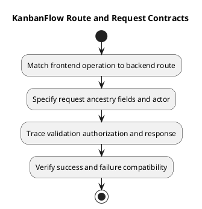

# KanbanFlow Route and Request Contracts

## Scope and design

Frontend navigation routes are declared in `frontend/src/App.tsx`. Backend auth routes are in `backend/routes/web.php`; API routes in `backend/routes/api.php` expose nested workspace/project/board/column/task/comment resources and relevant move endpoints.

For a contract, record method, path, actor, ancestry, accepted fields, validation, response shape, failure behavior, and side effects. Derive these from route/controller/client code. A route declaration alone does not establish response details or authorization correctness.

The configured client expects JSON and uses credentials/XSRF state. Verify identifier mismatches, invalid input, unauthenticated/unauthorized calls, and compatibility after a contract change. New password, file, PDF, or public-sharing contracts remain proposals.

## Review and evidence

Record the candidate commit, actor, environment, affected source paths, proposed change, observed checks, and remaining questions. Link implementation and acceptance evidence; keep untested behavior explicit. This document adds no application feature or newly executed security/behavior test.

## Related guidance

- [Design catalog](README.md)
- [Requirements](../02-requirements/README.md)
- [Analysis](../03-analysis/README.md)
- [Decision register](../../Project-Management/decision-register.md)
- [Verification record](../../Releases/verification-template.md)
- [Diagram guide](../../diagram-guide.md)

## PlantUML diagram

[Editable PlantUML source](diagrams/route-and-request-contracts.puml)

